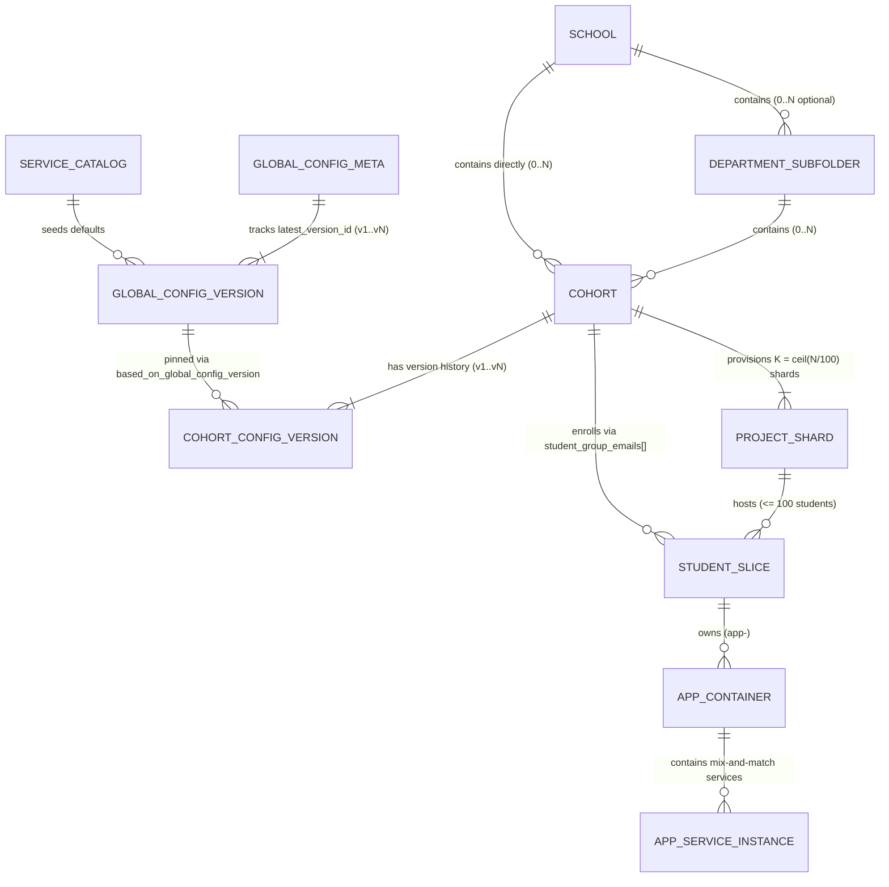

# Data & Firestore Schema Architecture — Master (`tdd-data-master.md`)

> **Parent TDD Master:** [../tdd-master.md](../tdd-master.md)  
> **Domain Sub-Specs:**
> * [tdd-data-catalog-and-config.md](tdd-data-catalog-and-config.md) — `ServiceCatalog`, `ITAdminGlobalConfig` (`v1..vN`), and `CohortConfig` (`v1..vN`)
> * [tdd-data-hierarchy-and-cohorts.md](tdd-data-hierarchy-and-cohorts.md) — `School`, `DepartmentSubfolder`, `Cohort`, and `ProjectShard`
> * [tdd-data-students-and-apps.md](tdd-data-students-and-apps.md) — `StudentSlice`, Student Singletons, `AppContainer`, and `AppServiceInstance`

---

## 1. Design Principles

1. **Single Clean Firestore Namespace:**
   * All entities live in one flat, canonical Firestore collection hierarchy. Simulation (`simulate: bool`) is a request-level flag passed down to the execution pipelines, not a separate database namespace.
2. **Version-Tracked Config with `latest_version_id` vs. `applied_version_id`:**
   * Both `ITAdminGlobalConfig` and `CohortConfig` store the latest saved version pointer (`latest_config_version_id`) on the parent document alongside an immutable `versions/{vN}` history subcollection.
   * `Cohort` additionally tracks `applied_config_version_id` (the last config version whose Cloud Build Terraform run completed with `SUCCESS`), ensuring Student JIT Workspace Initialization only provisions against fully ready infrastructure.
3. **Entity Status & Cloud Build Pointer Instead of a Separate Lock Engine:**
   * Concurrent mutations are prevented natively by **GCS `.tflock`** (for Terraform operations on `School`, `DepartmentSubfolder`, and `Cohort`) and Firestore document status checks (`status: "PROVISIONING" | "UPDATING" | "TEARING_DOWN"` + `active_cloud_build_id`).

---

## 2. Entity-Relationship Diagram (All Personas)



---

## 3. Firestore Collection Layout

```text
/platform_control/singleton                              # Root folder ID, Control Tower project ID, IT Admin principals
/service_catalog/default                                 # Master Service Catalog (MANDATORY sa, prerequisites, sizes, bounds)

/global_config/current                                   # Current ITAdminGlobalConfig + latest_version_id ("v2")
  └── /versions/{v1, v2, ...}                            # Immutable ITAdminGlobalConfig version history

/schools/{school_slug}                                   # Top-Level School Folder (IT Admin & School Admin)
/subfolders/{school_slug}__{subfolder_slug}              # Department Sub-folder (School Admin)

/cohorts/{cohort_slug}                                   # Cohort header, status, active_cloud_build_id,
  │                                                      # latest_config_version_id ("v3"), applied_config_version_id ("v2"),
  │                                                      # active_provisioning_project_id ("<cohort_slug>-p01"), current_config
  ├── /config_versions/{v1, v2, ...}                     # Immutable CohortConfig version history
  ├── /shards/{project_id}                               # ProjectShard (<cohort_slug>-p01..pKK)
  └── /students/{student_slug}                           # StudentSlice (singletons + usage_counters)
        └── /apps/{app_slug}                             # AppContainer (app-<app_slug>)
              └── /services/{service_instance_id}        # AppServiceInstance (GCS Folder, Schema, Cloud Run, Vertex Search)
```

---

## 4. Persona-to-Entity Ownership Matrix

| Entity | Firestore Path | Created / Mutated By | Backed By Pipeline |
| :--- | :--- | :--- | :--- |
| **`ServiceCatalog`** | `/service_catalog/default` | Seeded at Bootstrap | Static / Seed |
| **`ITAdminGlobalConfig`** | `/global_config/current` + `/versions/{vN}` | **IT Admin** | Firestore Transaction |
| **`School`** | `/schools/{school_slug}` | **IT Admin** | Cloud Build Terraform (`itadmin`) |
| **`DepartmentSubfolder`** | `/subfolders/{school_slug}__{subfolder_slug}` | **BU Admin (`School Admin`)** | Cloud Build Terraform (`subfolder`) |
| **`Cohort` & `CohortConfig`** | `/cohorts/{cohort_slug}` + `/config_versions/{vN}` | **BU Admin (`Cohort Admin` / `School Admin`)** | Cloud Build Terraform (`buadmin`) |
| **`ProjectShard`** | `/cohorts/{cohort_slug}/shards/{project_id}` | **BU Admin (`Cohort Admin` / `School Admin`)** | Cloud Build Terraform (`buadmin`) |
| **`StudentSlice`** | `/cohorts/{cohort_slug}/students/{student_slug}` | **Student** (JIT on Cohort entry) & **Cohort Admin** (Suspend/Delete) | Atomic Python Runner |
| **`AppContainer` & `AppServiceInstance`** | `.../students/{student_slug}/apps/{app_slug}/services/{id}` | **Student** (Create / Delete within allowance) | Atomic Python Runner |
