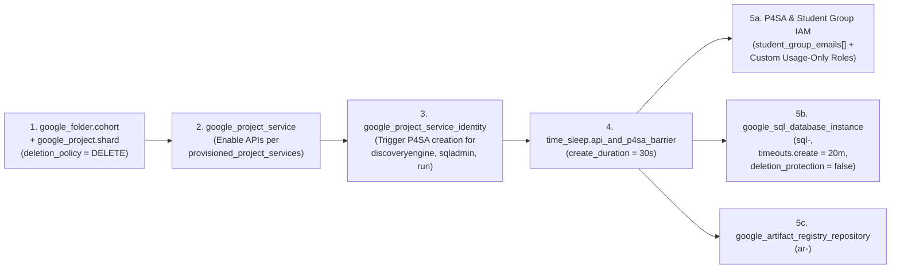

# BU Admin Sub-folder & Cohort Shards Terraform (`tdd-iac-buadmin-subfolder-and-cohort.md`)

> **Domain Master:** [tdd-iac-master.md](tdd-iac-master.md)  
> **Terraform Source Locations:** `src/terraform/buadmin/subfolder/` and `src/terraform/buadmin/cohort/`

---

## 1. Part A: Department Sub-folder Module (`src/terraform/buadmin/subfolder/`)

Triggered by a **Top-Level School Admin** (`CUJ-BU-01` .. `CUJ-BU-03`).
* **GCS State Path:** `gs://<tfstate-bucket>/tfstate/buadmin/subfolder-<school_slug>-<subfolder_slug>/default.tfstate`
* **Resources:**
  1. `google_folder.subfolder` (`parent = var.parent_school_folder_id`, `deletion_protection = false`).
  2. `google_folder_iam_member` binding `var.cohort_admin_principals` to `roles/resourcemanager.folderViewer` and `roles/viewer`.
  3. Optional `google_billing_budget.subfolder_budget` (`resource_ancestors = [google_folder.subfolder.name]`).

---

## 2. Part B: Cohort & Project Shards Module (`src/terraform/buadmin/cohort/`)

Triggered by any **Cohort Admin** (including all School Admins) when creating or updating a Cohort (`CohortConfig v1..vN`) or running **Cohort Teardown** (`CUJ-BU-04`, `CUJ-BU-05`, `CUJ-BU-07`, `CUJ-BU-09`).

* **GCS State Path:** `gs://<tfstate-bucket>/tfstate/buadmin/cohort-<cohort_slug>/default.tfstate`
* **Shard Calculation:**
  $$K = \max\left(1, \left\lceil \frac{N_{\text{target\_students}}}{100} \right\rceil\right), \quad \text{Project IDs: } \texttt{<cohort\_slug>-p01} \dots \texttt{<cohort\_slug>-p}\langle K \rangle$$

### Input `.tfvars.json` Contract (`tfvars/buadmin/cohort-<cohort_slug>/<version_id>.tfvars.json`)
```json
{
  "parent_folder_id": "folders/100000000201",
  "cohort_slug": "cs101-fall",
  "cohort_display_name": "CS101 Fall 2026",
  "config_version_id": "v2",
  "based_on_global_config_version": "v2",
  "shard_project_ids": [
    "cs101-fall-p01",
    "cs101-fall-p02",
    "cs101-fall-p03"
  ],
  "billing_account_id": "012345-6789AB-CDEF01",
  "currency_code": "USD",
  "region": "asia-southeast1",
  "cohort_budget_amount": 8000,
  "default_project_spend_limit": 3000,
  "project_spend_limit_overrides": {
    "cs101-fall-p01": 4000
  },
  "control_tower_budget_pubsub_topic": "projects/ct-prod/topics/sandbox-budget-events",
  "cohort_admin_principals": [
    "user:prof-smith@school.edu"
  ],
  "student_group_emails": [
    "grp-cs101-lec1@school.edu",
    "grp-cs101-lec2@school.edu"
  ],
  "provisioned_project_services": {
    "service_account": true,
    "gemini": true,
    "gcs": true,
    "cloud_sql": true,
    "cloud_run": true,
    "vertex_search": true
  },
  "pinned_service_sizes": {
    "cloud_sql_tier": "db-custom-2-7680",
    "cloud_sql_disk_gb": 50,
    "cloud_run_cpu": "1000m",
    "cloud_run_memory": "512Mi"
  }
}
```

---

## 3. Staged Async DAG Inside `src/terraform/buadmin/cohort/`

To guarantee zero eventual-consistency failures on first apply, each Project Shard in `var.shard_project_ids` executes the following strict dependency chain:



### Detailed Resource Breakdown per Shard (`<cohort_slug>-p01..pKK`):
1. **Cohort Folder & Shard Projects (`google_folder.cohort`, `google_project.shard`):**
   * `deletion_policy = "DELETE"` on `google_project.shard` so `terraform destroy` cleanly deletes the entire project shard and all dynamically created student/app resources inside it.
2. **Project API Enablement (`google_project_service.enabled_apis`):**
   * Enables APIs for all `true` entries in `var.provisioned_project_services` (`disable_on_destroy = false` to avoid cascading API-disable errors during `terraform destroy`).
3. **P4SA Warmup + `30s` `time_sleep` Barrier:**
   * Explicitly triggers `google_project_service_identity` for `discoveryengine.googleapis.com`, `run.googleapis.com`, and `sqladmin.googleapis.com`.
   * Waits `30s` via `time_sleep.api_and_p4sa_barrier` before binding `roles/storage.objectViewer` to the Discovery Engine P4SA or creating downstream instances.
4. **Shared Project Infrastructure:**
   * **If `provisioned_project_services.cloud_sql == true`:** Provisions `1` Shared Cloud SQL for PostgreSQL 15 instance (`sql-<project_id>`) per shard (`cloudsql.iam_authentication = "on"`, `deletion_protection = false`, `timeouts { create = "20m", update = "20m", delete = "20m" }`).
   * **If `provisioned_project_services.cloud_run == true`:** Provisions `1` shared Docker Artifact Registry repository (`ar-<project_id>`).
5. **Multi-Group Student Baseline IAM (`var.student_group_emails[]`) & Custom Usage Roles:**
   * Iterates over all groups in `var.student_group_emails[]` (`group:<email>`) and binds baseline project consumer/viewer permissions (`serviceusage.services.use`, `logging.viewAccessor`, `cloudsql.client`, `cloudsql.instanceUser`, `artifactregistry.writer`, and `aiplatform.user` if Gemini enabled).
   * Creates two custom project-level **Usage-Only Roles** (`customStudentCloudRunUser` and `customStudentVertexSearchUser`) that omit `.delete` and `.setIamPolicy` permissions, ready for the Atomic Pipeline to bind per App resource.
6. **Pooled Cohort Budget & Per-Project Shard Budgets:**
   * `1` `google_billing_budget` on `folders/${google_folder.cohort.folder_id}` (`cohort_budget_amount`).
   * `K` `google_billing_budget` resources on each shard (`projects/${google_project.shard[k].number}`), using `lookup(var.project_spend_limit_overrides, k, var.default_project_spend_limit)`.
