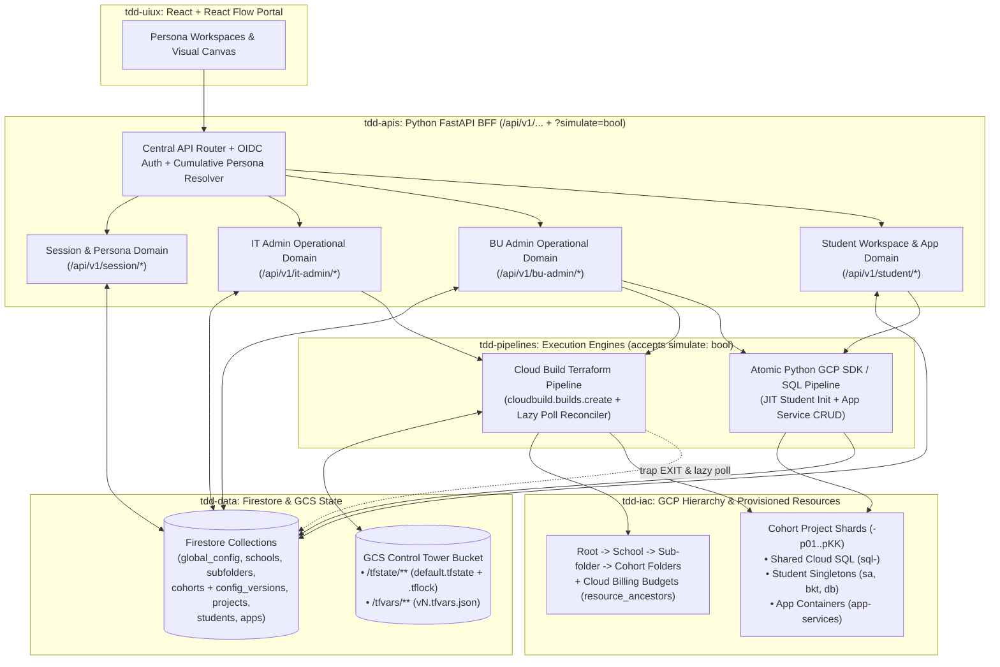

# Technical Design & Low-Level Design — Master (`THE HOW`)

> **Document Role:** Primary Technical Design & Low-Level Design (TDD / LLD) Master Specification (`specs/02-tdd/tdd-master.md`).  
> **Companion Business Requirements Spec (`THE WHAT` & `THE WHY`):** [../01-brs/brs-master.md](../01-brs/brs-master.md)

---

## 1. Purpose & Architectural Scope

While `specs/01-brs/` defines **what** the Learning Sandbox platform does and **why** each persona (`IT Admin ⊃ BU Admin [School Admin ⊃ Cohort Admin] ⊃ Student`) needs it, `specs/02-tdd/` specifies **how** the system is engineered end-to-end across six technical domains:

1. **`tdd-data/` — Data & Firestore Schema Architecture:** Single-namespace Firestore collections (no split `/environments/{live|simulate}` trees) modeling the three-tier version-tracked configuration cascade (`ServiceCatalog` $\rightarrow$ `ITAdminGlobalConfig` [`v1..vN`] $\rightarrow$ `CohortConfig` [`v1..vN`]), organizational hierarchy (`School`, `DepartmentSubfolder`, `Cohort`, `ProjectShard`), and student workspaces (`StudentSlice`, `AppContainer`, `AppServiceInstance`).
2. **`tdd-apis/` — FastAPI BFF & Operational API Domains:** Central API router topology, OIDC authentication, cumulative persona resolver (`IT Admin ⊃ School Admin ⊃ Cohort Admin ⊃ Student`), request-level `simulate: bool` pass-through flag, and route-path-to-operational-domain specifications (`session`, `it-admin`, `bu-admin`, `student`).
3. **`tdd-iac/` — Infrastructure-as-Code (Terraform Modules & GCS State Locking):** Day-0 Control Tower bootstrap (`bootstrap`), Top-Level School Folder & Pooled School Budget modules (`itadmin`), Department Sub-folder modules (`subfolder`), and Cohort Project Sharding (`<cohort_slug>-p01..pKK`), Shared Cloud SQL (`sql-<project_id>`), `time_sleep` propagation barriers for P4SA/API eventual consistency, native LRO `timeouts`, and GCS `.tflock` state locking (`buadmin`).
4. **`tdd-pipelines/` — Async Execution Pipelines (Cloud Build Terraform Runner & Atomic SDK Runner):**
   * **Cloud Build Terraform Pipeline (`tdd-pipelines-cloud-build-terraform.md`):** Executes `itadmin` and `buadmin` Terraform modules asynchronously via Google Cloud Build (`cloudbuild.projects.builds.create`), handling `.tfvars.json` handoff via GCS, `trap ... EXIT` callback reliability, lazy status reconciliation via `builds.get(active_cloud_build_id)`, stale `.tflock` `force-unlock` recovery, and `simulate=true` validation-only runs.
   * **Atomic GCP SDK / SQL Pipeline (`tdd-pipelines-atomic-runner.md`):** Fast (`<15s`) direct Python runner for Just-In-Time (JIT) Student Workspace Initialization on Cohort entry (`sa-<student_slug>`, `Gemini`, `bkt-<project_id>-<student_slug>`, `db_<student_sql_slug>`) and App-level `CREATE` / `DELETE` (`GCS Managed Folders`, `Postgres Schemas`, `Cloud Run Services`, `Vertex AI Search Data Stores & Apps`), plus student suspension and slice deletion.
5. **`tdd-skills/` — Companion Agent Skills (`agy-portal-guide`):** The packaged `SKILL.md` user guide and code recipes helping students consume their provisioned slice (`sa-<student_slug>`, `bkt-...`, `db_<student_sql_slug>`, Cloud Run, Vertex AI Search) inside Antigravity.
6. **`tdd-uiux/` — Visual Canvas & Portal UI/UX (React + Vite + Tailwind + React Flow):** *(Kept empty for now — to be discussed after the backend, data, IaC, and pipeline specs are reviewed.)*

---

## 2. System Architecture & End-to-End Execution Flow



---

## 3. Core Architectural Decisions Reflected Across TDD

1. **Three-Tier Version-Tracked Configuration Cascade (`ServiceCatalog` $\rightarrow$ `ITAdminGlobalConfig` $\rightarrow$ `CohortConfig`):**
   * Both `ITAdminGlobalConfig` and `CohortConfig` are **immutable and version-tracked (`v1`, `v2`, `v3`, ...)**.
   * Each `Cohort` maintains its current config pointer (`latest_config_version_id`) **and** the last version that completed Cloud Build Terraform (`applied_config_version_id`), plus a full `config_versions/{vN}` history subcollection.
   * Student JIT Workspace Initialization and App creation always read against **`applied_config_version_id`** so an in-progress Cohort Terraform update never exposes half-provisioned project services.
2. **Multiple Student Email Groups per Cohort (`student_group_emails: string[]`):**
   * `CohortConfig` supports an array of Google Group emails (`student_group_emails[]`). A student logging in sees every Cohort where their email belongs to at least one configured group.
3. **`simulate: bool` as a Request-Level Pipeline Flag:**
   * Simulation is not a separate database namespace or UI control domain; any mutating API call accepts `simulate: bool` (default `false`) and passes it down to the Cloud Build Terraform Pipeline or Atomic Pipeline.
4. **Cloud Build Terraform Execution & Failure Guardrails:**
   * **GCS Native State Locking (`.tflock`):** Each School (`itadmin/school-<slug>`), Department Sub-folder (`buadmin/subfolder-<school>-<sub_slug>`), and Cohort (`buadmin/cohort-<slug>`) uses an isolated GCS state prefix with atomic `.tflock` locking.
   * **Async GCP Propagation Inside HCL:** Terraform modules use `time_sleep` propagation barriers (`30s`) between API/P4SA creation and downstream IAM bindings, plus explicit `timeouts` (`20m`) on Long-Running Operations (`google_sql_database_instance`).
   * **Reliability Guardrails:**
     1. Cloud Build timeout (`3600s`) $>$ Terraform resource timeout (`20m`) to prevent hard kills.
     2. Wrapper script with `trap on_exit EXIT` inside Cloud Build plus **Lazy Poll Reconciliation** (`cloudbuild.projects.builds.get(active_cloud_build_id)`) in FastAPI so Firestore never stays stuck in `PROVISIONING` if a build fails.
     3. Automatic `terraform force-unlock` on retry when a prior `cloud_build_id` is in a terminal failed/timed-out state.

---

## 4. TDD Subfolder & Document Organization

```text
specs/02-tdd/
├── tdd-master.md                                        # THIS DOCUMENT: Primary Technical Design Index
│
├── tdd-data/                                            # 1. Data & Firestore Schema Domain
│   ├── tdd-data-master.md                               # Master ER Diagram, Collections Overview & State Pointers
│   ├── tdd-data-catalog-and-config.md                   # ServiceCatalog, ITAdminGlobalConfig (v1..vN) & CohortConfig (v1..vN)
│   ├── tdd-data-hierarchy-and-cohorts.md                # School, DepartmentSubfolder, Cohort & ProjectShard Schemas
│   └── tdd-data-students-and-apps.md                    # StudentSlice, Singletons, AppContainer & AppServiceInstance Schemas
│
├── tdd-apis/                                            # 2. FastAPI BFF & Operational API Domains
│   ├── tdd-apis-master.md                               # Master API Conventions, simulate Flag & Error Contracts
│   ├── tdd-apis-routing-and-middleware.md               # Router Tree, OIDC Auth, Cumulative Persona Resolver & Scope Guard
│   ├── tdd-apis-session.md                              # /api/v1/session/* (Caller Identity, Roles & Entitled Cohorts)
│   ├── tdd-apis-it-admin.md                             # /api/v1/it-admin/* (Catalog, GlobalConfig Versions & School CRUD)
│   ├── tdd-apis-bu-admin.md                             # /api/v1/bu-admin/* (Sub-folders, Cohorts, CohortConfig Versions, Shards)
│   └── tdd-apis-student.md                              # /api/v1/student/* (JIT Cohort Entry Init, App Containers & Services)
│
├── tdd-iac/                                             # 3. Infrastructure-as-Code (Terraform) Domain
│   ├── tdd-iac-master.md                                # Master Terraform Topology, GCS .tflock State & Async DAG Rules
│   ├── tdd-iac-bootstrap.md                             # Day-0 Control Tower Project, Automation SA, GCS Bucket & Cloud Build
│   ├── tdd-iac-itadmin-school.md                        # Top-Level School Folders, School Admin IAM & Pooled School Budgets
│   └── tdd-iac-buadmin-subfolder-and-cohort.md          # Sub-folders, Cohort Shards (<slug>-p01..pKK), P4SA Barrier & Shared SQL
│
├── tdd-pipelines/                                       # 4. Async Execution Pipelines Domain
│   ├── tdd-pipelines-master.md                          # Master Pipeline Architecture, simulate Flag & Concurrency Model
│   ├── tdd-pipelines-cloud-build-terraform.md           # Cloud Build Terraform Runner, Poll Reconciler & Failure Recovery
│   └── tdd-pipelines-atomic-runner.md                   # Direct Python GCP SDK / SQL Runner (JIT Student Init & App CRUD)
│
├── tdd-skills/                                          # 5. Companion Agent Skills Domain
│   ├── tdd-skills-master.md                             # Master Companion Skill Architecture & Packaging
│   └── tdd-skills-agy-portal-guide.md                   # SKILL.md Spec for Student/Admin Self-Service & App Consumption
│
└── tdd-uiux/                                            # 6. Visual Canvas & Portal UI/UX Domain (Empty — To Discuss Later)
```

---

## 5. Operational API Routing Matrix (`tdd-apis` $\rightarrow$ Operational Domains)

| Route Prefix | Operational API Spec | Minimum Persona | Key Endpoints & Connected Pipelines |
| :--- | :--- | :--- | :--- |
| `/api/v1/session` | [tdd-apis/tdd-apis-session.md](tdd-apis/tdd-apis-session.md) | Authenticated User | • `GET /api/v1/session/me` $\rightarrow$ Resolves caller email, Google Group memberships, cumulative roles (`IT Admin`, `School Admin`, `Cohort Admin`, `Student`), delegated scopes, and entitled Cohorts (matched via `CohortConfig.student_group_emails[]`). |
| `/api/v1/it-admin` | [tdd-apis/tdd-apis-it-admin.md](tdd-apis/tdd-apis-it-admin.md) | `IT Admin` | • `GET /api/v1/it-admin/service-catalog` $\rightarrow$ Returns `ServiceCatalog` (`MANDATORY` `sa`, `prerequisites`, size presets, quota bounds).<br>• `GET /api/v1/it-admin/global-config`, `GET .../versions`, `POST .../global-config` $\rightarrow$ Reads current `ITAdminGlobalConfig` (`latest_version_id`), lists immutable version history (`v1..vN`), or saves a new version.<br>• `GET /api/v1/it-admin/schools`, `POST .../schools`, `PATCH .../schools/{school_slug}`, `POST .../schools/{school_slug}/retry` $\rightarrow$ Triggers Cloud Build Terraform Pipeline (`itadmin` module) and lazily reconciles `active_cloud_build_id`. |
| `/api/v1/bu-admin` | [tdd-apis/tdd-apis-bu-admin.md](tdd-apis/tdd-apis-bu-admin.md) | `BU Admin` (`School Admin` for sub-folders; `Cohort Admin` for cohorts/shards/students) | • **Sub-folders & Admin Delegation (`School Admin`):**<br>  - `POST /api/v1/bu-admin/schools/{school_slug}/subfolders`, `PATCH .../{subfolder_slug}`, `DELETE .../{subfolder_slug}` $\rightarrow$ Triggers Cloud Build Terraform Pipeline (`subfolder` module).<br>  - `PUT /api/v1/bu-admin/subfolders/{subfolder_slug}/admins` & `PUT /api/v1/bu-admin/cohorts/{cohort_slug}/admins` $\rightarrow$ Updates delegated `cohort_admin_emails[]`.<br>• **Cohort & Versioned `CohortConfig` Lifecycle (`Cohort Admin`):**<br>  - `POST /api/v1/bu-admin/cohorts` & `PUT /api/v1/bu-admin/cohorts/{cohort_slug}/config` $\rightarrow$ Creates a new immutable `CohortConfig` version (`v1..vN` with `student_group_emails[]`, $N$ students, non-destructive service toggles, per-student quantities), updates `latest_config_version_id`, and triggers Cloud Build Terraform Pipeline (`buadmin` module).<br>  - `GET /api/v1/bu-admin/cohorts/{cohort_slug}/config/versions` $\rightarrow$ Lists version history (`v1..vN`) for the Cohort.<br>  - `POST /api/v1/bu-admin/cohorts/{cohort_slug}/resync` $\rightarrow$ Resyncs `student_group_emails[]` and re-triggers/reconciles Cohort Terraform.<br>  - `PATCH /api/v1/bu-admin/cohorts/{cohort_slug}/active-project` $\rightarrow$ Switches `active_provisioning_project_id` to any shard with remaining capacity (`< 100` seats).<br>  - `PATCH /api/v1/bu-admin/cohorts/{cohort_slug}/projects/{project_id}/budget` $\rightarrow$ Updates per-project spend limit override.<br>  - `POST /api/v1/bu-admin/cohorts/{cohort_slug}/teardown` $\rightarrow$ Triggers Cloud Build `terraform destroy` across the Cohort.<br>• **Student Governance (`Cohort Admin`):**<br>  - `GET /api/v1/bu-admin/cohorts/{cohort_slug}/students?q=...`<br>  - `POST .../students/{student_slug}/suspend`, `POST .../unsuspend`, `DELETE .../students/{student_slug}` $\rightarrow$ Invokes Atomic Pipeline. |
| `/api/v1/student` | [tdd-apis/tdd-apis-student.md](tdd-apis/tdd-apis-student.md) | `Student` (or `BU Admin` / `IT Admin` on behalf of student) | • `GET /api/v1/student/cohorts` $\rightarrow$ Lists entitled Cohorts matching caller's membership in `CohortConfig.student_group_emails[]`.<br>• `POST /api/v1/student/cohorts/{cohort_slug}/enter` $\rightarrow$ **JIT Workspace Entry & Auto-Initialization:** Verifies `Cohort.applied_config_version_id != null`, assigns student to `active_provisioning_project_id` on first entry (auto-advancing pointer if shard reaches `100`), and runs Atomic Pipeline to initialize missing Student-Level Singletons (`sa-<student_slug>`, `Gemini`, `bkt-...`, `db_<student_sql_slug>`), unlocking App creation.<br>• `POST /api/v1/student/cohorts/{cohort_slug}/apps` & `DELETE .../apps/{app_slug}` $\rightarrow$ Creates or tears down an `AppContainer` (`app-<app_slug>`).<br>• `POST /api/v1/student/cohorts/{cohort_slug}/apps/{app_slug}/services` & `DELETE .../services/{service_id}` $\rightarrow$ Enforces Cohort per-student allowance gate and runs Atomic Pipeline for `GCS_MANAGED_FOLDER`, `POSTGRES_SCHEMA`, `CLOUD_RUN_SERVICE`, or `VERTEX_SEARCH_APP`. |
