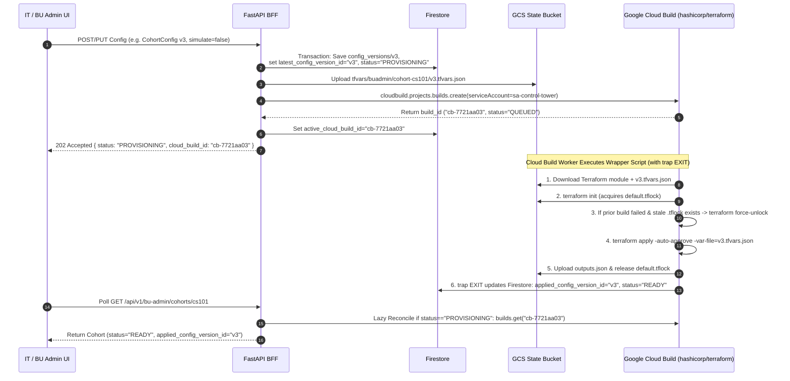

# Cloud Build Terraform Pipeline & Failure Recovery (`tdd-pipelines-cloud-build-terraform.md`)

> **Domain Master:** [tdd-pipelines-master.md](tdd-pipelines-master.md)

---

## 1. End-to-End Cloud Build Execution Flow

When an IT Admin mutates a `School`, a School Admin mutates a `DepartmentSubfolder`, or a Cohort Admin creates/updates a `Cohort` (`CohortConfig v{N}`) or triggers **Cohort Teardown**:



---

## 2. Cloud Build Inline Build Specification

FastAPI submits an inline `Build` specification via `google-cloud-build` Python client:

* **`service_account`:** `projects/<ct_project>/serviceAccounts/sa-control-tower@<ct_project>.iam.gserviceaccount.com`
* **`timeout`:** `"3600s"` (`60 minutes` — strictly greater than the `20m` Terraform resource `timeouts` so Cloud Build never hard-kills Terraform before it can release `.tflock`).
* **`logs_bucket`:** `gs://<control-tower-tfstate-bucket>/cloudbuild-logs`
* **Single Entrypoint Wrapper Script (`run_tf.sh` with `trap on_exit EXIT`):**
  ```bash
  #!/usr/bin/env bash
  set -uo pipefail

  EXIT_CODE=0
  on_exit() {
    # Always runs even if terraform init/apply fails with non-zero exit code
    python3 /workspace/sync_status_to_firestore.py \
      --entity-type="${_ENTITY_TYPE}" \
      --entity-slug="${_ENTITY_SLUG}" \
      --config-version="${_CONFIG_VERSION}" \
      --build-id="${BUILD_ID}" \
      --exit-code="${EXIT_CODE}"
  }
  trap on_exit EXIT

  terraform init -input=false \
    -backend-config="bucket=${_STATE_BUCKET}" \
    -backend-config="prefix=${_STATE_PREFIX}" || { EXIT_CODE=$?; exit $EXIT_CODE; }

  if [ "${_FORCE_UNLOCK_IF_LOCKED}" = "true" ]; then
    LOCK_ID=$(gsutil cat "gs://${_STATE_BUCKET}/${_STATE_PREFIX}/default.tflock" 2>/dev/null | jq -r '.ID // empty')
    if [ -n "${LOCK_ID}" ]; then
      terraform force-unlock -force "${LOCK_ID}" || true
    fi
  fi

  if [ "${_ACTION}" = "DESTROY" ]; then
    terraform destroy -auto-approve -input=false -var-file=input.tfvars.json || { EXIT_CODE=$?; exit $EXIT_CODE; }
  else
    terraform apply -auto-approve -input=false -var-file=input.tfvars.json || { EXIT_CODE=$?; exit $EXIT_CODE; }
    terraform output -json > outputs.json
    gsutil cp outputs.json "gs://${_STATE_BUCKET}/${_OUTPUTS_GCS_PATH}"
  fi
  ```

---

## 3. Comprehensive Failure Modes & Automated Guardrails

| Failure Scenario | What Happens Without Guardrails | Built-In Guardrail in Our Pipeline |
| :--- | :--- | :--- |
| **1. Partial `terraform apply` Failure**<br>*(e.g., Shard `p01` & `p02` succeed, Shard `p03` Cloud SQL fails with transient GCP error)* | Admin doesn't know which config version is live; re-running might duplicate or break `p01`/`p02`. | • Terraform saves `p01` & `p02` in `default.tfstate` and releases `.tflock`.<br>• `Cohort.latest_config_version_id` stays `"v3"`, `applied_config_version_id` stays `"v2"`, and `status` becomes `"ERROR"`.<br>• Clicking **Retry** re-runs Cloud Build with `v3.tfvars.json`; Terraform treats `p01`/`p02` as no-ops and only converges `p03`. |
| **2. Orphaned GCS `.tflock` File**<br>*(e.g., Cloud Build worker crashes or times out mid-run)* | Subsequent retries immediately fail with `Error acquiring the state lock`. | • **Timeout Hierarchy:** Cloud Build `timeout = 3600s` $>$ Terraform resource `timeouts = 20m`, preventing timeout `SIGKILL`s.<br>• **Auto Force-Unlock on Retry:** Before spawning a retry build, FastAPI checks `builds.get(last_cloud_build_id)`. If the previous build is in a terminal state (`FAILURE`, `TIMEOUT`, `CANCELLED`, `EXPIRED`), FastAPI sets `_FORCE_UNLOCK_IF_LOCKED=true`, which reads `ID` from `default.tflock` and runs `terraform force-unlock -force <ID>`. |
| **3. Lost Callback / Step Failure in Cloud Build**<br>*(e.g., `terraform apply` exits `1` or container dies before final step)* | Entity stays stuck in `status = "PROVISIONING"` forever in Firestore. | • **Layer 1 (`trap on_exit EXIT`):** Runs inside the same shell step regardless of `terraform apply` exit code.<br>• **Layer 2 (Lazy Poll Reconciliation in FastAPI):** Whenever `GET /schools/{slug}` or `GET /cohorts/{slug}` sees `status in ["PROVISIONING", "UPDATING", "TEARING_DOWN"]` and `active_cloud_build_id != null`, FastAPI queries `cloudbuild.builds.get(active_cloud_build_id)`. If Cloud Build is `SUCCESS`, FastAPI ingests `outputs.json` from GCS and marks `status = "READY"`, `applied_config_version_id = latest_config_version_id`; if `FAILURE`/`TIMEOUT`/`CANCELLED`, FastAPI marks `status = "ERROR"` with the Cloud Build log link. |
| **4. Student Enters Cohort During Provisioning / Update** | Student JIT initialization fails trying to create a DB on a Cloud SQL instance that is still creating. | • **Initial Creation (`applied_config_version_id == null`):** `POST /student/cohorts/{slug}/enter` returns `status = "COHORT_PROVISIONING"` until `v1` finishes.<br>• **Config Update (`applied_config_version_id == "v1"`, `latest == "v2"`):** Student JIT initialization reads from the **`applied_config_version_id` (`v1`)** snapshot, only unlocking newly enabled services once `applied_config_version_id` advances to `"v2"`. |
| **5. `terraform destroy` Blocked by Student Resources** | Cohort Teardown fails because students created buckets, Cloud Run services, or DB schemas outside Terraform. | • `google_project.shard` uses `deletion_policy = "DELETE"` and `google_sql_database_instance` uses `deletion_protection = false`. Destroying the project shard deletes the entire GCP project container and all student/app resources inside it in one operation. |
