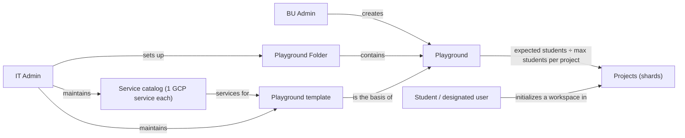
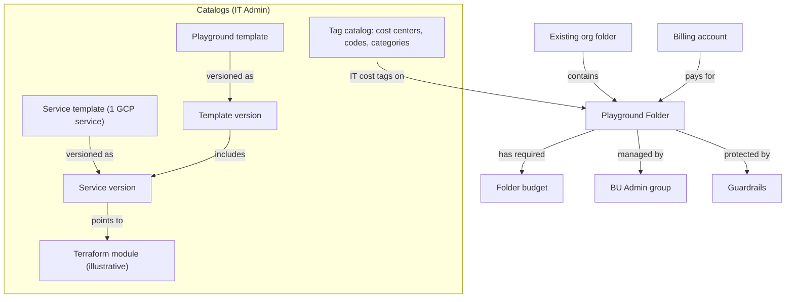
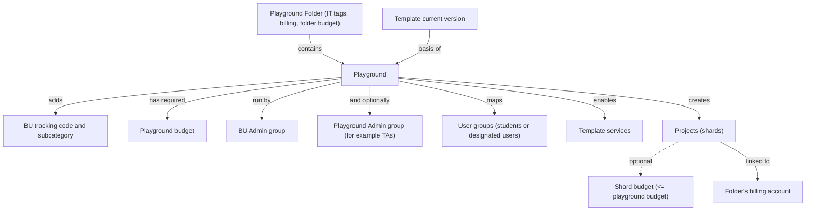
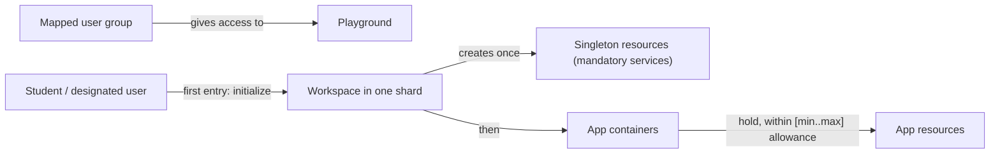

# Crucible (Learning Sandbox): Business Requirements (Master)

What Crucible (the Learning Sandbox platform) is for, the concepts it is built on (from the big picture down to each persona), who uses it, and the journeys of each persona. Technical design: [tdd-master.md](../02-tdd/tdd-master.md).

**Persona documents (journeys and the design decisions behind them):**
- **IT Admin:** [brs-it-admin-cuj.md](brs-it-admin-cuj.md)
- **BU Admin & Playground Admin:** [brs-bu-admin-cuj.md](brs-bu-admin-cuj.md) (see also section 7.1 below for the journeys applicable to Playground Admins)
- **Student & Designated User:** [brs-student-cuj.md](brs-student-cuj.md)

---

## 1. The business problem

Universities and enterprises run courses, labs and hackathons for hundreds or thousands of students on Google Cloud. Doing this in shared projects under pooled budgets runs into three problems:

1. **Isolation in shared projects:** broad roles let students see, change or delete each other's resources and exhaust shared budgets.
2. **The central IT bottleneck:** central IT owns billing, cost codes and guardrails, while schools and faculty own the courses. If every course needs an IT ticket, setup takes days instead of minutes.
3. **Governed cost tracking:** spend has to be attributed to the right school, cost code and category, without relying on people tagging resources correctly.

**Crucible (Learning Sandbox)** is a self-service platform, run from a central **Control Tower**, that lets IT govern once and lets schools and students serve themselves inside those rules.

---

## 2. Conceptual framework

This section builds up in layers: first the big picture, then one level down for each persona. Technical references (such as Terraform modules, org policies, IAM deny rules and specific GCP APIs) are included as illustrative anchors; their implementation mechanics live in [tdd-master.md](../02-tdd/tdd-master.md).

### 2.1 The big picture

Six ideas carry the whole platform:

1. **IT Admins set up Playground Folders** inside the organization's existing folders. A Playground Folder is a governed space with a billing account, a required budget and IT cost tags.
2. **BU Admins create playgrounds** inside the Playground Folders they've been given, one per course, lab or hackathon, with a required playground budget and optional per-project shard budgets.
3. **Every playground is built from a playground template** (always starting on its `current` version), chosen from a catalog IT maintains.
4. **A template lists the services** a playground offers (for example Gemini, Cloud Storage, Cloud SQL), drawn from IT's single-service catalog.
5. **The template also sets the maximum number of students per project.** With the number of students the BU Admin expects, that decides how many projects the playground gets. Each project is a **shard** that holds up to that many students.
6. **Users (students or designated users) initialize their own workspace** in one of those shards, then build app containers in it, within per-user allowances.



### 2.2 Why this is flexible

The same few concepts cover very different situations without new platform features:

| Scenario | How it's handled |
|---|---|
| A 20-student seminar and a 1,000-student course | Same template; the seminar gets 1 project, the course 10 (at 100 students per project) |
| A course that grows mid-term | Increasing expected students adds new shards; existing shards and workspaces are untouched |
| Courses that need different tools | Different templates, or optional services enabled per playground (optional services add app resources only, so no workspace is ever re-initialized) |
| A research lab that needs more power | A separate, elevated service definition in its own template, never a hidden switch on the standard one |
| Schools with their own cost centers or billing accounts | Each school gets its own Playground Folders, with its own cost tags, billing account and budget |
| A school's internal cost split | BU Admins add their own tracking code, subcategory, playground budget and optional shard budgets |
| Rolling out a fixed or improved service | A new service version and template version for new playgrounds; existing playgrounds stay permanently on the template version they were created with |
| A course that pauses and comes back | Decommission stops billing without deleting anything; recommission brings the playground back with every workspace intact |
| Different placement needs | A Playground Folder can sit under any existing folder; the organization's own folder structure stays as it is |

### 2.3 IT Admin level: governance and Playground Folders

IT Admins own everything that must stay consistent across schools: the catalogs and the Playground Folders.



**Setting up a Playground Folder.** An IT Admin browses the organization's folders and picks where the Playground Folder goes (the parent folder cannot be changed later). Anything granted on that parent folder also applies inside it, so the choice matters. The IT Admin then sets:
- **Billing account:** picked from the accounts the IT Admin can see. Cannot be changed later, so every project in the folder is always billed to it.
- **Budget:** a required amount, in the billing account's currency (updatable later along with the folder's display name, as a tracked job). Alert levels at 50, 75, 90 and 100% apply platform-wide; email notifications are out of scope for now.
- **Cost tags:** a cost center (one per school), one of that cost center's codes, and a cost category, all chosen from the active values in IT's tag catalog (**what you see is what you get** — each catalog entry is the literal tag value itself, with no separate human-readable display description). **Cannot be changed once the Playground Folder is created.**
- **BU Admin group:** exactly one existing group, which must already be inside the BU Admins group and **cannot be changed or swapped once created** (who manages playgrounds in this folder is changed by updating membership of that group in the Admin console).
- **Guardrails:** security guardrails (for example org policies and IAM deny rules) applied on the Playground Folder, on top of what the organization already enforces.

**Why tags matter.** Tags are what make cost tracking trustworthy:
- A tag on a folder is **inherited** by everything below it: every playground, project and resource.
- Only the people IT chose can set each tag, and project owners can't remove or change them.
- The platform **copies the tag values onto each project as labels**, so billing reports that work on labels show the same cost center, code and category. Tags are the source of truth; labels are the copy.
- IT's three cataloged tags (cost center, code, category) are set only on the Playground Folder, and the BU adds its own two **un-cataloged** literal tags (tracking code, subcategory) on each playground; **neither Playground Folder tags nor playground tags can be updated once created**.

**The service catalog.** Every **service template** in the catalog maps to a **single GCP service** (for example Cloud SQL) and is **versioned**, with one version marked `current`. Each service version points to the **Terraform module** (illustrative) that builds it, sets its **playground availability mode** (**mandatory**, **enabled by default and optional**, or **disabled by default and optional** — allowing flexible rollout across templates), and declares the APIs it enables, the prerequisite services it needs first, **service configuration defaults** (sizes and settings), **quota per project** (maximum capacity per project shard), **per-user bounds** (`min` minimum/default and a finite `max` ceiling per user — there is no unlimited allowance), the user group slots it needs, and the **singleton** and **app resources** it gives users (section 2.5). **Only mandatory services may define a user singleton resource;** optional services (enabled or disabled by default) provide app resources only, so enabling an optional service later never requires re-initializing anyone's workspace. Which roles each group gets is part of the Terraform module.

**Playground templates.** A playground template is a ready-made playground shape composed from pinned catalog service versions, also **versioned** with one version marked `current`. A template version inherits each included service's availability mode and bounds (with optional template-level tuning within those bounds), sets the **maximum number of students per project** (shard capacity ceiling), and lists the user group slots its services need. Every active template is available in every Playground Folder, and **creating a new playground always uses the chosen template's `current` version**.

**Versioning and lifecycle.** Every change to a service or template creates a new version; nothing is edited in place, so existing playgrounds never change underneath their users. **Nothing in the catalogs is ever deleted from the platform:** service templates, service versions, playground templates, and template versions can only be **retired** (blocking new selection while keeping existing uses intact), never hard-deleted. Cost tag values (`cost-center-bu`, `cost-center-code`, `cost-category`) are literal (**what you see is what you get**) and follow a strict **add new or mark disabled** lifecycle: existing tag values are never edited in place or deleted from the platform.

### 2.4 BU Admin level: playgrounds

BU Admins turn a template into a running playground for a course, inside a Playground Folder IT gave them.



**Who runs a playground.** The Playground Folder's **BU Admin group** always runs it. At playground creation, a BU Admin can also name an optional **Playground Admin group** (at most one, for example the course's TAs; **cannot be changed or swapped once created** — membership is managed in the Admin console). Playground Admins have the same rights as BU Admins, but for that one playground only: they own its projects, can manage them in the Cloud console, and can rename or update its budgets, configure its services and allowances, expand its capacity, suspend or restore user portal access, view its jobs, and act on behalf of its users through the platform. **Playground Admins cannot create, decommission, or recommission playgrounds**, and they see no Playground Folder-level jobs. They have no rights on the Playground Folder or on other playgrounds.

**What a BU Admin sees.** Only the Playground Folders whose BU Admin group they're in, and the playgrounds and jobs inside them. A Playground Admin sees only the playgrounds whose Playground Admin group they're in, and the jobs inside those playgrounds.

**Creating a playground.** In one of those Playground Folders, the BU Admin:
1. **Picks a template.** New playgrounds always start on the chosen template's **`current` version**, and stay **permanently pinned to that template version** for the entire life of the playground (a playground's template version can never be upgraded).
2. **Enters the expected number of students.** The platform creates expected students ÷ the template's maximum students per project projects, rounded up (for example 350 students at 100 per project gives 4 projects).
3. **Adds the BU tags:** literal `bu-tracking-code` and `bu-subcategory` values (**un-cataloged** — not drawn from a catalog, what you see is what you get), on top of the IT tags inherited from the folder; **cannot be updated once the playground is created**.
4. **Sets a required playground budget** (in the folder's billing account currency, with the same 50, 75, 90 and 100% alert levels), and **optionally sets a per-project shard budget** less than or equal to the playground budget (as a default across shards or overridden on individual shards). Both budgets and the playground's display name can be updated later.
5. **Optionally names a Playground Admin group** (at most one), for example the course's TAs, to run this playground alongside the BU Admins; **cannot be changed or swapped after creation**.
6. **Chooses services:** mandatory services are always on and cannot be unchecked; enabled-by-default services start on and can be unchecked before creation; disabled-by-default services start off and can be turned on. Prerequisite services are added automatically.
7. **Maps user groups (fixed at creation):** **strictly one existing group** of playground users (students or other designated users, for example `grp-cs101-students@`) is mapped to each user group slot expected by the template. The platform never creates groups or changes their members, and **mapped user groups cannot be changed or swapped once the playground is created** (membership is managed in the Admin console).
8. **Sets per-user allowances** for each enabled service between that service's `min` (the minimum, used by default) and `max` ceiling, subject to the project shard quota.

The platform creates the projects, links them to the folder's billing account, copies the IT and BU tags onto them as labels, and makes the BU Admin group, the IT Admins group, and — if configured — the Playground Admin group owners of every project.

**Evolving, monitoring, pausing and resuming a playground.**
- **Updating name or budgets:** BU Admins, Playground Admins (for their playground), and IT Admins can rename a playground or adjust its required playground budget and optional per-project shard budgets ($\le$ playground budget), as tracked jobs.
- **Adding a service (from its pinned template version):** turning on another optional service from the playground's pinned template version creates a new version of the playground's configuration, and the platform enables that service in **every project** of the playground. Because optional services never define user singletons, this only adds new **app resource** types for users — no existing workspace is ever re-initialized. Services are **add-only** (and a playground's template version is **never upgraded**): once on, a service isn't turned off, so no user work is ever lost. Adjusting a per-user allowance within `[min, max]` is non-destructive (lowering only gates new creations and leaves existing resources untouched).
- **Expanding capacity:** increasing expected students (grow-only) adds new project shards initialized with all enabled services and the default shard budget (if one is set), leaving existing shards untouched. This is also the admin action that lets more users in once every shard is full.
- **Suspending portal access and acting on behalf of users:** admins can suspend or restore a user's portal access to a playground as a tracked job. A suspended user still sees the playground, marked **Suspended**, read-only (including their own job history) with **all actions blocked**, and **nothing happens to their underlying GCP/workspace resources** (there is no removing a user or deleting a user's workspace slice). Admins can also search for a playground user to inspect and act on their workspace and app containers on their behalf (executing the Student / User journeys).
- **Viewing tracked jobs:** every folder setup, provisioning, rename or budget update, configuration update, shard expansion, portal access suspension or restore, workspace initialization, app-container or resource operation, decommission and recommission runs as a **tracked job** — jobs are the platform's audit trail. IT Admins see all Playground Folder jobs and all playground jobs across the platform; BU Admins see Playground Folder jobs and playground jobs inside their folders; Playground Admins see all playground jobs inside their assigned playground — with playground jobs filterable by **project (shard)** and **user**. Playground users see their own workspace and app-resource jobs.
- **Decommissioning:** BU Admins and IT Admins (not Playground Admins) can decommission a playground, and IT Admins can decommission a Playground Folder. Decommissioning runs as a tracked job that **disables billing** across all underlying playgrounds and associated projects to stop spend immediately, and marks the Playground Folder (when folder-scoped), **all underlying playgrounds, and their associated projects as decommissioned** in the platform — **nothing (including folders, projects, budgets, workspaces or resources) is deleted from the platform or GCP** (deletion is external manual cleanup outside current scope). While decommissioned, the folder or playground is **read-only for every persona** (its configuration and job history stay viewable; every mutating action is blocked).
- **Recommissioning:** decommissioning is reversible. IT Admins can recommission a Playground Folder (re-enabling billing and reactivating **all** underlying playgrounds and projects, the mirror of the decommission cascade), and BU Admins and IT Admins (not Playground Admins) can recommission a playground whose Playground Folder is active. Recommissioning runs as a tracked job; because nothing was deleted, every workspace, singleton and app resource is available again immediately.

### 2.5 Student / user level: workspaces and app containers

Playground users (students or other designated users) never touch GCP setup directly; they work through the platform inside the playgrounds their user groups are mapped to.



1. **Seeing playgrounds:** a user sees every playground whose mapped user groups they're in, and can work across several active playgrounds. Playgrounds where the user is **Suspended**, or that are **Decommissioned**, stay in the list marked as such and are read-only (all actions blocked).
2. **Initializing a workspace:** the first time a user enters an active playground, the platform automatically places them in a shard (project) with free capacity (admins do not manually choose or switch which shard new users land in) and creates **all** their **singleton resources** in one go: exactly one per mandatory service that defines one, such as their own service account, bucket and logical database. Because only mandatory services define singletons, a workspace is initialized once and never re-initialized. If every shard is already full, entry is blocked with a **capacity exhausted** state until an admin raises the expected number of students (which adds shards).
3. **App containers:** once initialized, the user creates **app containers**, one per app or lab (for example `app-lab1`), and adds **app resources** to them, such as a folder in their bucket, a database schema or a Cloud Run service.
4. **Adding, deleting, and tracking their jobs:** users add and delete app containers and app resources themselves through the platform (freeing allowance when deleted), and can view **their own tracked jobs** for workspace initialization and app-resource operations.
5. **Caps:** each enabled service gives every user a configured **allowance** (from `min` up to a finite `max`), shared across all their app containers in that playground. Each project shard also enforces the service's **quota per project**, so one shard can't outgrow its budget or quota.
6. **Usage rights only:** in GCP, users can use their own resources but can't change IAM or create and delete resources outside the platform.

### 2.6 Example: the AI playground template

An illustrative example of a first playground template for AI courses. Every service that gives users a singleton is **mandatory**; the optional services add app resources only.

| Service template (1 GCP service) | Availability mode | Project-level setup (illustrative) | User singleton (one per user) | App resources (in app containers) | Per-user allowance (`min` .. `max`) |
|---|---|---|---|---|---|
| Service Account | **Mandatory** | none | Service account `sa-<user>`, used by all their apps | none | Fixed singleton (`1`) |
| Gemini (Vertex AI) | **Mandatory** *(requires Service Account)* | Vertex AI API | Gemini access for `sa-<user>` | Called by the user's apps | Fixed singleton (access) |
| Cloud Storage | **Mandatory** *(requires Service Account)* | none | Bucket `bkt-<project>-<user>` | Managed folders `apps/<app>/<folder>/` in their bucket | Bucket: `1`; folders: `min` up to `max` (set per playground) |
| Cloud SQL | **Mandatory** *(requires Service Account)* | One shared instance `sql-<project>` | Logical database `db_<user>` on the shared instance | Schemas `db_<user>.<app>_<schema>` | `min` up to `max` (set per playground) |
| Cloud Run | **Enabled by default & optional** *(requires Service Account)* | Cloud Run API | none (runs as `sa-<user>`) | Services `run-<user>-<app>-<svc>` | `min` up to `max` (set per playground) |
| Vertex AI Search | **Enabled by default & optional** *(requires Service Account, Cloud Storage)* | Discovery Engine API | none | Data stores and apps `search-ds-...`, `search-app-...` | `min` up to `max` (set per playground) |

With a ceiling of 100 students per project, a 350-student playground gets 4 project shards. Each user lands in one shard, gets their service account, Gemini access, bucket and logical database on first entry, and then builds app containers such as `app-lab1` with a bucket folder, a schema, a Cloud Run service and a search data store. If a BU Admin unchecked Vertex AI Search at creation and turns it on later, users simply gain a new app resource type — nobody is re-initialized.

### 2.7 Terms

| Term | Meaning |
|---|---|
| Playground Folder | A platform-created folder where a BU builds playgrounds: immutable parent folder, IT cost tags, billing account, and BU Admin group, plus a required folder budget and guardrails |
| Playground | A platform-created folder inside a Playground Folder, with its project shards, permanently pinned template version, immutable BU tags, optional Playground Admin group, and mapped user groups, plus a required playground budget, for one course, lab or hackathon (earlier drafts: cohort) |
| Project (shard) | One of a playground's projects; holds up to max-students-per-project workspaces and may carry an optional shard budget ($\le$ playground budget) |
| Service template, service version | A single GCP capability offered to playgrounds, and one immutable versioned definition of it (availability mode, Terraform module, project quota, per-user `min`/`max` bounds, singleton and app resources); never deleted |
| Availability mode | How a service behaves in templates and playgrounds: **mandatory** (the only mode that may define a user singleton), **enabled by default and optional**, or **disabled by default and optional** (app resources only) |
| Playground template, template version | A ready-made playground shape, and one immutable definition of it (pinned service versions, max students per project, user group slots); new playgrounds always use `current`; never deleted |
| Current, retired / disabled | `Current`: version used for every new playground (templates) and default when composing a template (services). `Retired` (services/templates) or `disabled` (tag values): blocked for new selection while existing uses stay intact; never deleted |
| Max students per project | Maximum workspaces that share one project shard; set in the template version |
| Expected students | How many users a playground is sized for (grow-only); entered by the BU Admin; raising it is how admins add shards once every shard is full |
| Cost center, cost center code, cost category | IT's three cataloged cost tags (`cost-center-bu`, `cost-center-code`, `cost-category`), literal WYSIWYG values (no separate display description), set only on Playground Folders at creation and immutable thereafter; add-new or mark-disabled catalog lifecycle |
| BU tracking code, BU subcategory | The BU's two **un-cataloged** literal tags (`bu-tracking-code`, `bu-subcategory`, WYSIWYG — not drawn from a catalog), set on playgrounds at creation and immutable thereafter |
| Tag, label | Tag: inherited by everything below, the source of truth. Label: the copy on each project for billing reports |
| Billing account, budgets | Fixed billing account per Playground Folder; required folder budget, required playground budget, and optional per-project shard budget ($\le$ playground budget, inherited by new shards as the default), all with 50/75/90/100% alert levels |
| Guardrails | Security guardrails (for example org policies and IAM deny rules) on each Playground Folder |
| IT Admins group, BU Admins group | `grp-lsb-it-admins@` and `grp-lsb-bu-admins@` (IT Admins nested in BU Admins) |
| BU Admin group | The one group that manages a Playground Folder's playgrounds; inside the BU Admins group, set at folder creation and never swapped |
| Playground Admin group | An optional group (at most one per playground, for example TAs), set at playground creation and never swapped, with the same rights as BU Admins for that one playground except creating, decommissioning or recommissioning playgrounds (and no folder-level jobs); owner of its projects in the Cloud console |
| User groups | Existing groups of the people who use a playground (students or other designated users), mapped 1-to-1 to template user group slots at playground creation and never swapped |
| Workspace | A user's slice of one playground, in one shard (earlier drafts: student slice) |
| Workspace initialization | The first entry into an active playground: shard placement and all singleton resources, done once; blocked with a capacity-exhausted state when every shard is full |
| Singleton resource | A resource a user has exactly one of per playground, defined only by mandatory services (service account, bucket, logical database) and created at workspace initialization |
| App container, app resource | A named group for one app or lab (`app-<name>`), and the resources inside it |
| Allowance | How many app resources of a service a user may hold (configured from `min` up to a finite `max`), shared across their app containers |
| Suspended | A user whose portal access to one playground is blocked by an admin: the playground stays visible to them, read-only, with all actions blocked; their GCP resources are untouched |
| Decommissioned, recommission | Decommissioned: billing disabled on all underlying projects and the folder/playground read-only for everyone (configuration and job history viewable), nothing deleted. Recommission: the reverse tracked job that re-enables billing and reactivates it |
| Config version, tracked job | An immutable snapshot of a playground's configuration, and the recorded job executing any folder, playground, workspace, access or app-resource change — the platform's audit trail (viewable by folder, or at the playground level filtered by project shard and user) |
| Control Tower | Crucible's own project: Self Service APIs, configuration and jobs databases, Terraform state, pipeline |

---

## 3. Personas and groups

```text
IT Admin            members of grp-lsb-it-admins@
  │  Governs the catalogs and Playground Folders. Can do everything a BU Admin can, act on behalf of users, and view all jobs.
  ▼
BU Admin            members of grp-lsb-bu-admins@ (IT Admins nested inside)
  │  Builds, manages, pauses and resumes playgrounds in the Playground Folders whose BU Admin group they're in;
  │  suspends/restores user access, acts on behalf of users, and views folder and playground jobs.
  ▼
Playground Admin    members of a playground's optional Playground Admin group (for example TAs)
  │  Same rights as a BU Admin for that one playground, except creating, decommissioning or recommissioning playgrounds
  │  (and no folder-level jobs): owns its projects (Cloud console), configures it, updates name/budgets, suspends/restores
  │  user access, views its jobs, and acts on behalf of its users.
  ▼
Student / User      members of the user groups mapped to a playground
     Initializes a workspace in each playground, builds app containers in it, and views their own jobs.
```

1. **Group membership is managed outside the platform,** in the Admin console. The platform only reads it.
2. **One immutable admin group per container:** a Playground Folder has one BU Admin group, and a playground has at most one optional Playground Admin group; **neither group can be changed or swapped once created**.
3. **Plain users in the UI:** a signed-in user with no admin role and no mapped playground sees nothing (a "No Sandbox Assigned" state) in the portal UI.

---

## 4. How playgrounds are organized

```text
Organization
└── any existing folder         not managed by the platform
    └── Playground Folder       immutable parent, IT cost tags, billing account & BU Admin group; required folder budget, guardrails
        └── Playground          immutable template version, BU tags, optional Playground Admin group & mapped user groups;
            │                   expected students, required playground budget
            └── projects        expected students ÷ max students per project, rounded up (shards);
                │               optional per-project shard budget (<= playground budget)
                └── workspace   one per user: singleton resources (mandatory services), then app containers
```

1. **Two levels only:** Playground Folder, then playground. No nesting of either.
2. **Projects are created only by the platform.** Projects created by hand in a playground aren't supported.
3. **Owners of every project:** the BU Admin group, the IT Admins group, and — if configured — the Playground Admin group.
4. **The Control Tower** is a separate project; it isn't a playground.

---

## 5. Core business rules

1. **Cost attribution and immutable tags:** IT's three cataloged tags on every Playground Folder and the BU's two **un-cataloged** literal tags on every playground are **set at creation and never updated**; projects inherit them as tags and carry them as labels.
2. **Immutable container bindings:** a Playground Folder's parent folder, billing account, IT cost tags, and BU Admin group — and a playground's **template version, BU tags, optional Playground Admin group, and mapped user groups** (one per template group slot) — are chosen at creation and never changed, swapped, or upgraded.
3. **Budgets:** one **required** budget per Playground Folder, one **required** budget per playground, and an **optional** per-project shard budget (less than or equal to the playground budget; new shards inherit the default) — all in the billing account's currency with alert levels at 50, 75, 90 and 100% (notifications out of scope for now).
4. **Immutable versions and zero catalog deletion:** service templates, playground templates, and their versions are versioned, never edited in place, and **only ever retired — never deleted from the platform**; new playgrounds always start on a template's `current` version and stay on it permanently. Cost tag catalog values are literal (**what you see is what you get**) and strictly **add new or mark disabled** (never edited or deleted).
5. **Services are add-only, singletons come only from mandatory services, capacity is grow-only:** optional services from a playground's pinned template version can be turned on (never turned off) and only ever add app resources, so a workspace is initialized once and never re-initialized; capacity (`expected_students`) is grow-only and is the only way to add shards when every shard is full; a playground's template version is **never upgraded**.
6. **Decommissioning stops billing without deleting, and is reversible:** decommissioning a Playground Folder (IT Admin) or a playground (BU/IT Admin) disables billing across all underlying playgrounds and associated projects and marks the Playground Folder (when folder-scoped), **all underlying playgrounds, and their associated projects as decommissioned**; **nothing (including folders, projects, budgets, workspaces or resources) is deleted from the platform or GCP** (manual external cleanup). While decommissioned, everything is read-only for every persona (configuration and job history remain viewable). Recommissioning (IT Admin for a Playground Folder, cascading to everything below; BU/IT Admin for a playground inside an active folder) re-enables billing and reactivates it.
7. **Users work through the platform,** within per-user allowances (`min` up to a finite `max`) shared across their app containers and bounded by per-project shard quotas. Suspending a user's portal access blocks all their actions in that playground (which stays visible to them, read-only, including their own jobs) while leaving their underlying GCP resources untouched; there is no removing a user or deleting a workspace slice.
8. **No simulate or dry-run mode:** every action acts on real Google Cloud.
9. **Tracked jobs are the audit trail:** every change — including renames, budget updates, and suspending or restoring portal access — runs as a tracked job that records who asked for it, visible according to persona scope (folder jobs, playground jobs filtered by project shard and user, and a user's own jobs).

---

## 6. Responsibilities by level

| Level | IT Admin | BU Admin | Playground Admin | Student / Designated User |
|---|---|---|---|---|
| Service catalog, templates, tag catalog | Manage (create, version, retire / disable; never delete) | Read | Read (in their playground context) | none |
| Playground Folder | Create, rename / update budget, decommission, recommission | Read the folders whose group they're in | none | none |
| Playground | Same as BU Admin | Create, rename / update budgets, configure, expand, decommission, recommission | Rename / update budgets, configure, expand their own playground (no create, no decommission, no recommission) | Sees the playgrounds their user groups are mapped to |
| Projects in a playground | Owner | Owner | Owner | Usage rights on their own resources |
| Workspace and app containers | Suspend/restore portal access; act on behalf of users | Suspend/restore portal access; act on behalf of users (in their folders) | Suspend/restore portal access; act on behalf of users (in their playground) | Initialize, create and delete through the platform |
| Tracked jobs | View all Playground Folder jobs and all playground jobs (filtered by project & user) | View folder jobs (in their folders) and all playground jobs in their folders (filtered by project & user) | View all playground jobs in their assigned playground (filtered by project & user) | View their own workspace and app-resource jobs |

---

## 7. Journeys per persona

- **IT Admin:** manages the service catalog, playground templates, cost centers and categories, and Playground Folders (create, rename / update budget, decommission, recommission), acts across any folder, playground, or user workspace, and views all folder and playground jobs (filtered by project and user). [brs-it-admin-cuj.md](brs-it-admin-cuj.md)
- **BU Admin:** creates playgrounds (with permanently pinned `current` template, un-cataloged BU tags, budgets, optional Playground Admin group, and fixed mapped user groups), renames or updates playground and shard budgets, configures services and allowances, expands capacity, suspends/restores user portal access, acts on behalf of users, views folder and playground jobs (filtered by project and user), and decommissions and recommissions playgrounds. [brs-bu-admin-cuj.md](brs-bu-admin-cuj.md)
- **Student / Designated User:** initializes a workspace on playground entry, creates and deletes app containers and app resources within their allowance, operates resources in Google Cloud Console and Antigravity IDE, and views their own jobs. [brs-student-cuj.md](brs-student-cuj.md)

### 7.1 Journeys applicable to Playground Admins

Because a **Playground Admin** (members of a playground's optional Playground Admin group, set at creation and never swapped, such as course TAs) holds `roles/owner` on that playground's projects and the same platform rights as a BU Admin **scoped to that single playground** — except creating, decommissioning, or recommissioning playgrounds, and without Playground Folder-level jobs — they do not have a separate journey file. The following journeys in [brs-bu-admin-cuj.md](brs-bu-admin-cuj.md) apply directly to Playground Admins within their assigned playground:

| BU Admin Journey | Applicable to Playground Admin? | Scope / Constraint |
|---|---|---|
| **BU-01** Create a playground (incl. fixed tags, admin group & mapped user groups) | **No** | BU Admins and IT Admins only (requires Playground Folder access) |
| **BU-02** Update a playground's name or budgets | **Yes** | Their assigned playground only |
| **BU-03** Configure playground services & per-user allowances (`min`..`max`) | **Yes** | Their assigned playground only (add-only services from its pinned template version; template version is never upgraded) |
| **BU-04** Expand playground student capacity (grow-only shards) | **Yes** | Their assigned playground only |
| **BU-05** Suspend or restore a user's portal access | **Yes** | Users in their assigned playground only (leaves underlying GCP resources untouched; no user/slice removal) |
| **BU-06** Search for and act on behalf of a playground user | **Yes** | Users and project shards in their assigned playground only (linked to Student / User journeys) |
| **BU-07** View Playground Folder and playground jobs | **Playground jobs only** | Playground-level jobs filtered by project & user in their assigned playground (no Playground Folder jobs) |
| **BU-08** Decommission a playground (disable billing) | **No** | BU Admins and IT Admins only |
| **BU-09** Recommission a playground (re-enable billing) | **No** | BU Admins and IT Admins only |
