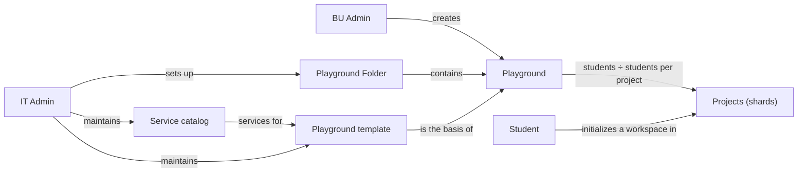
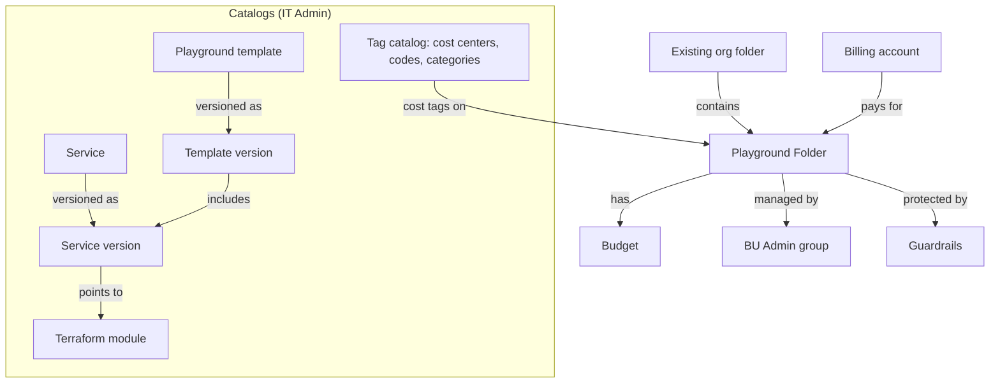
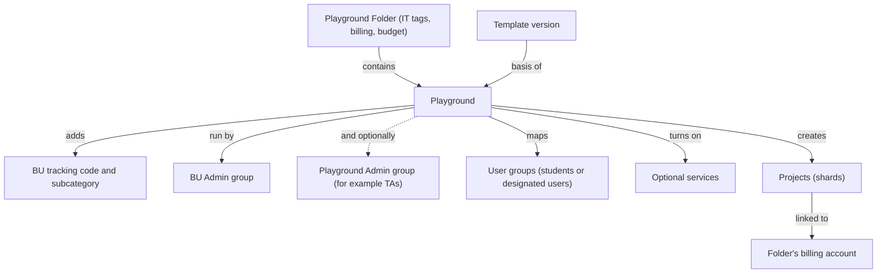
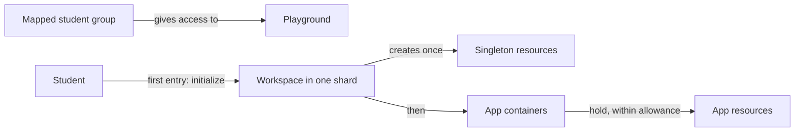

# Learning Sandbox: Business Requirements (Master)

What the platform is for, the concepts it is built on (from the big picture down to each persona), who uses it, and the journeys of each persona. Technical design: [tdd-master.md](../02-tdd/tdd-master.md).

**Persona documents (journeys and the design decisions behind them):**
- **IT Admin:** [brs-it-admin-cuj.md](brs-it-admin-cuj.md)
- **BU Admin:** [brs-bu-admin-cuj.md](brs-bu-admin-cuj.md)
- **Playground Admin:** to be written
- **Student:** to be written (reference: [brs-student-cuj.md](../../specs-reference/01-brs/brs-student-cuj.md))

---

## 1. The business problem

Universities and enterprises run courses, labs and hackathons for hundreds or thousands of students on Google Cloud. Doing this in shared projects under pooled budgets runs into three problems:

1. **Isolation in shared projects:** broad roles let students see, change or delete each other's resources and exhaust shared budgets.
2. **The central IT bottleneck:** central IT owns billing, cost codes and guardrails, while schools and faculty own the courses. If every course needs an IT ticket, setup takes days instead of minutes.
3. **Governed cost tracking:** spend has to be attributed to the right school, cost code and category, without relying on people tagging resources correctly.

The Learning Sandbox is a self-service platform, run from a central **Control Tower**, that lets IT govern once and lets schools and students serve themselves inside those rules.

---

## 2. Conceptual framework

This section builds up in layers: first the big picture, then one level down for each persona.

### 2.1 The big picture

Six ideas carry the whole platform:

1. **IT Admins set up Playground Folders** inside the organization's existing folders. A Playground Folder is a governed space with a billing account, a budget and cost tags.
2. **BU Admins create playgrounds** inside the Playground Folders they've been given, one per course, lab or hackathon.
3. **Every playground is built from a playground template,** chosen from a catalog IT maintains.
4. **A template lists the services** a playground offers (for example Gemini, Cloud Storage, Cloud SQL), drawn from IT's service catalog.
5. **The template also sets how many students share a project.** With the number of students the BU Admin expects, that decides how many projects the playground gets. Each project is a **shard** that holds up to that many students.
6. **Students initialize their own workspace** in one of those shards, then build app containers in it, within allowances.



### 2.2 Why this is flexible

The same few concepts cover very different situations without new platform features:

| Scenario | How it's handled |
|---|---|
| A 20-student seminar and a 1,000-student course | Same template; the seminar gets 1 project, the course 10 (at 100 students per project) |
| A course that grows mid-term | More expected students means more shards; existing shards and students are untouched |
| Courses that need different tools | Different templates, or optional services turned on per playground |
| A research lab that needs more power | A separate, elevated variant of a service in its own template, never a hidden switch on the standard one |
| Schools with their own cost centers or billing accounts | Each school gets its own Playground Folders, with its own cost tags, billing account and budget |
| A school's internal cost split | BU Admins add their own tracking code and subcategory on each playground |
| Rolling out a fixed or improved service | A new service version and template version; existing playgrounds keep theirs until upgraded |
| Different placement needs | A Playground Folder can sit under any existing folder; the organization's own folder structure stays as it is |

### 2.3 IT Admin level: governance and Playground Folders

IT Admins own everything that must stay consistent across schools: the catalogs and the Playground Folders.



**Setting up a Playground Folder.** An IT Admin browses the organization's folders and picks where the Playground Folder goes. Anything granted on that parent folder also applies inside it, so the choice matters. The IT Admin then sets:
- **Billing account:** picked from the accounts the IT Admin can see. It can't be changed later, so every project in the folder is always billed to it.
- **Budget:** a required amount, in the billing account's currency. Alert levels at 50, 75, 90 and 100% apply platform-wide; email notifications are out of scope for now.
- **Cost tags:** a cost center (one per school), one of that cost center's codes, and a cost category, all chosen from IT's tag catalog.
- **BU Admin group:** exactly one existing group, which must already be inside the BU Admins group. Everyone who manages playgrounds in this folder is added to it in the Admin console.
- **Guardrails:** org policies and IAM deny rules applied on the Playground Folder, on top of what the organization already enforces.

**Why tags matter.** Tags are what make cost tracking trustworthy:
- A tag on a folder is **inherited** by everything below it: every playground, project and resource.
- Only the people IT chose can set each tag, and project owners can't remove or change them.
- The platform **copies the tag values onto each project as labels**, so billing reports that work on labels show the same cost center, code and category. Tags are the source of truth; labels are the copy.
- IT's three tags (cost center, code, category) are set only on the Playground Folder. The BU adds its own two (tracking code, subcategory) on each playground.

**The service catalog.** Each service (for example Cloud SQL) is described once and **versioned**. A service version points to the **Terraform module** that builds it, and declares the APIs it enables, the services it needs first, whether it's on by default or optional, its limits (max per project, min per student), its sizes, the groups it needs (for example students), and the **singleton** and **app resources** it gives students (section 2.5). Which roles each group gets is part of the Terraform module. One version is marked current.

**Playground templates.** A template is a ready-made playground shape, also **versioned**. A template version picks service versions (each on by default or optional), sets **students per project**, and lists the groups its services need. Every template is available in every Playground Folder.

**Versioning and retiring.** Every change to a service or template creates a new version; nothing is edited in place, so existing playgrounds never change underneath their users. Anything in use (a service, a template, a tag value) can only be retired, which stops new use but keeps existing uses. Tag values can't be changed; a different value is a new entry.

### 2.4 BU Admin level: playgrounds

BU Admins turn a template into a running playground for a course, inside a Playground Folder IT gave them.



**Who runs a playground.** The Playground Folder's **BU Admin group** always runs it. A BU Admin can also name an optional **Playground Admin group** (for example the course's TAs). Playground Admins have the same rights as BU Admins, but for that one playground only: they own its projects, can manage them in the Cloud console, and can configure the playground through the platform. They have no rights on the Playground Folder or on other playgrounds.

**What a BU Admin sees.** Only the Playground Folders whose BU Admin group they're in, and the playgrounds inside them. A Playground Admin sees only the playgrounds whose Playground Admin group they're in.

**Creating a playground.** In one of those Playground Folders, the BU Admin:
1. **Picks a template.** The playground keeps that template version until it's explicitly upgraded.
2. **Enters the expected number of students.** The platform creates expected students ÷ the template's students per project projects, rounded up (for example 350 students at 100 per project gives 4 projects).
3. **Adds the BU tags:** a tracking code and subcategory, on top of the IT tags it inherits from the folder.
4. **Optionally names a Playground Admin group** (at most one), for example the course's TAs, to run this playground alongside the BU Admins.
5. **Chooses services:** the template's default services are on; optional ones can be turned on. Services a chosen service needs are added automatically.
6. **Maps user groups:** existing groups of the people who will use the playground, students or other designated users (for example `grp-cs101-students@`), are mapped to the groups the template's services need. The platform never creates groups or changes their members.
7. **Sets per-student allowances** for each service, within the limits the template and service allow.

The platform creates the projects, links them to the folder's billing account, copies the tags onto them as labels, and makes the BU Admin group, the IT Admins group and the Playground Admin group owners of every project.

**Adding a service later.** Turning on another service creates a new version of the playground's configuration. The platform then enables that service in **every project** of the playground, and students get its singleton resource the next time they enter. Services are add-only: once on, a service isn't turned off, so no student work is ever lost.

### 2.5 Student level: workspaces and app containers

Students never touch GCP setup directly; they work through the platform inside the playgrounds they're mapped to.



1. **Seeing playgrounds:** a student sees every playground whose mapped groups they're in, and can work in several.
2. **Initializing a workspace:** the first time a student enters a playground, the platform places them in a shard (project) with free capacity and creates their **singleton resources**: exactly one per enabled service that defines one, such as their own service account, bucket and database.
3. **App containers:** once initialized, the student creates **app containers**, one per app or lab (for example `app-lab1`), and adds **app resources** to them, such as a folder in their bucket, a database schema or a Cloud Run service.
4. **Adding and deleting:** students add and delete app containers and app resources themselves, through the platform. Deleting frees allowance for something else.
5. **Caps:** each service gives every student an **allowance**, shared across all their app containers in that playground. Each project also has a max per service, so one shard can't outgrow its budget or quota.
6. **Usage rights only:** in GCP, students can use their own resources but can't change IAM or create and delete resources outside the platform.

### 2.6 Example: the AI playground template

An example of a first template for AI courses (values are illustrative):

| Service | On by default | Project-level setup | Student singleton (one per student) | App resources (in app containers) | Allowance per student |
|---|---|---|---|---|---|
| Service Account | Always | none | Service account `sa-<student>`, used by all their apps | none | 1 |
| Gemini (Vertex AI) | Yes | Vertex AI API | Gemini access for the student's service account | Called by the student's apps | On or off |
| Cloud Storage | Yes | none | Bucket `bkt-<project>-<student>` | Folders `apps/<app>/<folder>/` in their bucket | Unlimited folders |
| Cloud SQL | Optional | One shared instance `sql-<project>` | Logical database `db_<student>` on the shared instance | Schemas `db_<student>.<app>_<schema>` | Set per playground |
| Cloud Run | Yes | Cloud Run API | none (runs as `sa-<student>`) | Services `run-<student>-<app>-<svc>` | Set per playground |
| Vertex AI Search | Yes (needs Cloud Storage) | Discovery Engine API | none | Data stores and apps `search-ds-...`, `search-app-...` | Set per playground |

With 100 students per project, a 350-student playground gets 4 projects. Each student lands in one, gets their service account, Gemini access, bucket and logical database on first entry, and then builds app containers such as `app-lab1` with a bucket folder, a schema, a Cloud Run service and a search data store.

### 2.7 Terms

| Term | Meaning |
|---|---|
| Playground Folder | A platform-created folder where a BU builds playgrounds: IT cost tags, billing account, budget, BU Admin group, guardrails |
| Playground | A platform-created folder inside a Playground Folder, with its projects, for one course, lab or hackathon (earlier drafts: cohort) |
| Project (shard) | One of a playground's projects; holds up to students-per-project students |
| Service, service version | A GCP capability offered to playgrounds, and one immutable definition of it (Terraform module, limits, singleton and app resources) |
| Playground template, template version | A ready-made playground shape, and one immutable definition of it (service versions, students per project, groups needed) |
| Current, retired | Current: the default for new use. Retired: no new use; existing uses keep it |
| Students per project | How many students share one project; set in the template version |
| Expected students | How many students a playground is for; entered by the BU Admin |
| Cost center, cost center code, cost category | IT's three cost tags (`cost-center-bu`, `cost-center-code`, `cost-category`), set on Playground Folders |
| BU tracking code, BU subcategory | The BU's two tags (`bu-tracking-code`, `bu-subcategory`), set on playgrounds |
| Tag, label | Tag: inherited by everything below, the source of truth. Label: the copy on each project for billing reports |
| Billing account, budget | The account a Playground Folder's projects are billed to (fixed), and its spend amount with alert levels |
| Guardrails | Org policies and IAM deny rules on each Playground Folder |
| IT Admins group, BU Admins group | `grp-lsb-it-admins@` and `grp-lsb-bu-admins@` (IT Admins nested in BU Admins) |
| BU Admin group | The one group that manages a Playground Folder's playgrounds; inside the BU Admins group |
| Playground Admin group | An optional group (for example TAs) with the same rights as BU Admins, for one playground only; owner of its projects and can manage them in the Cloud console |
| User groups | Existing groups of the people who use a playground (students or other designated users), mapped to it by a BU Admin |
| Workspace | A student's slice of one playground, in one shard (earlier drafts: student slice) |
| Workspace initialization | The first entry into a playground: shard placement and singleton resources |
| Singleton resource | A resource a student has exactly one of per playground (service account, bucket, logical database) |
| App container, app resource | A named group for one app or lab (`app-<name>`), and the resources inside it |
| Allowance | How many app resources of a service a student may hold, shared across their app containers |
| Config version | An immutable snapshot of a playground's configuration; each change is applied by a job |
| Control Tower | The platform's own project: Self Service APIs, configuration and jobs databases, Terraform state, pipeline |

---

## 3. Personas and groups

```text
IT Admin            members of grp-lsb-it-admins@
  │  Governs the catalogs and Playground Folders. Can do everything a BU Admin can.
  ▼
BU Admin            members of grp-lsb-bu-admins@ (IT Admins nested inside)
  │  Builds playgrounds in the Playground Folders whose BU Admin group they're in.
  ▼
Playground Admin    members of a playground's optional Playground Admin group (for example TAs)
  │  Same rights as a BU Admin, for that one playground: owns its projects (Cloud console) and configures it.
  ▼
Student             members of the groups mapped to a playground
     Initializes a workspace in each playground, then builds app containers in it.
```

1. **Group membership is managed outside the platform,** in the Admin console. The platform only reads it.
2. **One group per container:** a Playground Folder has one BU Admin group; a playground has at most one Playground Admin group.
3. **Plain users** (no admin role, not mapped to a playground) see nothing.

---

## 4. How playgrounds are organized

```text
Organization
└── any existing folder         not managed by the platform
    └── Playground Folder       IT cost tags, billing account, budget, BU Admin group, guardrails
        └── Playground          template version, expected students, BU tags, Playground Admin group, mapped groups
            └── projects        expected students ÷ students per project, rounded up (shards)
                └── workspace   one per student: singleton resources, then app containers
```

1. **Two levels only:** Playground Folder, then playground. No nesting of either.
2. **Projects are created only by the platform.** Projects created by hand in a playground aren't supported.
3. **Owners of every project:** the BU Admin group, the IT Admins group and the Playground Admin group.
4. **The Control Tower** is a separate project; it isn't a playground.

---

## 5. Core business rules

1. **Cost attribution:** IT's three tags on every Playground Folder, the BU's two tags on every playground; projects inherit them as tags and carry them as labels.
2. **One billing account per Playground Folder,** chosen at creation and never changed.
3. **One budget per Playground Folder,** required, in the billing account's currency, with alert levels at 50, 75, 90 and 100%. Notifications are out of scope for now.
4. **Versioned, never edited in place;** retire, don't delete, once in use.
5. **Services are add-only** in a playground.
6. **Students work through the platform,** within allowances shared across their app containers.
7. **No simulate or dry-run mode:** every action acts on real Google Cloud.
8. **Every change records who asked for it.**

---

## 6. Responsibilities by level

| Level | IT Admin | BU Admin | Playground Admin | Student |
|---|---|---|---|---|
| Service catalog, templates, tag catalog | Manage | Read | none | none |
| Playground Folder | Create, update, decommission | Read the folders whose group they're in | none | none |
| Playground | Same as BU Admin | Create, configure, decommission | Configure their own playground | Sees the playgrounds they're mapped to |
| Projects in a playground | Owner | Owner | Owner | Usage rights on their own resources |
| Workspace and app containers | Same as BU Admin | To be specified | Same as BU Admin, in their playground | Initialize, create and delete through the platform |

---

## 7. Journeys per persona

- **IT Admin:** manages the service catalog, playground templates, cost centers and categories, and Playground Folders. [brs-it-admin-cuj.md](brs-it-admin-cuj.md)
- **BU Admin:** creates playgrounds from templates, maps groups, configures services and decommissions playgrounds. [brs-bu-admin-cuj.md](brs-bu-admin-cuj.md)
- **Playground Admin:** runs one playground with the same rights as a BU Admin, for that playground only. To be written.
- **Student:** initializes a workspace in each playground, then creates and deletes app containers and app resources within their allowance. To be written.
