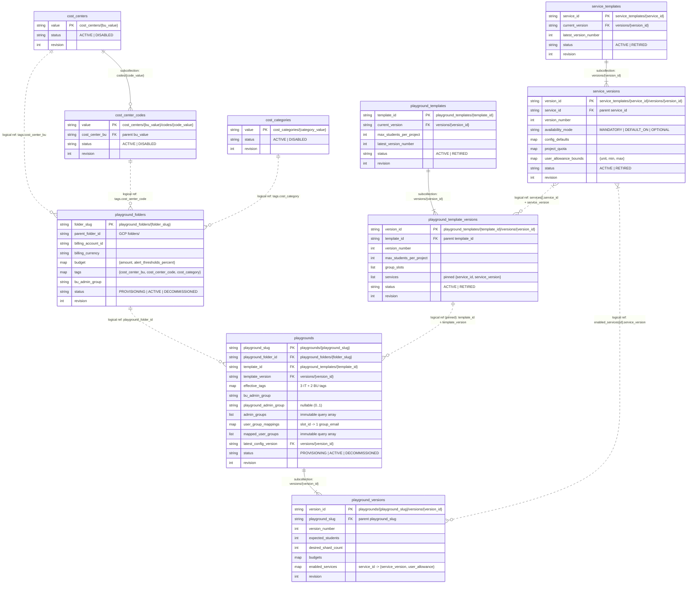

# Crucible (LSB Control Tower) TDD: Configuration Entities — Physical Firestore Model

> Parent: [tdd-data-master.md](tdd-data-master.md) · Business requirements: [brs-master.md](../../01-brs/brs-master.md)

Physical Firestore schema, collection organization, logical NoSQL relationships, document JSON examples, transactional write rules, and retrieval/index specifications for the Configuration Database (`lsb-control-tower-config-db`, environment key `FIRESTORE_CONFIG_DATABASE`).

---

## 1. Database elements and physical NoSQL model

### 1.1 Database elements summary

`lsb-control-tower-config-db` contains **10 physical elements** (6 top-level collections and 4 subcollections).

> **Note on `_health/ping`:** Nothing is stored at `_health/ping` and it is **not** a database element. In `src/api/lsb_api/firestore_check.py` ([tdd-apis-health.md](../tdd-apis/tdd-apis-health.md) section 3), calling `.get()` on a non-existent document path returns an empty snapshot (`exists=False`) without error, which already proves network path, credentials, IAM read permission, and database existence without seeding or maintaining a document.

| # | Element | Physical Firestore path | Kind | Document ID (`PK`) | Lifecycle & mutability | Stores |
|---|---|---|---|---|---|---|
| 1 | **`cost_centers`** | `cost_centers/{bu_value}` | Top-level collection | Literal `cost-center-bu` value (e.g. `computing`) | `ACTIVE -> DISABLED` (status only; never deleted) | School / BU cost center tag catalog (`IT-03`) |
| 2 | **`codes`** | `cost_centers/{bu_value}/codes/{code_value}` | Subcollection of `cost_centers` | Literal `cost-center-code` value (e.g. `cs-teaching`) | `ACTIVE -> DISABLED` (status only; never deleted) | Cost center sub-codes owned by one cost center (`IT-03`) |
| 3 | **`cost_categories`** | `cost_categories/{category_value}` | Top-level collection | Literal `cost-category` value (e.g. `teaching`) | `ACTIVE -> DISABLED` (status only; never deleted) | Shared institution-wide cost category tag catalog (`IT-04`) |
| 4 | **`service_templates`** | `service_templates/{service_id}` | Top-level collection | Service slug (e.g. `cloud-sql`) | `ACTIVE -> RETIRED` (header pointers mutable; never deleted) | Single-GCP-service catalog header & `current_version` pointer (`IT-01`) |
| 5 | **`service_templates/versions`** | `service_templates/{service_id}/versions/{version_id}` | Subcollection of `service_templates` | Version ID (`v1`, `v2`, ...) | Payload immutable; `status` `ACTIVE -> RETIRED` | Versioned Terraform module ref, APIs, prerequisites, `config_defaults`, shard `project_quota`, and finite `min..max` user bounds (`IT-01`) |
| 6 | **`playground_templates`** | `playground_templates/{template_id}` | Top-level collection | Template slug (e.g. `ai-course-standard`) | `ACTIVE -> RETIRED` (header pointers mutable; never deleted) | Playground blueprint header & `current_version` pointer (`IT-02`) |
| 7 | **`playground_templates/versions`** | `playground_templates/{template_id}/versions/{version_id}` | Subcollection of `playground_templates` | Version ID (`v1`, `v2`, ...) | Payload immutable; `status` `ACTIVE -> RETIRED` | Pinned `ServiceVersion` list, bounded mode/allowance tuning, `max_students_per_project`, and `group_slots` (`IT-02`) |
| 8 | **`playground_folders`** | `playground_folders/{folder_slug}` | Top-level collection | Folder slug (e.g. `cs-2026`) | `PROVISIONING -> ACTIVE <-> DECOMMISSIONED` (`display_name` & `budget.amount` mutable) | Governed folder container: immutable parent, billing account, IT tags, and `bu_admin_group`, plus folder budget (`IT-05`..`IT-10`) |
| 9 | **`playgrounds`** | `playgrounds/{playground_slug}` | Top-level collection | Playground slug (e.g. `cs100-2026`) | `PROVISIONING -> ACTIVE <-> DECOMMISSIONED` (`display_name`, capacity & version pointer mutable) | Playground header, permanently pinned template version, immutable BU tags, admin groups & mapped user groups, and query arrays (`BU-01`..`BU-09`) |
| 10 | **`playgrounds/versions`** | `playgrounds/{playground_slug}/versions/{version_id}` | Subcollection of `playgrounds` | Version ID (`v1`, `v2`, ...) | Strictly write-once (`revision = 1`) | Desired-state snapshot (`v1..vN`) driving `seeds/vN.tfvars.json`: name, capacity, budgets, and add-only `enabled_services` (`BU-01`..`BU-04`) |

---

### 1.2 Physical model and logical relationships (NoSQL)

Because Firestore is a document database without foreign-key constraints, relationships take two forms in the diagram below:
- **Solid lines (`--`) — Physical subcollection containment:** The child collection lives physically inside the parent document's path.
- **Dashed lines (`..`) — Logical ID references:** Stored string/composite ID fields validated and enforced by the Self Service API before write.



### 1.3 Collection hierarchy, ID formats, and common revision fields

```text
lsb-control-tower-config-db
├── cost_centers/{bu_value}
│   └── codes/{code_value}
├── cost_categories/{category_value}
├── service_templates/{service_id}
│   └── versions/{version_id}
├── playground_templates/{template_id}
│   └── versions/{version_id}
├── playground_folders/{folder_slug}
└── playgrounds/{playground_slug}
    └── versions/{version_id}
```

1. **No phantom parent documents:** Every intermediate path (`cost_centers/{bu_value}`, `service_templates/{service_id}`, `playground_templates/{template_id}`, `playgrounds/{playground_slug}`) is a real Firestore document.
2. **Top-level `playgrounds/{playground_slug}`:** Kept at root rather than nested inside `playground_folders` because `playground_slug` is globally unique across CLI commands, REST URLs, GCS state paths, and project IDs, enabling $O(1)$ point lookups by slug and single-collection queries across folders for `admin_groups` and `mapped_user_groups`.
3. **Naming & ID patterns:** All collection and field names use `snake_case`; enum values use `UPPERCASE`; timestamps are UTC (`RFC 3339` in JSON).
   - Tag values (`bu_value`, `code_value`, `category_value`): `^[a-z]([a-z0-9-]{0,61}[a-z0-9])?$`
   - Slugs (`service_id`, `template_id`, `folder_slug`, `playground_slug`): `^[a-z][a-z0-9-]{1,38}[a-z0-9]$`
   - Version IDs (`version_id`): `^v[1-9][0-9]*$` paired with integer `version_number` (`1, 2, ...`)
4. **Standard revision and audit block (every document):**

| Field | Type | Description |
|---|---|---|
| `revision` | integer (`>= 1`) | Starts at `1` on creation; incremented by `+1` on each update inside a Firestore transaction (`409` on mismatch; stays `1` on write-once `playgrounds/.../versions/{vN}`) |
| `created_at` | timestamp | UTC timestamp when the document was created (immutable) |
| `updated_at` | timestamp | UTC timestamp of the latest write (`== created_at` at `revision = 1`) |
| `updated_by` | string (email) | Lowercase email of the caller who created (`revision = 1`) or last updated the document |

---

## 2. Physical entity schemas and example JSONs

### 2.1 Tag Governance Catalog (`cost_centers`, `codes`, `cost_categories`)

Each entry is **WYSIWYG** (the literal tag value is both the document ID and `value` field, with no separate display title or description) and follows a strict `ACTIVE -> DISABLED` lifecycle (`IT-03`, `IT-04`).

| Path | Field | Type | Mutability | Description |
|---|---|---|---|---|
| `cost_centers/{bu_value}` | `value` | string | Immutable | Literal `cost-center-bu` tag value (`== bu_value`) |
| | `status` | enum | `ACTIVE -> DISABLED` | `ACTIVE` or `DISABLED` |
| | `revision`, `created_at`, `updated_at`, `updated_by` | common | Mutable on disable | Standard revision block |
| `cost_centers/{bu_value}/codes/{code_value}` | `value` | string | Immutable | Literal `cost-center-code` tag value (`== code_value`) |
| | `cost_center_bu` | string | Immutable | Denormalized parent `bu_value` for self-contained reads |
| | `status` | enum | `ACTIVE -> DISABLED` | `ACTIVE` or `DISABLED` |
| | `revision`, `created_at`, `updated_at`, `updated_by` | common | Mutable on disable | Standard revision block |
| `cost_categories/{category_value}` | `value` | string | Immutable | Literal `cost-category` tag value (`== category_value`) |
| | `status` | enum | `ACTIVE -> DISABLED` | `ACTIVE` or `DISABLED` |
| | `revision`, `created_at`, `updated_at`, `updated_by` | common | Mutable on disable | Standard revision block |

**Example — `cost_centers/computing`:**
```json
{
  "value": "computing",
  "status": "ACTIVE",
  "revision": 1,
  "created_at": "2026-11-09T08:00:00Z",
  "updated_at": "2026-11-09T08:00:00Z",
  "updated_by": "lsb-it-admin1@shankyram.altostrat.com"
}
```

**Example — `cost_centers/computing/codes/cs-teaching`:**
```json
{
  "value": "cs-teaching",
  "cost_center_bu": "computing",
  "status": "ACTIVE",
  "revision": 1,
  "created_at": "2026-11-09T08:01:00Z",
  "updated_at": "2026-11-09T08:01:00Z",
  "updated_by": "lsb-it-admin1@shankyram.altostrat.com"
}
```

**Example — `cost_categories/teaching`:**
```json
{
  "value": "teaching",
  "status": "ACTIVE",
  "revision": 1,
  "created_at": "2026-11-09T08:02:00Z",
  "updated_at": "2026-11-09T08:02:00Z",
  "updated_by": "lsb-it-admin1@shankyram.altostrat.com"
}
```

---

### 2.2 Service Catalog (`service_templates` and `versions`)

Maps 1:1 to a single GCP service capability (`IT-01`). **Only `MANDATORY` services may define `singleton_resources`**; optional services (`DEFAULT_ON` / `OPTIONAL`) provide `app_resources` only. Never hard-deleted (`ACTIVE -> RETIRED`).

#### Header: `service_templates/{service_id}`

| Field | Type | Mutability | Description |
|---|---|---|---|
| `service_id` | string | Immutable | Document ID (for example `service-account`, `cloud-sql`, `cloud-run`) |
| `display_name` | string | Mutable (mirrored from `current_version`) | Human-readable name for catalog listings |
| `current_version` | string | Mutable (`ACTIVE` version ID) | Default `version_id` used when composing new playground templates |
| `latest_version_number` | integer | Monotonic (`+1`) | Highest `version_number` allocated under `versions/` |
| `status` | enum | `ACTIVE -> RETIRED` | `RETIRED` blocks adding this service to new playground templates |
| `revision`, `created_at`, `updated_at`, `updated_by` | common | Mutable | Standard revision block |

#### Version snapshot: `service_templates/{service_id}/versions/{version_id}`

| Field | Type | Description |
|---|---|---|
| `service_id` | string | Parent `service_id` |
| `version_id` | string | `"v1"`, `"v2"`, ... |
| `version_number` | integer | `1`, `2`, ... (used for `ORDER BY version_number DESC`) |
| `status` | enum | `ACTIVE` or `RETIRED` (only field allowed to change via retirement; payload fields are immutable) |
| `display_name` | string | Human-readable service title |
| `description` | string | What this service version provisions and how users consume it |
| `availability_mode` | enum | `MANDATORY`, `DEFAULT_ON` (enabled by default & optional), or `OPTIONAL` (disabled by default & optional) |
| `terraform_module` | `{source_path, git_ref}` | Repo module path and pinned Git commit SHA or release tag |
| `required_apis` | `string[]` | GCP service APIs enabled per shard project (for example `["sqladmin.googleapis.com"]`) |
| `prerequisite_services` | `string[]` | `service_id`s that must be enabled before this service (DAG) |
| `group_slots` | `string[]` | User group slot keys expected by the Terraform module (for example `["students"]`) |
| `config_defaults` | `map<string, any>` | Fixed service sizes and settings passed to Terraform (not overridable by templates or playgrounds) |
| `project_quota` | `map<string, integer>` | Maximum capacity ceilings per project shard |
| `singleton_resources` | `list<{kind, naming_pattern, min, max, description}>` | User singleton resources (`min: 1, max: 1`), **permitted only when `availability_mode == "MANDATORY"`** (`[]` otherwise) |
| `app_resources` | `list<{kind, naming_pattern, description}>` | Resources users create/delete inside app containers (`[]` when singleton-only) |
| `user_allowance_bounds` | `{unit, min, max}` | Finite integer per-user app-resource allowance bounds (`min` = floor and default, `max` = finite ceiling; `{ "unit": "none", "min": 0, "max": 0 }` when `app_resources` is empty) |
| `change_summary` | string | Why this version was created |
| `revision`, `created_at`, `updated_at`, `updated_by` | common | Standard revision block (`revision = 1` on create; `+1` only if retired) |

**Example — `service_templates/cloud-sql` (header) and `service_templates/cloud-sql/versions/v1`:**
```json
{
  "service_id": "cloud-sql",
  "display_name": "Cloud SQL for PostgreSQL",
  "current_version": "v1",
  "latest_version_number": 1,
  "status": "ACTIVE",
  "revision": 1,
  "created_at": "2026-11-09T08:10:00Z",
  "updated_at": "2026-11-09T08:10:00Z",
  "updated_by": "lsb-it-admin1@shankyram.altostrat.com"
}
```

```json
{
  "service_id": "cloud-sql",
  "version_id": "v1",
  "version_number": 1,
  "status": "ACTIVE",
  "display_name": "Cloud SQL for PostgreSQL",
  "description": "Shared Enterprise Plus PostgreSQL 16 instance per project shard with built-in Managed Connection Pooling, one logical database per user, and per-app schemas.",
  "availability_mode": "MANDATORY",
  "terraform_module": {
    "source_path": "src/terraform/playground-services/cloud-sql",
    "git_ref": "refs/tags/svc-cloud-sql-v1.0.0"
  },
  "required_apis": [
    "sqladmin.googleapis.com"
  ],
  "prerequisite_services": [
    "service-account"
  ],
  "group_slots": [
    "students"
  ],
  "config_defaults": {
    "edition": "ENTERPRISE_PLUS",
    "database_version": "POSTGRES_16",
    "tier": "db-perf-optimized-N-8",
    "availability_type": "ZONAL",
    "enable_connection_pooling": true,
    "data_cache_enabled": false,
    "storage_type": "PD_SSD",
    "disk_size_gb": 20,
    "disk_autoresize": true,
    "disk_autoresize_limit_gb": 150,
    "public_ip_enabled": false
  },
  "project_quota": {
    "shared_sql_instances": 1,
    "max_logical_databases": 80,
    "max_total_schemas": 800
  },
  "singleton_resources": [
    {
      "kind": "CLOUD_SQL_LOGICAL_DB",
      "naming_pattern": "db_<user_slug>",
      "min": 1,
      "max": 1,
      "description": "One logical PostgreSQL database per user on singleton instance sql-<project_id>"
    }
  ],
  "app_resources": [
    {
      "kind": "CLOUD_SQL_SCHEMA",
      "naming_pattern": "db_<user_slug>.<app_slug>_<resource_slug>",
      "description": "Isolated PostgreSQL schema inside the user's logical database"
    }
  ],
  "user_allowance_bounds": {
    "unit": "postgres_schemas",
    "min": 5,
    "max": 10
  },
  "change_summary": "Enterprise Plus db-perf-optimized-N-8 (8 vCPU / 64 GB) singleton with built-in connection pooling",
  "revision": 1,
  "created_at": "2026-11-09T08:10:00Z",
  "updated_at": "2026-11-09T08:10:00Z",
  "updated_by": "lsb-it-admin1@shankyram.altostrat.com"
}
```

**Example — `service_templates/cloud-run/versions/v1` (optional app-resource service):**
```json
{
  "service_id": "cloud-run",
  "version_id": "v1",
  "version_number": 1,
  "status": "ACTIVE",
  "display_name": "Cloud Run App Services",
  "description": "Gen2 request-billed 2 vCPU / 2 GiB Cloud Run services running as the user's singleton service account.",
  "availability_mode": "DEFAULT_ON",
  "terraform_module": {
    "source_path": "src/terraform/playground-services/cloud-run",
    "git_ref": "refs/tags/svc-cloud-run-v1.0.0"
  },
  "required_apis": [
    "run.googleapis.com",
    "artifactregistry.googleapis.com",
    "cloudbuild.googleapis.com"
  ],
  "prerequisite_services": [
    "service-account"
  ],
  "group_slots": [
    "students"
  ],
  "config_defaults": {
    "cpu": "2000m",
    "memory": "2Gi",
    "min_instance_count": 0,
    "max_instance_count": 2,
    "concurrency": 40,
    "cpu_idle": true,
    "startup_cpu_boost": true,
    "execution_environment": "GEN2",
    "timeout_seconds": 300
  },
  "project_quota": {
    "max_services": 600
  },
  "singleton_resources": [],
  "app_resources": [
    {
      "kind": "CLOUD_RUN_SERVICE",
      "naming_pattern": "run-<user_slug>-<app_slug>-<resource_slug>",
      "description": "Containerized web/API service running as sa-<user_slug>"
    }
  ],
  "user_allowance_bounds": {
    "unit": "cloud_run_services",
    "min": 5,
    "max": 10
  },
  "change_summary": "Initial 2 vCPU / 2 GiB scale-to-zero Cloud Run app service definition (project cap 600)",
  "revision": 1,
  "created_at": "2026-11-09T08:12:00Z",
  "updated_at": "2026-11-09T08:12:00Z",
  "updated_by": "lsb-it-admin1@shankyram.altostrat.com"
}
```

**AI catalog baseline across all six services (`max_students_per_project = 80`, [brs-master.md](../../01-brs/brs-master.md) section 2.6):**

| `service_id` | `availability_mode` | `prerequisite_services` | `project_quota` | User Singleton (`min..max`) | App Resource `user_allowance_bounds` (`min..max`) | `config_defaults` highlights |
|---|---|---|---|---|---|---|
| `service-account` | `MANDATORY` | `[]` | `max_service_accounts: 80` *(GCP cap: 100)* | `sa-<user>` (`1..1`) | `none` (`0..0`) | `{}` |
| `gemini` | `MANDATORY` | `["service-account"]` | `max_users: 80` *(PayGo DSQ)* | Gemini access on `sa-<user>` (`1..1`) | `none` (`0..0`) | `{}` *(no model restrictions)* |
| `cloud-storage` | `MANDATORY` | `["service-account"]` | `max_buckets: 80`, `max_managed_folders: 1600` | Bucket `bkt-<project>-<user>` (`1..1`) | `gcs_managed_folders`: **`5 .. 20`** | `STANDARD`, Uniform Bucket-Level Access `true` |
| `cloud-sql` | `MANDATORY` | `["service-account"]` | `shared_sql_instances: 1`, `max_logical_databases: 80`, `max_total_schemas: 800` | Logical DB `db_<user>` (`1..1`) | `postgres_schemas`: **`5 .. 10`** | `ENTERPRISE_PLUS`, `db-perf-optimized-N-8` (`8 vCPU / 64 GB`), `ZONAL`, MCP `true`, `PD_SSD` `20..150 GB` |
| `cloud-run` | `DEFAULT_ON` | `["service-account"]` | `max_services: 600` *(GCP hard cap: 1,000)* | none | `cloud_run_services`: **`5 .. 10`** | `2000m` (`2 vCPU`), `2Gi` RAM, `min_instances: 0`, `max_instances: 2`, `concurrency: 40`, `GEN2` |
| `vertex-ai-search` | `DEFAULT_ON` | `["service-account", "cloud-storage"]` | `max_data_stores: 100`, `max_engines: 150` *(GCP project caps)* | none | `search_apps`: **`1 .. 2`** | `GENERIC` vertical, `SOLUTION_TYPE_SEARCH` |

---

### 2.3 Playground Templates (`playground_templates` and `versions`)

Composes pinned `ServiceVersion` entries and sets `max_students_per_project` (`IT-02`, capped at `80` for AI templates). Creating a new playground always uses `current_version` and stays permanently pinned to it; never hard-deleted (`ACTIVE -> RETIRED`).

#### Header: `playground_templates/{template_id}`

| Field | Type | Mutability | Description |
|---|---|---|---|
| `template_id` | string | Immutable | Document ID (for example `ai-course-standard`) |
| `display_name` | string | Mutable (mirrored from `current_version`) | Human-readable template name |
| `description` | string | Mutable (mirrored from `current_version`) | Summary shown in template pickers |
| `current_version` | string | Mutable (`ACTIVE` version ID) | **Only** version used when creating new playgrounds |
| `max_students_per_project` | integer | Mirrored from `current_version` | Shard capacity ceiling on `current_version` (`<= 80`) |
| `latest_version_number` | integer | Monotonic (`+1`) | Highest `version_number` allocated under `versions/` |
| `status` | enum | `ACTIVE -> RETIRED` | `RETIRED` hides template from new playground creation |
| `revision`, `created_at`, `updated_at`, `updated_by` | common | Mutable | Standard revision block |

#### Version snapshot: `playground_templates/{template_id}/versions/{version_id}`

| Field | Type | Description |
|---|---|---|
| `template_id` | string | Parent `template_id` |
| `version_id` | string | `"v1"`, `"v2"`, ... |
| `version_number` | integer | `1`, `2`, ... |
| `status` | enum | `ACTIVE` or `RETIRED` (payload fields are immutable) |
| `display_name`, `description` | string | Snapshot title and description |
| `max_students_per_project` | integer (`1..80`) | Maximum student workspaces per project shard (`80`) |
| `group_slots` | `string[]` | Sorted union of `group_slots` across all included `ServiceVersion`s (for example `["students"]`) |
| `services` | `list<TemplateServiceEntry>` | Ordered list of pinned services (topologically sorted by `prerequisite_services`) |
| `services[].service_id` | string | Catalog `service_id` |
| `services[].service_version` | string | Pinned `ServiceVersion` (`"v1"`, `"v2"`, ...) |
| `services[].effective_availability_mode` | enum | Inherited from `ServiceVersion`, or **promoted** (`OPTIONAL -> DEFAULT_ON \| MANDATORY`, `DEFAULT_ON -> MANDATORY`) |
| `services[].effective_user_allowance_bounds` | `{unit, min, max}` | Inherited from `ServiceVersion`, or **narrowed** (`min >= service.min` and `max <= service.max`) |
| `change_summary` | string | Why this template version was created |
| `revision`, `created_at`, `updated_at`, `updated_by` | common | Standard revision block (`revision = 1` on create; `+1` only if retired) |

**Example — `playground_templates/ai-course-standard` (header) and `playground_templates/ai-course-standard/versions/v1`:**
```json
{
  "template_id": "ai-course-standard",
  "display_name": "Standard AI & App Engineering Course",
  "description": "Shared-shard AI playground (80 students/shard) with mandatory SA, Gemini, Cloud Storage, and Cloud SQL, plus optional Cloud Run and Vertex AI Search.",
  "current_version": "v1",
  "max_students_per_project": 80,
  "latest_version_number": 1,
  "status": "ACTIVE",
  "revision": 1,
  "created_at": "2026-11-09T08:30:00Z",
  "updated_at": "2026-11-09T08:30:00Z",
  "updated_by": "lsb-it-admin1@shankyram.altostrat.com"
}
```

```json
{
  "template_id": "ai-course-standard",
  "version_id": "v1",
  "version_number": 1,
  "status": "ACTIVE",
  "display_name": "Standard AI & App Engineering Course",
  "description": "Shared-shard AI playground (80 students/shard) with mandatory SA, Gemini, Cloud Storage, and Cloud SQL, plus optional Cloud Run and Vertex AI Search.",
  "max_students_per_project": 80,
  "group_slots": [
    "students"
  ],
  "services": [
    {
      "service_id": "service-account",
      "service_version": "v1",
      "effective_availability_mode": "MANDATORY",
      "effective_user_allowance_bounds": {
        "unit": "none",
        "min": 0,
        "max": 0
      }
    },
    {
      "service_id": "gemini",
      "service_version": "v1",
      "effective_availability_mode": "MANDATORY",
      "effective_user_allowance_bounds": {
        "unit": "none",
        "min": 0,
        "max": 0
      }
    },
    {
      "service_id": "cloud-storage",
      "service_version": "v1",
      "effective_availability_mode": "MANDATORY",
      "effective_user_allowance_bounds": {
        "unit": "gcs_managed_folders",
        "min": 5,
        "max": 20
      }
    },
    {
      "service_id": "cloud-sql",
      "service_version": "v1",
      "effective_availability_mode": "MANDATORY",
      "effective_user_allowance_bounds": {
        "unit": "postgres_schemas",
        "min": 5,
        "max": 10
      }
    },
    {
      "service_id": "cloud-run",
      "service_version": "v1",
      "effective_availability_mode": "DEFAULT_ON",
      "effective_user_allowance_bounds": {
        "unit": "cloud_run_services",
        "min": 5,
        "max": 10
      }
    },
    {
      "service_id": "vertex-ai-search",
      "service_version": "v1",
      "effective_availability_mode": "DEFAULT_ON",
      "effective_user_allowance_bounds": {
        "unit": "search_apps",
        "min": 1,
        "max": 2
      }
    }
  ],
  "change_summary": "Initial AI course template at 80 students/project with mandatory SA/Gemini/GCS/SQL singletons and optional Cloud Run + Vertex AI Search",
  "revision": 1,
  "created_at": "2026-11-09T08:30:00Z",
  "updated_at": "2026-11-09T08:30:00Z",
  "updated_by": "lsb-it-admin1@shankyram.altostrat.com"
}
```

---

### 2.4 Playground Folders (`playground_folders`)

Single document per Playground Folder (`IT-05`..`IT-10`). GCP-assigned folder IDs and budget resource names live in `lsb-control-tower-db` (`runtime/playground_folders/{folder_slug}`).

| Field | Type | Mutability | Description |
|---|---|---|---|
| `folder_slug` | string | Immutable | Document ID (for example `cs-2026`) |
| `display_name` | string | **Mutable (`IT-06`)** | GCP folder display name (tracked job) |
| `parent_folder_id` | string | **Immutable** | Existing GCP org folder resource name (`folders/<number>`) |
| `billing_account_id` | string | **Immutable** | Billing account ID (`01951D-A71E6A-80664C`) |
| `billing_currency` | string | **Immutable** | ISO 4217 currency code read from billing account at creation (`USD`, `SGD`) |
| `budget` | `{amount, alert_thresholds_percent}` | **`amount` mutable (`IT-06`)** | `amount` is integer whole currency units `> 0` (tracked job); `alert_thresholds_percent` is `[50, 75, 90, 100]` |
| `tags` | `{cost_center_bu, cost_center_code, cost_category}` | **Immutable** | Validated against `ACTIVE` entries in `cost_centers` / `codes` / `cost_categories` at creation |
| `bu_admin_group` | string | **Immutable** | Strictly 1 Google group email (must be transitive member of `grp-lsb-bu-admins@`) |
| `status` | enum | `PROVISIONING -> ACTIVE <-> DECOMMISSIONED` | Reversible via `IT-07` / `IT-10` (never deleted; budgets stay in place) |
| `last_job_id` | string | Mutable | `job_id` of the latest tracked job that created or updated this folder |
| `revision`, `created_at`, `updated_at`, `updated_by` | common | Mutable | Standard revision block |

**Example — `playground_folders/cs-2026`:**
```json
{
  "folder_slug": "cs-2026",
  "display_name": "School of Computing Sandboxes 2026",
  "parent_folder_id": "folders/600433119916",
  "billing_account_id": "01951D-A71E6A-80664C",
  "billing_currency": "USD",
  "budget": {
    "amount": 50000,
    "alert_thresholds_percent": [50, 75, 90, 100]
  },
  "tags": {
    "cost_center_bu": "computing",
    "cost_center_code": "cs-teaching",
    "cost_category": "teaching"
  },
  "bu_admin_group": "grp-lsb-cs-bu-admins@shankyram.altostrat.com",
  "status": "ACTIVE",
  "last_job_id": "job-20261109-4b19e802",
  "revision": 1,
  "created_at": "2026-11-09T09:00:00Z",
  "updated_at": "2026-11-09T09:00:00Z",
  "updated_by": "lsb-it-admin1@shankyram.altostrat.com"
}
```

---

### 2.5 Playgrounds and Config Versions (`playgrounds` and `versions`)

Splits immutable container anchors and query arrays on `playgrounds/{playground_slug}` from write-once desired-state snapshots in `playgrounds/{playground_slug}/versions/{version_id}` (`BU-01`..`BU-09`).

#### Header: `playgrounds/{playground_slug}`

| Field | Type | Mutability | Description |
|---|---|---|---|
| `playground_slug` | string | Immutable | Document ID (for example `cs100-2026`) |
| `playground_folder_id` | string | **Immutable** | Parent `playground_folders/{folder_slug}` ID |
| `display_name` | string | **Mutable (`BU-02`, `vN`)** | Course or lab display name |
| `template_id`, `template_version` | string | **Immutable** | Permanently pinned `PlaygroundTemplateVersion` (`current_version` at creation; never upgraded) |
| `max_students_per_project` | integer | **Immutable** | Copied from the pinned `PlaygroundTemplateVersion` (`80`) |
| `billing_account_id`, `billing_currency` | string | **Immutable** (copied from parent folder) | Denormalized so budget validation needs no extra read |
| `effective_tags` | `{cost_center_bu, cost_center_code, cost_category, bu_tracking_code, bu_subcategory}` | **Immutable** | 3 inherited IT folder tags + 2 un-cataloged BU playground tags; copied once onto every shard project as billing labels |
| `bu_admin_group` | string | **Immutable** (copied from parent folder) | Folder's BU Admin group |
| `playground_admin_group` | `string \| null` | **Immutable** | Optional Playground Admin group (`0..1`, such as course TAs); `null` if unset |
| `admin_groups` | `string[]` | **Immutable** | `[bu_admin_group]` or `[bu_admin_group, playground_admin_group]` — powers single-query admin listing |
| `user_group_mappings` | `map<slot_id, group_email>` | **Immutable** | **Strictly 1** existing Google group email per required template `group_slot`, fixed at creation |
| `mapped_user_groups` | `string[]` | **Immutable** | Distinct Google group emails from `user_group_mappings` — powers single-query student/user listing |
| `latest_config_version` | string | Monotonic (`"v1" -> "vN"`) | Latest desired config version ID (compare with `applied_config_version` in runtime DB) |
| `latest_version_number` | integer | Monotonic (`+1`) | Integer counter matching `latest_config_version` |
| `expected_students`, `desired_shard_count` | integer | **Grow-only (`BU-04`, `vN`)** | Mirrored from `latest_config_version` for list views |
| `status` | enum | `PROVISIONING -> ACTIVE <-> DECOMMISSIONED` | Reversible via `BU-08` / `BU-09` and `IT-07` / `IT-10` (never deleted) |
| `last_job_id` | string | Mutable | `job_id` of the latest playground-level tracked job |
| `revision`, `created_at`, `updated_at`, `updated_by` | common | Mutable | Standard revision block |

#### Version snapshot: `playgrounds/{playground_slug}/versions/{version_id}` (write-once)

| Field | Type | Description |
|---|---|---|
| `playground_slug` | string | Parent `playground_slug` |
| `version_id`, `version_number` | string, integer | `"v1"` / `1`, `"v2"` / `2`, ... |
| `previous_version_id` | `string \| null` | `"v1"` on `v2`, `null` on `v1` |
| `mutation_kind` | enum | `CREATE` (`v1`), `UPDATE_METADATA_OR_BUDGETS` (`BU-02`), `CONFIGURE_SERVICES` (`BU-03`), or `EXPAND_CAPACITY` (`BU-04`) |
| `display_name` | string | Playground display name at this version |
| `template_id`, `template_version` | string | Permanently pinned `PlaygroundTemplateVersion` |
| `max_students_per_project` | integer | Shard ceiling (`80`) |
| `expected_students` | integer | Grow-only student count ($\ge$ `previous_version.expected_students`) |
| `desired_shard_count` | integer | `ceil(expected_students / max_students_per_project)` — generates shard codes `p01..pNN` |
| `budgets` | `{currency_code, playground_budget_amount, default_shard_budget_amount, shard_budget_overrides, alert_thresholds_percent}` | `playground_budget_amount > 0` (required); `default_shard_budget_amount` (`integer \| null`, $\le$ playground budget, inherited by new shards); `shard_budget_overrides` (`map<shard_code, integer>`, each $\le$ playground budget) |
| `user_group_mappings` | `map<slot_id, group_email>` | Immutable 1-to-1 slot-to-group map repeated in the snapshot so `vN.tfvars.json` assembly is self-contained |
| `enabled_services` | `map<service_id, EnabledServiceConfig>` | Monotonically **add-only** map across `v1..vN` |
| `enabled_services[id].service_version` | string | Pinned `ServiceVersion` from the playground's `PlaygroundTemplateVersion` |
| `enabled_services[id].origin` | enum | `TEMPLATE_MANDATORY`, `TEMPLATE_DEFAULT`, or `USER_ENABLED` |
| `enabled_services[id].user_allowance` | `{unit, value}` | Finite integer per-user app-resource allowance within `effective_user_allowance_bounds` (`0` when `unit == "none"`) |
| `change_summary` | string | Human-readable summary of what changed in `vN` |
| `revision`, `created_at`, `updated_at`, `updated_by` | common | Write-once (`revision = 1`, `updated_at == created_at`, `updated_by` = requester email) |

**Example — `playgrounds/cs100-2026` (header) and `playgrounds/cs100-2026/versions/v2` (`280` students $\div$ `80` = `4` shards):**
```json
{
  "playground_slug": "cs100-2026",
  "playground_folder_id": "cs-2026",
  "display_name": "CS 100 Intro to AI Engineering (Sem 1)",
  "template_id": "ai-course-standard",
  "template_version": "v1",
  "max_students_per_project": 80,
  "billing_account_id": "01951D-A71E6A-80664C",
  "billing_currency": "USD",
  "effective_tags": {
    "cost_center_bu": "computing",
    "cost_center_code": "cs-teaching",
    "cost_category": "teaching",
    "bu_tracking_code": "cs100-ay26-s1",
    "bu_subcategory": "ug-core"
  },
  "bu_admin_group": "grp-lsb-cs-bu-admins@shankyram.altostrat.com",
  "playground_admin_group": "grp-cs100-tas@shankyram.altostrat.com",
  "admin_groups": [
    "grp-lsb-cs-bu-admins@shankyram.altostrat.com",
    "grp-cs100-tas@shankyram.altostrat.com"
  ],
  "user_group_mappings": {
    "students": "grp-cs100-students@shankyram.altostrat.com"
  },
  "mapped_user_groups": [
    "grp-cs100-students@shankyram.altostrat.com"
  ],
  "latest_config_version": "v2",
  "latest_version_number": 2,
  "expected_students": 280,
  "desired_shard_count": 4,
  "status": "ACTIVE",
  "last_job_id": "job-20261109-9d04a118",
  "revision": 2,
  "created_at": "2026-11-09T09:15:00Z",
  "updated_at": "2026-11-09T09:40:00Z",
  "updated_by": "lsb-bu-cs1@shankyram.altostrat.com"
}
```

```json
{
  "playground_slug": "cs100-2026",
  "version_id": "v2",
  "version_number": 2,
  "previous_version_id": "v1",
  "mutation_kind": "CONFIGURE_SERVICES",
  "display_name": "CS 100 Intro to AI Engineering (Sem 1)",
  "template_id": "ai-course-standard",
  "template_version": "v1",
  "max_students_per_project": 80,
  "expected_students": 280,
  "desired_shard_count": 4,
  "budgets": {
    "currency_code": "USD",
    "playground_budget_amount": 12000,
    "default_shard_budget_amount": 3000,
    "shard_budget_overrides": {
      "p01": 3500
    },
    "alert_thresholds_percent": [50, 75, 90, 100]
  },
  "user_group_mappings": {
    "students": "grp-cs100-students@shankyram.altostrat.com"
  },
  "enabled_services": {
    "service-account": {
      "service_version": "v1",
      "origin": "TEMPLATE_MANDATORY",
      "user_allowance": {
        "unit": "none",
        "value": 0
      }
    },
    "gemini": {
      "service_version": "v1",
      "origin": "TEMPLATE_MANDATORY",
      "user_allowance": {
        "unit": "none",
        "value": 0
      }
    },
    "cloud-storage": {
      "service_version": "v1",
      "origin": "TEMPLATE_MANDATORY",
      "user_allowance": {
        "unit": "gcs_managed_folders",
        "value": 10
      }
    },
    "cloud-sql": {
      "service_version": "v1",
      "origin": "TEMPLATE_MANDATORY",
      "user_allowance": {
        "unit": "postgres_schemas",
        "value": 5
      }
    },
    "cloud-run": {
      "service_version": "v1",
      "origin": "TEMPLATE_DEFAULT",
      "user_allowance": {
        "unit": "cloud_run_services",
        "value": 6
      }
    },
    "vertex-ai-search": {
      "service_version": "v1",
      "origin": "USER_ENABLED",
      "user_allowance": {
        "unit": "search_apps",
        "value": 1
      }
    }
  },
  "change_summary": "Enabled Vertex AI Search (1 app/user) and raised Cloud Storage folders to 10 and Cloud Run services to 6",
  "revision": 1,
  "created_at": "2026-11-09T09:40:00Z",
  "updated_at": "2026-11-09T09:40:00Z",
  "updated_by": "lsb-bu-cs1@shankyram.altostrat.com"
}
```

---

## 3. Transactional write rules

1. **Appending a version (`ServiceTemplate`, `PlaygroundTemplate`, `Playground`):** A single Firestore transaction in `lsb-control-tower-config-db` reads the parent header document, verifies `revision` (and `status == "ACTIVE"`), computes `next_num = latest_version_number + 1` (`v{next_num}`), creates `versions/v{next_num}` (`create()` fails if it already exists), and updates the header document (`latest_version_number`, `current_version` or `latest_config_version`, summary fields, `revision + 1`, `updated_at`, and `updated_by`).
2. **Pre-check before writing `PlaygroundConfigVersion`:** Every structural invariant (active folder and playground, add-only `enabled_services` drawn from the permanently pinned `template_version`, prerequisite closure, finite `user_allowance` within `effective_user_allowance_bounds`, `expected_students >= previous`, shard budgets `<= playground_budget_amount`, and no active lock on `locks/PLAYGROUND:{slug}`) is validated before committing `v{next_num}`.
3. **Cascading Playground Folder decommission & recommission (`IT-07`, `IT-10`):**
   - **Decommission (`IT-07`):** After disabling billing across all underlying shard projects (leaving folders, projects, budgets, workspaces, and resources untouched), the finalizer marks every child `playgrounds/{slug}` (`WHERE playground_folder_id == folder_slug AND status != "DECOMMISSIONED"`) and `playground_folders/{folder_slug}` as `status = "DECOMMISSIONED"` (batched up to 500 writes per `WriteBatch`).
   - **Recommission (`IT-10`):** Re-links all underlying shard projects to `billing_account_id` and flips `playground_folders/{folder_slug}` and its child `playgrounds/{slug}` back to `status = "ACTIVE"`. Individual playground recommission (`BU-09`) requires the parent `playground_folders/{folder_slug}` to be `ACTIVE`.

---

## 4. Retrieval patterns and data indexing

### 4.1 Retrieval pattern matrix

Let $G$ denote the caller's transitive Google group email list returned live by `DirectoryReader.user_groups(caller.email)`. Note that suspended or decommissioned playgrounds remain visible in user and admin lists (`RP-07`..`RP-09`, marked `SUSPENDED` via runtime workspace state or `DECOMMISSIONED` via `status`).

| ID | Access pattern | Collection | Filter & sort | Index strategy |
|---|---|---|---|---|
| **RP-01** | Validate IT tag triplet on folder create (`IT-05`) | `cost_centers`, `codes`, `cost_categories` | 3 parallel point reads by document ID; check `status == "ACTIVE"` | **Document ID ($O(1)$)** — no extra index |
| **RP-02** | List active (or all) cost centers, BU codes, or categories (`IT-03`, `IT-04`) | `cost_centers`, `cost_centers/{bu}/codes`, `cost_categories` | Optional `status == "ACTIVE"`, `ORDER BY value ASC` | **Composite** `(status ASC, value ASC)` (single-field `value ASC` when unfiltered) |
| **RP-03** | List active service templates & selectable versions (`IT-01`) | `service_templates`, `.../versions` | `status == "ACTIVE"`, `ORDER BY display_name ASC` (header) / `ORDER BY version_number DESC` (`versions`) | **Composite** `(status ASC, display_name ASC)` on `service_templates`; collection-group `(status ASC, version_number DESC)` on `versions` |
| **RP-04** | List active playground templates & resolve `current_version` (`IT-02`, `BU-01`) | `playground_templates`, `.../versions/{current}` | `status == "ACTIVE"`, `ORDER BY display_name ASC`, then point read of `versions/{current_version}` | **Composite** `(status ASC, display_name ASC)` + **$O(1)$ point read** |
| **RP-05** | List Playground Folders for an **IT Admin** | `playground_folders` | Optional `status` filter, `ORDER BY created_at DESC` | **Composite** `(status ASC, created_at DESC)` |
| **RP-06** | List Playground Folders visible to a **BU Admin** | `playground_folders` | `bu_admin_group IN G` (and optional `status` filter), `ORDER BY created_at DESC` | **Composite** `(bu_admin_group ASC, created_at DESC)` and `(status ASC, bu_admin_group ASC, created_at DESC)` |
| **RP-07** | List Playgrounds inside one Playground Folder (`BU-01`, `IT-07`, `IT-10`) | `playgrounds` | `playground_folder_id == slug` (and optional `status` filter), `ORDER BY created_at DESC` | **Composite** `(playground_folder_id ASC, created_at DESC)` and `(playground_folder_id ASC, status ASC, created_at DESC)` |
| **RP-08** | List Playgrounds manageable by a **BU Admin or Playground Admin** | `playgrounds` | `admin_groups ARRAY_CONTAINS_ANY G` (and optional `status` filter), `ORDER BY created_at DESC` | **Composite** `(admin_groups CONTAINS, created_at DESC)` and `(admin_groups CONTAINS, status ASC, created_at DESC)` |
| **RP-09** | List Playgrounds visible to a **Student / Designated User** ("my playgrounds", incl. `DECOMMISSIONED`) | `playgrounds` | `mapped_user_groups ARRAY_CONTAINS_ANY G`, `ORDER BY created_at DESC` | **Composite** `(mapped_user_groups CONTAINS, created_at DESC)` |
| **RP-10** | Assemble Terraform seed (`vN.tfvars.json`) or view playground version history | `playgrounds/{slug}/versions` | Point read `versions/v{N}` (+ parallel point reads of pinned `ServiceVersion` docs); history via `ORDER BY version_number DESC` | **Document ID ($O(1)$)** + built-in single-field index on `version_number` |
| **RP-11** | Audit playgrounds pinned to a template version (before retirement) | `playgrounds` | `template_id == id` (and optional `status == "ACTIVE"`), `ORDER BY template_version ASC` | **Composite** `(template_id ASC, status ASC, template_version ASC)` |

### 4.2 Handling Firestore's 30-element `IN` / `ARRAY_CONTAINS_ANY` limit

Firestore Native caps `IN` and `ARRAY_CONTAINS_ANY` clauses at **30 comparison values** per query. In a university Google Workspace domain, `DirectoryReader.user_groups(email)` can return more than 30 groups (departmental mailing lists, committees, cohorts).

- **Rule:** If `len(G) == 0`, return `[]` without querying Firestore. Otherwise partition `G` into chunks $G_1, G_2, \dots, G_m$ of at most **30 group emails each**, run the indexed queries concurrently (`asyncio.gather`), merge and deduplicate results by document ID (`folder_slug` or `playground_slug`), and sort in memory by `created_at DESC`.
- **Cost:** Even a user in 90 Workspace groups executes only 3 parallel ~5 ms index probes with zero group-sync maintenance in Firestore.

### 4.3 Composite indexes and field exemptions (`firestore.indexes.json`)

Nested configuration maps (`config_defaults`, `project_quota`, `singleton_resources`, `app_resources`, `user_group_mappings`, `enabled_services`, `shard_budget_overrides`) are read as whole sub-objects and never queried in `WHERE` clauses. Exempting them from automatic single-field indexing avoids unnecessary index write amplification and Firestore's 40,000 index-entries-per-document ceiling.

```json
{
  "indexes": [
    {
      "collectionGroup": "cost_centers",
      "queryScope": "COLLECTION",
      "fields": [
        { "fieldPath": "status", "order": "ASCENDING" },
        { "fieldPath": "value", "order": "ASCENDING" }
      ]
    },
    {
      "collectionGroup": "codes",
      "queryScope": "COLLECTION",
      "fields": [
        { "fieldPath": "status", "order": "ASCENDING" },
        { "fieldPath": "value", "order": "ASCENDING" }
      ]
    },
    {
      "collectionGroup": "cost_categories",
      "queryScope": "COLLECTION",
      "fields": [
        { "fieldPath": "status", "order": "ASCENDING" },
        { "fieldPath": "value", "order": "ASCENDING" }
      ]
    },
    {
      "collectionGroup": "service_templates",
      "queryScope": "COLLECTION",
      "fields": [
        { "fieldPath": "status", "order": "ASCENDING" },
        { "fieldPath": "display_name", "order": "ASCENDING" }
      ]
    },
    {
      "collectionGroup": "playground_templates",
      "queryScope": "COLLECTION",
      "fields": [
        { "fieldPath": "status", "order": "ASCENDING" },
        { "fieldPath": "display_name", "order": "ASCENDING" }
      ]
    },
    {
      "collectionGroup": "versions",
      "queryScope": "COLLECTION",
      "fields": [
        { "fieldPath": "status", "order": "ASCENDING" },
        { "fieldPath": "version_number", "order": "DESCENDING" }
      ]
    },
    {
      "collectionGroup": "playground_folders",
      "queryScope": "COLLECTION",
      "fields": [
        { "fieldPath": "status", "order": "ASCENDING" },
        { "fieldPath": "created_at", "order": "DESCENDING" }
      ]
    },
    {
      "collectionGroup": "playground_folders",
      "queryScope": "COLLECTION",
      "fields": [
        { "fieldPath": "bu_admin_group", "order": "ASCENDING" },
        { "fieldPath": "created_at", "order": "DESCENDING" }
      ]
    },
    {
      "collectionGroup": "playground_folders",
      "queryScope": "COLLECTION",
      "fields": [
        { "fieldPath": "status", "order": "ASCENDING" },
        { "fieldPath": "bu_admin_group", "order": "ASCENDING" },
        { "fieldPath": "created_at", "order": "DESCENDING" }
      ]
    },
    {
      "collectionGroup": "playgrounds",
      "queryScope": "COLLECTION",
      "fields": [
        { "fieldPath": "playground_folder_id", "order": "ASCENDING" },
        { "fieldPath": "created_at", "order": "DESCENDING" }
      ]
    },
    {
      "collectionGroup": "playgrounds",
      "queryScope": "COLLECTION",
      "fields": [
        { "fieldPath": "playground_folder_id", "order": "ASCENDING" },
        { "fieldPath": "status", "order": "ASCENDING" },
        { "fieldPath": "created_at", "order": "DESCENDING" }
      ]
    },
    {
      "collectionGroup": "playgrounds",
      "queryScope": "COLLECTION",
      "fields": [
        { "fieldPath": "admin_groups", "arrayConfig": "CONTAINS" },
        { "fieldPath": "created_at", "order": "DESCENDING" }
      ]
    },
    {
      "collectionGroup": "playgrounds",
      "queryScope": "COLLECTION",
      "fields": [
        { "fieldPath": "admin_groups", "arrayConfig": "CONTAINS" },
        { "fieldPath": "status", "order": "ASCENDING" },
        { "fieldPath": "created_at", "order": "DESCENDING" }
      ]
    },
    {
      "collectionGroup": "playgrounds",
      "queryScope": "COLLECTION",
      "fields": [
        { "fieldPath": "mapped_user_groups", "arrayConfig": "CONTAINS" },
        { "fieldPath": "created_at", "order": "DESCENDING" }
      ]
    },
    {
      "collectionGroup": "playgrounds",
      "queryScope": "COLLECTION",
      "fields": [
        { "fieldPath": "template_id", "order": "ASCENDING" },
        { "fieldPath": "status", "order": "ASCENDING" },
        { "fieldPath": "template_version", "order": "ASCENDING" }
      ]
    }
  ],
  "fieldOverrides": [
    { "collectionGroup": "versions", "fieldPath": "config_defaults", "indexes": [] },
    { "collectionGroup": "versions", "fieldPath": "project_quota", "indexes": [] },
    { "collectionGroup": "versions", "fieldPath": "singleton_resources", "indexes": [] },
    { "collectionGroup": "versions", "fieldPath": "app_resources", "indexes": [] },
    { "collectionGroup": "versions", "fieldPath": "user_group_mappings", "indexes": [] },
    { "collectionGroup": "versions", "fieldPath": "enabled_services", "indexes": [] },
    { "collectionGroup": "versions", "fieldPath": "budgets.shard_budget_overrides", "indexes": [] },
    { "collectionGroup": "playgrounds", "fieldPath": "user_group_mappings", "indexes": [] }
  ]
}
```

> **Terraform note:** Creating Firestore composite indexes and `google_firestore_field` index exemptions can take several minutes per index in GCP (`LONG-RUNNING` when provisioned via Day-0 Terraform). Provision them in a dedicated data/indexes step with explicit `timeouts { create = "30m" update = "30m" }`.

### 4.4 Client SDK security rules posture (`firestore.rules`)

All reads and writes to `lsb-control-tower-config-db` flow through the Self Service API (`sa-lsb-api` via IAM, which bypasses client rules). Client SDK access on `lsb-control-tower-config-db` is completely locked down (future web UI real-time listeners target `lsb-control-tower-db` only):

```text
rules_version = '2';
service cloud.firestore {
  match /databases/{database}/documents {
    match /{document=**} {
      allow read, write: if false;
    }
  }
}
```
