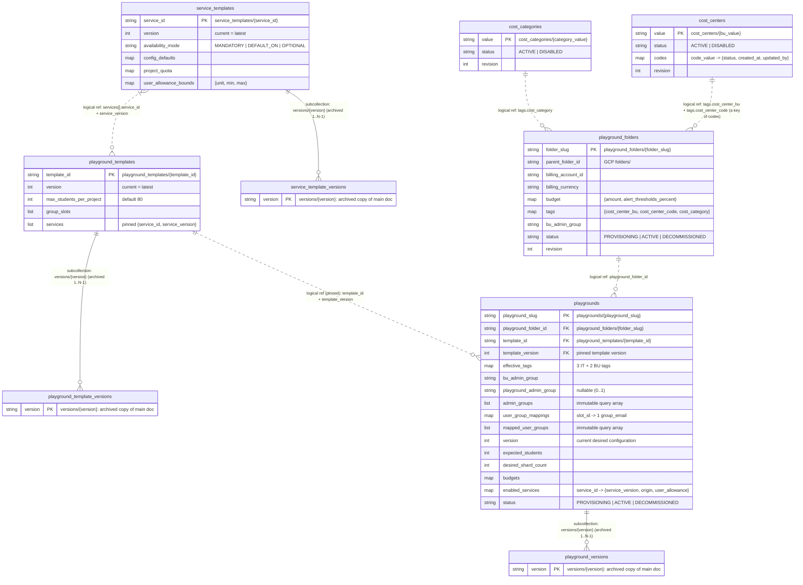

# Crucible (Learning Sandbox) Control Tower TDD: Configuration Entities — Physical Firestore Model

> Parent: [tdd-data-master.md](tdd-data-master.md) · Business requirements: [brs-master.md](../../01-brs/brs-master.md)

Physical Firestore schema, collection organization, logical NoSQL relationships, document JSON examples, transactional write rules, and retrieval/index specifications for the Configuration Database (`lsb-control-tower-config-db`, environment key `FIRESTORE_CONFIG_DATABASE`). Versioned entities follow the single-latest copy-on-write model of [tdd-data-master.md](tdd-data-master.md) section 3.

---

## 1. Database elements and physical NoSQL model

### 1.1 Database elements summary

`lsb-control-tower-config-db` contains **9 physical elements** (6 top-level collections and 3 subcollections).

| # | Element | Physical Firestore path | Kind | Document ID (`PK`) | Lifecycle & mutability | Stores |
|---|---|---|---|---|---|---|
| 1 | **`cost_centers`** | `cost_centers/{bu_value}` | Top-level collection | Literal `cost-center-bu` value (e.g. `computing`) | `ACTIVE -> DISABLED` on the cost center and on each code inside it (status only; never deleted); codes are added in place | One school's cost center **with its allowed `cost-center-code` values** as a `codes` map on the same document |
| 2 | **`cost_categories`** | `cost_categories/{category_value}` | Top-level collection | Literal `cost-category` value (e.g. `teaching`) | `ACTIVE -> DISABLED` (status only; never deleted) | Shared institution-wide cost category tag catalog (`IT-04`) |
| 3 | **`service_templates`** | `service_templates/{service_id}` | Top-level collection | Service slug (e.g. `cloud-sql`) | **Current version on the main document** (`version = N`); every `PATCH` archives `N` and writes `N + 1`; no status; never deleted | Single-GCP-service definition: availability mode, Terraform module ref, APIs, prerequisites, `config_defaults`, shard `project_quota`, finite `min..max` user bounds, singleton (mandatory only) and app resources (`IT-01`) |
| 4 | **`service_templates/versions`** | `service_templates/{service_id}/versions/{version}` | Subcollection of `service_templates` | Integer version as string (`"1"`, `"2"`, …), always `< main.version` | Immutable archived copies of prior versions (`1 .. N-1`) | Version history of element 4 |
| 5 | **`playground_templates`** | `playground_templates/{template_id}` | Top-level collection | Template slug (e.g. `ai-course-standard`) | **Current version on the main document**; copy-on-write on `PATCH`; no status; never deleted | Playground blueprint: pinned `{service_id, service_version}` list, bounded mode/allowance tuning, `max_students_per_project`, `group_slots` (`IT-02`) |
| 6 | **`playground_templates/versions`** | `playground_templates/{template_id}/versions/{version}` | Subcollection of `playground_templates` | Integer version as string | Immutable archived copies (`1 .. N-1`) | Version history of element 6 |
| 7 | **`playground_folders`** | `playground_folders/{folder_slug}` | Top-level collection | Folder slug (e.g. `cs-2026`) | Unversioned flat document with `revision`; `PROVISIONING -> ACTIVE <-> DECOMMISSIONED`; `display_name` and `budget.amount` mutable | Governed folder container: immutable parent, billing account, IT tags, and `bu_admin_group`, plus folder budget (`IT-05`..`IT-10`) |
| 8 | **`playgrounds`** | `playgrounds/{playground_slug}` | Top-level collection | Playground slug (e.g. `cs100-2026`) | **Current desired configuration on the main document** (`version = N`); copy-on-write on every configuration mutation; `status` `PROVISIONING -> ACTIVE <-> DECOMMISSIONED` written in place by jobs | Immutable anchors (pinned template version, BU tags, admin groups, mapped user groups) plus current configuration (name, capacity, budgets, add-only `enabled_services`) (`BU-01`..`BU-09`) |
| 9 | **`playgrounds/versions`** | `playgrounds/{playground_slug}/versions/{version}` | Subcollection of `playgrounds` | Integer version as string | Immutable archived copies (`1 .. N-1`) | Desired-state history of element 9; each archived version is what `seeds/{version}.tfvars.json` was built from |

---

### 1.2 Physical model and logical relationships (NoSQL)

Because Firestore is a document database without foreign-key constraints, relationships take two forms in the diagram below:
- **Solid lines (`--`) — Physical subcollection containment:** The child collection lives physically inside the parent document's path.
- **Dashed lines (`..`) — Logical ID references:** Stored string/integer ID fields validated and enforced by the Self Service API before write.



### 1.3 Collection hierarchy, ID formats, and common fields

```text
lsb-control-tower-config-db
├── cost_centers/{bu_value}            (codes live inside the document)
├── cost_categories/{category_value}
├── service_templates/{service_id}
│   └── versions/{version}
├── playground_templates/{template_id}
│   └── versions/{version}
├── playground_folders/{folder_slug}
└── playgrounds/{playground_slug}
    └── versions/{version}
```

1. **No phantom parent documents:** Every intermediate path (`service_templates/{service_id}`, `playground_templates/{template_id}`, `playgrounds/{playground_slug}`) is a real Firestore document — and for the versioned ones it *is* the current version.
2. **Top-level `playgrounds/{playground_slug}`:** Kept at root rather than nested inside `playground_folders` because `playground_slug` is globally unique across CLI commands, REST URLs, GCS state paths, and project IDs, enabling $O(1)$ point lookups by slug and single-collection queries across folders for `admin_groups` and `mapped_user_groups`.
3. **Naming & ID patterns:** All collection and field names use `snake_case`; enum values use `UPPERCASE`; timestamps are UTC (`RFC 3339` in JSON).
   - Tag values (`bu_value`, the keys of `codes`, `category_value`): `^[a-z]([a-z0-9-]{0,61}[a-z0-9])?$`
   - Slugs (`service_id`, `template_id`, `folder_slug`, `playground_slug`): `^[a-z][a-z0-9-]{1,38}[a-z0-9]$`
   - Archived version document IDs: the integer `version` rendered as a string (`"1"`, `"2"`, …); every pin (`template_version`, `services[].service_version`, `enabled_services[].service_version`, `config_version` on jobs) is the same integer.
4. **Common fields:**

| Field | On | Type | Description |
|---|---|---|---|
| `version` | Versioned entities (`service_templates`, `playground_templates`, `playgrounds`) and their archived copies | integer (`>= 1`) | Current version number; the optimistic-concurrency token on `PATCH` and domain mutations (`409 CONFLICT` on mismatch). An archived copy keeps the `version` it had |
| `revision` | Unversioned entities (`cost_centers`, `cost_categories`, `playground_folders`) | integer (`>= 1`) | Starts at `1`; `+1` on every in-place update inside a transaction (`409` on mismatch) |
| `mutation_kind`, `change_summary` | Versioned entities and their archived copies | enum, string | How and why this version came to be (`CREATE` for version `1`; entity-specific kinds below) |
| `created_at` | All | timestamp | UTC creation time of the entity (carried unchanged into every version) |
| `updated_at` | All | timestamp | UTC time of the write that produced this document state (`== created_at` at `version` / `revision` `= 1`) |
| `updated_by` | All | string (email) | Lowercase email of the caller who produced this document state |

---

## 2. Physical entity schemas and example JSONs

### 2.1 Tag Governance Catalog (`cost_centers` with their codes, `cost_categories`)

Each entry is **WYSIWYG** (the literal tag value is the document ID — or, for a code, the key inside `codes` — with no separate display title or description) and follows a strict `ACTIVE -> DISABLED` lifecycle. A cost center and its codes are **one document**: adding a code or disabling a code is an in-place update of the cost center (`revision + 1`); there is no code subcollection.

| Path | Field | Type | Mutability | Description |
|---|---|---|---|---|
| `cost_centers/{bu_value}` | `value` | string | Immutable | Literal `cost-center-bu` tag value (`== bu_value`) |
| | `status` | enum | `ACTIVE -> DISABLED` | Status of the cost center itself; `DISABLED` blocks the cost center (and therefore all its codes) for new Playground Folders |
| | `codes` | `map<code_value, {status, created_at, updated_by}>` | Keys added in place; each `status` `ACTIVE -> DISABLED` | Allowed `cost-center-code` values of this cost center; a key is the literal tag value and is never removed or renamed |
| | `revision`, `created_at`, `updated_at`, `updated_by` | common | Mutable (disable, add code, disable code) | Standard block |
| `cost_categories/{category_value}` | `value` | string | Immutable | Literal `cost-category` tag value (`== category_value`) |
| | `status` | enum | `ACTIVE -> DISABLED` | `ACTIVE` or `DISABLED` |
| | `revision`, `created_at`, `updated_at`, `updated_by` | common | Mutable on disable | Standard block |

**Example — `cost_centers/computing` (two codes, one of them disabled):**
```json
{
  "value": "computing",
  "status": "ACTIVE",
  "codes": {
    "cs-teaching": { "status": "ACTIVE", "created_at": "2026-11-09T08:01:00Z", "updated_by": "lsb-it-admin1@shankyram.altostrat.com" },
    "cs-research-2025": { "status": "DISABLED", "created_at": "2026-11-09T08:01:00Z", "updated_by": "lsb-it-admin1@shankyram.altostrat.com" }
  },
  "revision": 3,
  "created_at": "2026-11-09T08:00:00Z",
  "updated_at": "2026-11-09T08:05:00Z",
  "updated_by": "lsb-it-admin1@shankyram.altostrat.com"
}
```

**Example — `cost_categories/teaching`:**
```json
{
  "value": "teaching",
  "status": "ACTIVE",
  "revision": 1,
  "created_at": "2026-11-09T08:02:00Z",
  "updated_at": "2026-11-09T08:02:00Z",
  "updated_by": "lsb-it-admin1@shankyram.altostrat.com"
}
```

---

### 2.2 Service Catalog (`service_templates` and `versions`)

Maps 1:1 to a single GCP service capability (`IT-01`). The main document is the current version; `versions/{N}` are archived untouched copies of earlier versions. **Only `MANDATORY` services may define `singleton_resources`**; optional services (`DEFAULT_ON` / `OPTIONAL`) provide `app_resources` only. No status field; never deleted.

#### Document: `service_templates/{service_id}` (and each archived copy in `versions/{version}`)

| Field | Type | Mutability | Description |
|---|---|---|---|
| `service_id` | string | Immutable | Document ID (for example `service-account`, `cloud-sql`, `cloud-run`) |
| `version` | integer | `+1` per `PATCH` | Current version on the main document; frozen on archived copies |
| `mutation_kind` | enum | Per version | `CREATE` (version `1`) or `UPDATE` |
| `change_summary` | string | Per version | Why this version was created |
| `display_name` | string | Versioned | Human-readable service title |
| `description` | string | Versioned | What this service provisions and how users consume it |
| `availability_mode` | enum | Versioned | `MANDATORY`, `DEFAULT_ON` (enabled by default & optional), or `OPTIONAL` (disabled by default & optional) |
| `terraform_module` | `{source_path, git_ref}` | Versioned | Repo module path and pinned Git commit SHA or release tag |
| `required_apis` | `string[]` | Versioned | GCP service APIs enabled per shard project (for example `["sqladmin.googleapis.com"]`) |
| `prerequisite_services` | `string[]` | Versioned | `service_id`s that must be enabled before this service (DAG) |
| `group_slots` | `string[]` | Versioned | User group slot keys expected by the Terraform module (for example `["students"]`) |
| `config_defaults` | `map<string, any>` | Versioned | Fixed service sizes and settings passed to Terraform (not overridable by templates or playgrounds) |
| `project_quota` | `map<string, integer>` | Versioned | Maximum capacity ceilings per project shard |
| `singleton_resources` | `list<{kind, naming_pattern, min, max, description}>` | Versioned | User singleton resources (`min: 1, max: 1`), **permitted only when `availability_mode == "MANDATORY"`** (`[]` otherwise) |
| `app_resources` | `list<{kind, naming_pattern, description}>` | Versioned | Resources users create/delete inside app containers (`[]` when singleton-only) |
| `user_allowance_bounds` | `{unit, min, max}` | Versioned | Finite integer per-user app-resource allowance bounds (`min` = floor and default, `max` = finite ceiling; `{ "unit": "none", "min": 0, "max": 0 }` when `app_resources` is empty) |
| `created_at`, `updated_at`, `updated_by` | common | — | Standard block |

**Example — `service_templates/cloud-sql` (current, `version: 1`):**
```json
{
  "service_id": "cloud-sql",
  "version": 1,
  "mutation_kind": "CREATE",
  "change_summary": "Enterprise Plus db-perf-optimized-N-8 (8 vCPU / 64 GB) singleton with built-in connection pooling",
  "display_name": "Cloud SQL for PostgreSQL",
  "description": "Shared Enterprise Plus PostgreSQL 16 instance per project shard with built-in Managed Connection Pooling, one logical database per user, and per-app schemas.",
  "availability_mode": "MANDATORY",
  "terraform_module": {
    "source_path": "src/terraform/playground-services/cloud-sql",
    "git_ref": "refs/tags/svc-cloud-sql-v1.0.0"
  },
  "required_apis": ["sqladmin.googleapis.com"],
  "prerequisite_services": ["service-account"],
  "group_slots": ["students"],
  "config_defaults": {
    "edition": "ENTERPRISE_PLUS",
    "database_version": "POSTGRES_16",
    "tier": "db-perf-optimized-N-8",
    "availability_type": "ZONAL",
    "enable_connection_pooling": true,
    "data_cache_enabled": false,
    "storage_type": "PD_SSD",
    "disk_size_gb": 20,
    "disk_autoresize": true,
    "disk_autoresize_limit_gb": 150,
    "public_ip_enabled": false
  },
  "project_quota": {
    "shared_sql_instances": 1,
    "max_logical_databases": 80,
    "max_total_schemas": 800
  },
  "singleton_resources": [
    {
      "kind": "CLOUD_SQL_LOGICAL_DB",
      "naming_pattern": "db_<user_slug>",
      "min": 1,
      "max": 1,
      "description": "One logical PostgreSQL database per user on singleton instance sql-<project_id>"
    }
  ],
  "app_resources": [
    {
      "kind": "CLOUD_SQL_SCHEMA",
      "naming_pattern": "db_<user_slug>.<app_slug>_<resource_slug>",
      "description": "Isolated PostgreSQL schema inside the user's logical database"
    }
  ],
  "user_allowance_bounds": { "unit": "postgres_schemas", "min": 5, "max": 10 },
  "created_at": "2026-11-09T08:10:00Z",
  "updated_at": "2026-11-09T08:10:00Z",
  "updated_by": "lsb-it-admin1@shankyram.altostrat.com"
}
```

**Example — after a `PATCH` raising `max` to `12`:** the document above is copied untouched to `service_templates/cloud-sql/versions/1`, and the main document becomes `version: 2`, `mutation_kind: "UPDATE"`, `change_summary: "Raise schema ceiling to 12 per user"`, `user_allowance_bounds.max: 12`, new `updated_at` / `updated_by`; everything else unchanged. Templates pinned to `service_version: 1` keep reading `versions/1`.

**Example — `service_templates/cloud-run` (optional app-resource service, `version: 1`):**
```json
{
  "service_id": "cloud-run",
  "version": 1,
  "mutation_kind": "CREATE",
  "change_summary": "Initial 2 vCPU / 2 GiB scale-to-zero Cloud Run app service definition (project cap 600)",
  "display_name": "Cloud Run App Services",
  "description": "Gen2 request-billed 2 vCPU / 2 GiB Cloud Run services running as the user's singleton service account.",
  "availability_mode": "DEFAULT_ON",
  "terraform_module": {
    "source_path": "src/terraform/playground-services/cloud-run",
    "git_ref": "refs/tags/svc-cloud-run-v1.0.0"
  },
  "required_apis": ["run.googleapis.com", "artifactregistry.googleapis.com", "cloudbuild.googleapis.com"],
  "prerequisite_services": ["service-account"],
  "group_slots": ["students"],
  "config_defaults": {
    "cpu": "2000m",
    "memory": "2Gi",
    "min_instance_count": 0,
    "max_instance_count": 2,
    "concurrency": 40,
    "cpu_idle": true,
    "startup_cpu_boost": true,
    "execution_environment": "GEN2",
    "timeout_seconds": 300
  },
  "project_quota": { "max_services": 600 },
  "singleton_resources": [],
  "app_resources": [
    {
      "kind": "CLOUD_RUN_SERVICE",
      "naming_pattern": "run-<user_slug>-<app_slug>-<resource_slug>",
      "description": "Containerized web/API service running as sa-<user_slug>"
    }
  ],
  "user_allowance_bounds": { "unit": "cloud_run_services", "min": 5, "max": 10 },
  "created_at": "2026-11-09T08:12:00Z",
  "updated_at": "2026-11-09T08:12:00Z",
  "updated_by": "lsb-it-admin1@shankyram.altostrat.com"
}
```

**AI catalog baseline across all six services (`max_students_per_project` default `80`, [brs-master.md](../../01-brs/brs-master.md) section 2.6):**

| `service_id` | `availability_mode` | `prerequisite_services` | `project_quota` | User singleton (`min..max`) | App resource `user_allowance_bounds` (`min..max`) | `config_defaults` highlights |
|---|---|---|---|---|---|---|
| `service-account` | `MANDATORY` | `[]` | `max_service_accounts: 80` *(GCP cap: 100)* | `sa-<user>` (`1..1`) | `none` (`0..0`) | `{}` |
| `gemini` | `MANDATORY` | `["service-account"]` | `max_users: 80` *(PayGo DSQ)* | Gemini access on `sa-<user>` (`1..1`) | `none` (`0..0`) | `{}` *(no model restrictions)* |
| `cloud-storage` | `MANDATORY` | `["service-account"]` | `max_buckets: 80`, `max_managed_folders: 1600` | Bucket `bkt-<project>-<user>` (`1..1`) | `gcs_managed_folders`: **`5 .. 20`** | `STANDARD`, Uniform Bucket-Level Access `true` |
| `cloud-sql` | `MANDATORY` | `["service-account"]` | `shared_sql_instances: 1`, `max_logical_databases: 80`, `max_total_schemas: 800` | Logical DB `db_<user>` (`1..1`) | `postgres_schemas`: **`5 .. 10`** | `ENTERPRISE_PLUS`, `db-perf-optimized-N-8` (`8 vCPU / 64 GB`), `ZONAL`, MCP `true`, `PD_SSD` `20..150 GB` |
| `cloud-run` | `DEFAULT_ON` | `["service-account"]` | `max_services: 600` *(GCP hard cap: 1,000)* | none | `cloud_run_services`: **`5 .. 10`** | `2000m` (`2 vCPU`), `2Gi` RAM, `min_instances: 0`, `max_instances: 2`, `concurrency: 40`, `GEN2` |
| `vertex-ai-search` | `DEFAULT_ON` | `["service-account", "cloud-storage"]` | `max_data_stores: 100`, `max_engines: 150` *(GCP project caps)* | none | `search_apps`: **`1 .. 2`** | `GENERIC` vertical, `SOLUTION_TYPE_SEARCH` |

---

### 2.3 Playground Templates (`playground_templates` and `versions`)

Composes pinned service versions and sets `max_students_per_project` (`IT-02`, default `80`). The main document is the current version used for every new playground; a playground stays permanently pinned to the integer `template_version` it was created from. No status field; never deleted.

#### Document: `playground_templates/{template_id}` (and each archived copy in `versions/{version}`)

| Field | Type | Mutability | Description |
|---|---|---|---|
| `template_id` | string | Immutable | Document ID (for example `ai-course-standard`) |
| `version` | integer | `+1` per `PATCH` | Current version on the main document; frozen on archived copies |
| `mutation_kind`, `change_summary` | enum, string | Per version | `CREATE` or `UPDATE`, and why |
| `display_name`, `description` | string | Versioned | Title and summary shown in template pickers |
| `max_students_per_project` | integer (`> 0`) | Versioned | Maximum user workspaces per project shard; **default `80`**; must not exceed any pinned service's relevant `project_quota` (for example `max_service_accounts`) |
| `group_slots` | `string[]` | Versioned (derived) | Sorted union of `group_slots` across all included services (for example `["students"]`) |
| `services` | `list<TemplateServiceEntry>` | Versioned | Ordered list of pinned services (topologically sorted by `prerequisite_services`) |
| `services[].service_id` | string | | Catalog `service_id` |
| `services[].service_version` | integer | | Pinned service version — the service's current `version` at the time this template version was written |
| `services[].effective_availability_mode` | enum | | Inherited, or **promoted** (`OPTIONAL -> DEFAULT_ON \| MANDATORY`, `DEFAULT_ON -> MANDATORY`); promotion never adds a singleton |
| `services[].effective_user_allowance_bounds` | `{unit, min, max}` | | Inherited, or **narrowed** (`min >= service.min` and `max <= service.max`) |
| `created_at`, `updated_at`, `updated_by` | common | — | Standard block |

**Example — `playground_templates/ai-course-standard` (current, `version: 1`):**
```json
{
  "template_id": "ai-course-standard",
  "version": 1,
  "mutation_kind": "CREATE",
  "change_summary": "Initial AI course template at 80 students/project with mandatory SA/Gemini/GCS/SQL singletons and optional Cloud Run + Vertex AI Search",
  "display_name": "Standard AI & App Engineering Course",
  "description": "Shared-shard AI playground (80 students/shard) with mandatory SA, Gemini, Cloud Storage, and Cloud SQL, plus optional Cloud Run and Vertex AI Search.",
  "max_students_per_project": 80,
  "group_slots": ["students"],
  "services": [
    { "service_id": "service-account", "service_version": 1, "effective_availability_mode": "MANDATORY", "effective_user_allowance_bounds": { "unit": "none", "min": 0, "max": 0 } },
    { "service_id": "gemini", "service_version": 1, "effective_availability_mode": "MANDATORY", "effective_user_allowance_bounds": { "unit": "none", "min": 0, "max": 0 } },
    { "service_id": "cloud-storage", "service_version": 1, "effective_availability_mode": "MANDATORY", "effective_user_allowance_bounds": { "unit": "gcs_managed_folders", "min": 5, "max": 20 } },
    { "service_id": "cloud-sql", "service_version": 1, "effective_availability_mode": "MANDATORY", "effective_user_allowance_bounds": { "unit": "postgres_schemas", "min": 5, "max": 10 } },
    { "service_id": "cloud-run", "service_version": 1, "effective_availability_mode": "DEFAULT_ON", "effective_user_allowance_bounds": { "unit": "cloud_run_services", "min": 5, "max": 10 } },
    { "service_id": "vertex-ai-search", "service_version": 1, "effective_availability_mode": "DEFAULT_ON", "effective_user_allowance_bounds": { "unit": "search_apps", "min": 1, "max": 2 } }
  ],
  "created_at": "2026-11-09T08:30:00Z",
  "updated_at": "2026-11-09T08:30:00Z",
  "updated_by": "lsb-it-admin1@shankyram.altostrat.com"
}
```

A later `PATCH` (for example pinning `cloud-sql` at `service_version: 2`) archives this document to `versions/1` and writes `version: 2` on the main document; playgrounds created before stay on `template_version: 1`, new playgrounds use `2`.

---

### 2.4 Playground Folders (`playground_folders`)

Single unversioned document per Playground Folder (`IT-05`..`IT-10`). GCP-assigned folder IDs and budget resource names live in `lsb-control-tower-db` (`runtime/playground_folders/{folder_slug}`).

| Field | Type | Mutability | Description |
|---|---|---|---|
| `folder_slug` | string | Immutable | Document ID (for example `cs-2026`) |
| `display_name` | string | **Mutable (`IT-06`)** | GCP folder display name (tracked job) |
| `parent_folder_id` | string | **Immutable** | Existing GCP org folder resource name (`folders/<number>`) |
| `billing_account_id` | string | **Immutable** | Billing account ID (`01951D-A71E6A-80664C`) |
| `billing_currency` | string | **Immutable** | ISO 4217 currency code read from billing account at creation (`USD`, `SGD`) |
| `budget` | `{amount, alert_thresholds_percent}` | **`amount` mutable (`IT-06`)** | `amount` is integer whole currency units `> 0` (tracked job); `alert_thresholds_percent` is `[50, 75, 90, 100]` |
| `tags` | `{cost_center_bu, cost_center_code, cost_category}` | **Immutable** | Validated at creation: `cost_center_bu` is an `ACTIVE` cost center, `cost_center_code` is an `ACTIVE` key of that cost center's `codes`, `cost_category` is an `ACTIVE` category |
| `bu_admin_group` | string | **Immutable** | Strictly 1 Google group email (must be transitive member of `grp-lsb-bu-admins@`) |
| `status` | enum | `PROVISIONING -> ACTIVE <-> DECOMMISSIONED` | Reversible via `IT-07` / `IT-10` (never deleted; budgets stay in place) |
| `last_job_id` | string | Mutable | `job_id` of the latest tracked job that created or updated this folder |
| `revision`, `created_at`, `updated_at`, `updated_by` | common | Mutable | Standard block |

**Example — `playground_folders/cs-2026`:**
```json
{
  "folder_slug": "cs-2026",
  "display_name": "School of Computing Sandboxes 2026",
  "parent_folder_id": "folders/600433119916",
  "billing_account_id": "01951D-A71E6A-80664C",
  "billing_currency": "USD",
  "budget": { "amount": 50000, "alert_thresholds_percent": [50, 75, 90, 100] },
  "tags": { "cost_center_bu": "computing", "cost_center_code": "cs-teaching", "cost_category": "teaching" },
  "bu_admin_group": "grp-lsb-cs-bu-admins@shankyram.altostrat.com",
  "status": "ACTIVE",
  "last_job_id": "job-20261109-4b19e802",
  "revision": 1,
  "created_at": "2026-11-09T09:00:00Z",
  "updated_at": "2026-11-09T09:00:00Z",
  "updated_by": "lsb-it-admin1@shankyram.altostrat.com"
}
```

---

### 2.5 Playgrounds (`playgrounds` and `versions`)

One document per playground holding its immutable anchors **and** its current desired configuration (`version = N`); every configuration mutation archives the whole document to `versions/{N}` and writes `N + 1` (`BU-01`..`BU-04`). Lifecycle `status` (`BU-08`, `BU-09`, `IT-07`, `IT-10`) and `last_job_id` are written in place by jobs and do not create a version. Per-user portal access (`BU-05`) is not stored here (runtime DB).

#### Document: `playgrounds/{playground_slug}` (and each archived copy in `versions/{version}`)

| Field | Type | Mutability | Description |
|---|---|---|---|
| `playground_slug` | string | Immutable | Document ID (for example `cs100-2026`) |
| `playground_folder_id` | string | **Immutable** | Parent `playground_folders/{folder_slug}` ID |
| `template_id`, `template_version` | string, integer | **Immutable** | Permanently pinned playground template version (the template's current `version` at creation; never upgraded) |
| `max_students_per_project` | integer | **Immutable** | Copied from the pinned template version (default `80`) |
| `billing_account_id`, `billing_currency` | string | **Immutable** (copied from parent folder) | Denormalized so budget validation needs no extra read |
| `effective_tags` | `{cost_center_bu, cost_center_code, cost_category, bu_tracking_code, bu_subcategory}` | **Immutable** | 3 inherited IT folder tags + 2 un-cataloged BU playground tags; copied once onto every shard project as billing labels |
| `bu_admin_group` | string | **Immutable** (copied from parent folder) | Folder's BU Admin group |
| `playground_admin_group` | `string \| null` | **Immutable** | Optional Playground Admin group (`0..1`, such as course TAs); `null` if unset |
| `admin_groups` | `string[]` | **Immutable** | `[bu_admin_group]` or `[bu_admin_group, playground_admin_group]` — powers single-query admin listing |
| `user_group_mappings` | `map<slot_id, group_email>` | **Immutable** | **Strictly 1** existing Google group email per required template `group_slot`, fixed at creation |
| `mapped_user_groups` | `string[]` | **Immutable** | Distinct Google group emails from `user_group_mappings` — powers single-query user listing |
| `version` | integer | `+1` per configuration mutation | Current desired configuration version; compare with `applied_version` in the runtime DB |
| `mutation_kind` | enum | Per version | `CREATE` (version `1`), `UPDATE_METADATA_OR_BUDGETS` (`BU-02`), `CONFIGURE_SERVICES` (`BU-03`), or `EXPAND_CAPACITY` (`BU-04`) |
| `change_summary` | string | Per version | Human-readable summary of what changed in this version |
| `display_name` | string | **Versioned (`BU-02`)** | Course or lab display name |
| `expected_students` | integer | **Versioned, grow-only (`BU-04`)** | $\ge$ the previous version's value |
| `desired_shard_count` | integer | **Versioned (derived)** | `ceil(expected_students / max_students_per_project)` — generates shard codes `p01..pNN` |
| `budgets` | `{currency_code, playground_budget_amount, default_shard_budget_amount, shard_budget_overrides, alert_thresholds_percent}` | **Versioned (`BU-02`)** | `playground_budget_amount > 0` (required); `default_shard_budget_amount` (`integer \| null`, $\le$ playground budget, inherited by new shards); `shard_budget_overrides` (`map<shard_code, integer>`, each $\le$ playground budget) |
| `enabled_services` | `map<service_id, EnabledServiceConfig>` | **Versioned, add-only (`BU-03`)** | Monotonically growing map across versions |
| `enabled_services[id].service_version` | integer | | Pinned service version from the playground's pinned template version |
| `enabled_services[id].origin` | enum | | `TEMPLATE_MANDATORY`, `TEMPLATE_DEFAULT`, or `USER_ENABLED` |
| `enabled_services[id].user_allowance` | `{unit, value}` | | Finite integer per-user app-resource allowance within `effective_user_allowance_bounds` (`0` when `unit == "none"`) |
| `status` | enum | In place (jobs) | `PROVISIONING -> ACTIVE <-> DECOMMISSIONED` (never deleted) |
| `last_job_id` | string | In place (jobs) | `job_id` of the latest playground-level tracked job |
| `created_at`, `updated_at`, `updated_by` | common | — | Standard block |

**Example — `playgrounds/cs100-2026` (current, `version: 2`, `280` students $\div$ `80` = `4` shards):**
```json
{
  "playground_slug": "cs100-2026",
  "playground_folder_id": "cs-2026",
  "template_id": "ai-course-standard",
  "template_version": 1,
  "max_students_per_project": 80,
  "billing_account_id": "01951D-A71E6A-80664C",
  "billing_currency": "USD",
  "effective_tags": {
    "cost_center_bu": "computing",
    "cost_center_code": "cs-teaching",
    "cost_category": "teaching",
    "bu_tracking_code": "cs100-ay26-s1",
    "bu_subcategory": "ug-core"
  },
  "bu_admin_group": "grp-lsb-cs-bu-admins@shankyram.altostrat.com",
  "playground_admin_group": "grp-cs100-tas@shankyram.altostrat.com",
  "admin_groups": ["grp-lsb-cs-bu-admins@shankyram.altostrat.com", "grp-cs100-tas@shankyram.altostrat.com"],
  "user_group_mappings": { "students": "grp-cs100-students@shankyram.altostrat.com" },
  "mapped_user_groups": ["grp-cs100-students@shankyram.altostrat.com"],
  "version": 2,
  "mutation_kind": "CONFIGURE_SERVICES",
  "change_summary": "Enabled Vertex AI Search (1 app/user) and raised Cloud Storage folders to 10 and Cloud Run services to 6",
  "display_name": "CS 100 Intro to AI Engineering (Sem 1)",
  "expected_students": 280,
  "desired_shard_count": 4,
  "budgets": {
    "currency_code": "USD",
    "playground_budget_amount": 12000,
    "default_shard_budget_amount": 3000,
    "shard_budget_overrides": { "p01": 3500 },
    "alert_thresholds_percent": [50, 75, 90, 100]
  },
  "enabled_services": {
    "service-account": { "service_version": 1, "origin": "TEMPLATE_MANDATORY", "user_allowance": { "unit": "none", "value": 0 } },
    "gemini": { "service_version": 1, "origin": "TEMPLATE_MANDATORY", "user_allowance": { "unit": "none", "value": 0 } },
    "cloud-storage": { "service_version": 1, "origin": "TEMPLATE_MANDATORY", "user_allowance": { "unit": "gcs_managed_folders", "value": 10 } },
    "cloud-sql": { "service_version": 1, "origin": "TEMPLATE_MANDATORY", "user_allowance": { "unit": "postgres_schemas", "value": 5 } },
    "cloud-run": { "service_version": 1, "origin": "TEMPLATE_DEFAULT", "user_allowance": { "unit": "cloud_run_services", "value": 6 } },
    "vertex-ai-search": { "service_version": 1, "origin": "USER_ENABLED", "user_allowance": { "unit": "search_apps", "value": 1 } }
  },
  "status": "ACTIVE",
  "last_job_id": "job-20261109-9d04a118",
  "created_at": "2026-11-09T09:15:00Z",
  "updated_at": "2026-11-09T09:40:00Z",
  "updated_by": "lsb-bu-cs1@shankyram.altostrat.com"
}
```

**Archived — `playgrounds/cs100-2026/versions/1`:** the identical shape as it was at creation — `version: 1`, `mutation_kind: "CREATE"`, `change_summary: "Created from ai-course-standard v1 for 280 students"`, `enabled_services` without `vertex-ai-search` and with `cloud-storage.value: 5`, `cloud-run.value: 5`, `status: "PROVISIONING"` (the status at the moment the copy was taken), `updated_at: "2026-11-09T09:15:00Z"`. The Terraform runner built `seeds/1.tfvars.json` from it and builds `seeds/2.tfvars.json` from the current document.

---

## 3. Transactional write rules

1. **Creating a versioned entity (`POST`):** one `create()` of `<collection>/{id}` with `version: 1`, `mutation_kind: "CREATE"`; `create()` fails if the slug already exists (`409 ALREADY_EXISTS`). No `versions/` document is written.
2. **Updating a versioned entity (`PATCH` or domain mutation, [tdd-data-master.md](tdd-data-master.md) section 3.2):** one transaction in `lsb-control-tower-config-db` that (a) reads `<collection>/{id}`, (b) verifies `version == expected` (`409 CONFLICT` otherwise) and, for playgrounds, `status == "ACTIVE"` with an `ACTIVE` parent folder, (c) validates and merges the delta into `next_doc` (`version + 1`, `mutation_kind`, `change_summary`, `updated_at`, `updated_by`), (d) `create()`s `versions/{version}` as the untouched copy of the document read in (a), and (e) `set()`s `<collection>/{id} = next_doc`. The `create()` in (d) makes an archived version impossible to overwrite.
3. **Pre-check before writing a new playground version:** every structural invariant — active folder and playground, add-only `enabled_services` drawn from the permanently pinned `template_version`, prerequisite closure, finite `user_allowance` within `effective_user_allowance_bounds`, `expected_students >=` current, shard budgets `<= playground_budget_amount`, and no active lock on `locks/PLAYGROUND:{slug}` — is validated before the transaction commits.
4. **Unversioned entities (`cost_centers`, `cost_categories`, `playground_folders`):** in-place `update()` inside a transaction that verifies `revision == expected` and writes `revision + 1`, `updated_at`, `updated_by`. Adding a code to a cost center sets `codes.{code_value}` (rejected if the key exists); disabling a code sets `codes.{code_value}.status`; both are ordinary in-place updates of the cost center document.
5. **Lifecycle status and `last_job_id`:** written in place by the job finalizer (no version, no revision check needed beyond the job lock): `PROVISIONING -> ACTIVE` on create success, `ACTIVE -> DECOMMISSIONED` on decommission success, `DECOMMISSIONED -> ACTIVE` on recommission success.
6. **Cascading Playground Folder decommission & recommission (`IT-07`, `IT-10`):**
   - **Decommission:** after billing is unlinked from every underlying shard project (folders, projects, budgets, workspaces, and resources untouched), the finalizer marks every child `playgrounds/{slug}` (`WHERE playground_folder_id == folder_slug AND status != "DECOMMISSIONED"`) and `playground_folders/{folder_slug}` as `status = "DECOMMISSIONED"` (batched up to 500 writes per `WriteBatch`).
   - **Recommission:** relinks all underlying shard projects to `billing_account_id` and flips `playground_folders/{folder_slug}` and its child `playgrounds/{slug}` back to `status = "ACTIVE"`. Individual playground recommission (`BU-09`) requires the parent folder to be `ACTIVE`.

---

## 4. Retrieval patterns and data indexing

### 4.1 Retrieval pattern matrix

Let $G$ denote the caller's transitive Google group email list returned live by `DirectoryReader.user_groups(caller.email)`. Decommissioned playgrounds remain visible in user and admin lists (`RP-07`..`RP-09`, marked by `status`); a user's own `SUSPENDED` state comes from their workspace record in the runtime DB.

| ID | Access pattern | Collection | Filter & sort | Index strategy |
|---|---|---|---|---|
| **RP-01** | Validate IT tag triplet on folder create (`IT-05`) | `cost_centers`, `cost_categories` | 2 parallel point reads by document ID: the cost center (check its `status` and `codes[code].status`) and the category | **Document ID ($O(1)$)** — no extra index |
| **RP-02** | List active (or all) cost centers or categories (`IT-03`, `IT-04`); a cost center's codes come with its document | `cost_centers`, `cost_categories` | Optional `status == "ACTIVE"`, `ORDER BY value ASC`; codes filtered in memory from the `codes` map | **Composite** `(status ASC, value ASC)` (single-field `value ASC` when unfiltered) |
| **RP-03** | List services (current versions) for catalog and template authoring (`IT-01`, `IT-02`) | `service_templates` | `ORDER BY display_name ASC` | Built-in single-field index |
| **RP-04** | List templates (current versions) for pickers (`IT-02`, `BU-01`) | `playground_templates` | `ORDER BY display_name ASC`; the main document already is the version a new playground will pin | Built-in single-field index |
| **RP-05** | List Playground Folders for an **IT Admin** | `playground_folders` | Optional `status` filter, `ORDER BY created_at DESC` | **Composite** `(status ASC, created_at DESC)` |
| **RP-06** | List Playground Folders visible to a **BU Admin** | `playground_folders` | `bu_admin_group IN G` (and optional `status` filter), `ORDER BY created_at DESC` | **Composite** `(bu_admin_group ASC, created_at DESC)` and `(status ASC, bu_admin_group ASC, created_at DESC)` |
| **RP-07** | List Playgrounds inside one Playground Folder (`BU-01`, `IT-07`, `IT-10`) | `playgrounds` | `playground_folder_id == slug` (and optional `status` filter), `ORDER BY created_at DESC` | **Composite** `(playground_folder_id ASC, created_at DESC)` and `(playground_folder_id ASC, status ASC, created_at DESC)` |
| **RP-08** | List Playgrounds manageable by a **BU Admin or Playground Admin** | `playgrounds` | `admin_groups ARRAY_CONTAINS_ANY G` (and optional `status` filter), `ORDER BY created_at DESC` | **Composite** `(admin_groups CONTAINS, created_at DESC)` and `(admin_groups CONTAINS, status ASC, created_at DESC)` |
| **RP-09** | List Playgrounds visible to a **Student / Designated User** ("my playgrounds", incl. `DECOMMISSIONED`) | `playgrounds` | `mapped_user_groups ARRAY_CONTAINS_ANY G`, `ORDER BY created_at DESC` | **Composite** `(mapped_user_groups CONTAINS, created_at DESC)` |
| **RP-10** | Read a pinned version: template → service version `K`, playground → template version `K`, runner → playground `config_version = K` ([tdd-data-master.md](tdd-data-master.md) 3.3) | any versioned collection | Point read of `<collection>/{id}`; if `version != K`, point read of `versions/{K}` | **Document ID ($O(1)$)**, at most two reads |
| **RP-11** | Version history of one entity | `<collection>/{id}/versions` | `ORDER BY version DESC` (archived `1..N-1`), plus the main document as `N` | Built-in single-field index on `version` |
| **RP-12** | Impact of publishing a new template version: playgrounds pinned to `template_id` (and optionally a given `template_version`) | `playgrounds` | `template_id == id` (and optional `status == "ACTIVE"`), `ORDER BY template_version ASC` | **Composite** `(template_id ASC, status ASC, template_version ASC)` |

### 4.2 Handling Firestore's 30-element `IN` / `ARRAY_CONTAINS_ANY` limit

Firestore Native caps `IN` and `ARRAY_CONTAINS_ANY` clauses at **30 comparison values** per query. In a university Google Workspace domain, `DirectoryReader.user_groups(email)` can return more than 30 groups (departmental mailing lists, committees, cohorts).

- **Rule:** If `len(G) == 0`, return `[]` without querying Firestore. Otherwise partition `G` into chunks $G_1, G_2, \dots, G_m$ of at most **30 group emails each**, run the indexed queries concurrently (`asyncio.gather`), merge and deduplicate results by document ID (`folder_slug` or `playground_slug`), and sort in memory by `created_at DESC`.
- **Cost:** Even a user in 90 Workspace groups executes only 3 parallel ~5 ms index probes with zero group-sync maintenance in Firestore.

### 4.3 Composite indexes and field exemptions (`firestore.indexes.json`)

Nested maps (`codes`, `config_defaults`, `project_quota`, `singleton_resources`, `app_resources`, `services`, `user_group_mappings`, `enabled_services`, `budgets.shard_budget_overrides`) are read as whole sub-objects and never queried in `WHERE` clauses. They now live on the **main documents** as well as on every archived copy under the shared `versions` collection group, so both are exempted from automatic single-field indexing to avoid index write amplification and Firestore's 40,000 index-entries-per-document ceiling.

```json
{
  "indexes": [
    { "collectionGroup": "cost_centers", "queryScope": "COLLECTION", "fields": [ { "fieldPath": "status", "order": "ASCENDING" }, { "fieldPath": "value", "order": "ASCENDING" } ] },
    { "collectionGroup": "cost_categories", "queryScope": "COLLECTION", "fields": [ { "fieldPath": "status", "order": "ASCENDING" }, { "fieldPath": "value", "order": "ASCENDING" } ] },
    { "collectionGroup": "playground_folders", "queryScope": "COLLECTION", "fields": [ { "fieldPath": "status", "order": "ASCENDING" }, { "fieldPath": "created_at", "order": "DESCENDING" } ] },
    { "collectionGroup": "playground_folders", "queryScope": "COLLECTION", "fields": [ { "fieldPath": "bu_admin_group", "order": "ASCENDING" }, { "fieldPath": "created_at", "order": "DESCENDING" } ] },
    { "collectionGroup": "playground_folders", "queryScope": "COLLECTION", "fields": [ { "fieldPath": "status", "order": "ASCENDING" }, { "fieldPath": "bu_admin_group", "order": "ASCENDING" }, { "fieldPath": "created_at", "order": "DESCENDING" } ] },
    { "collectionGroup": "playgrounds", "queryScope": "COLLECTION", "fields": [ { "fieldPath": "playground_folder_id", "order": "ASCENDING" }, { "fieldPath": "created_at", "order": "DESCENDING" } ] },
    { "collectionGroup": "playgrounds", "queryScope": "COLLECTION", "fields": [ { "fieldPath": "playground_folder_id", "order": "ASCENDING" }, { "fieldPath": "status", "order": "ASCENDING" }, { "fieldPath": "created_at", "order": "DESCENDING" } ] },
    { "collectionGroup": "playgrounds", "queryScope": "COLLECTION", "fields": [ { "fieldPath": "admin_groups", "arrayConfig": "CONTAINS" }, { "fieldPath": "created_at", "order": "DESCENDING" } ] },
    { "collectionGroup": "playgrounds", "queryScope": "COLLECTION", "fields": [ { "fieldPath": "admin_groups", "arrayConfig": "CONTAINS" }, { "fieldPath": "status", "order": "ASCENDING" }, { "fieldPath": "created_at", "order": "DESCENDING" } ] },
    { "collectionGroup": "playgrounds", "queryScope": "COLLECTION", "fields": [ { "fieldPath": "mapped_user_groups", "arrayConfig": "CONTAINS" }, { "fieldPath": "created_at", "order": "DESCENDING" } ] },
    { "collectionGroup": "playgrounds", "queryScope": "COLLECTION", "fields": [ { "fieldPath": "template_id", "order": "ASCENDING" }, { "fieldPath": "status", "order": "ASCENDING" }, { "fieldPath": "template_version", "order": "ASCENDING" } ] }
  ],
  "fieldOverrides": [
    { "collectionGroup": "cost_centers", "fieldPath": "codes", "indexes": [] },
    { "collectionGroup": "service_templates", "fieldPath": "config_defaults", "indexes": [] },
    { "collectionGroup": "service_templates", "fieldPath": "project_quota", "indexes": [] },
    { "collectionGroup": "service_templates", "fieldPath": "singleton_resources", "indexes": [] },
    { "collectionGroup": "service_templates", "fieldPath": "app_resources", "indexes": [] },
    { "collectionGroup": "playground_templates", "fieldPath": "services", "indexes": [] },
    { "collectionGroup": "playgrounds", "fieldPath": "user_group_mappings", "indexes": [] },
    { "collectionGroup": "playgrounds", "fieldPath": "enabled_services", "indexes": [] },
    { "collectionGroup": "playgrounds", "fieldPath": "budgets.shard_budget_overrides", "indexes": [] },
    { "collectionGroup": "versions", "fieldPath": "config_defaults", "indexes": [] },
    { "collectionGroup": "versions", "fieldPath": "project_quota", "indexes": [] },
    { "collectionGroup": "versions", "fieldPath": "singleton_resources", "indexes": [] },
    { "collectionGroup": "versions", "fieldPath": "app_resources", "indexes": [] },
    { "collectionGroup": "versions", "fieldPath": "services", "indexes": [] },
    { "collectionGroup": "versions", "fieldPath": "user_group_mappings", "indexes": [] },
    { "collectionGroup": "versions", "fieldPath": "enabled_services", "indexes": [] },
    { "collectionGroup": "versions", "fieldPath": "budgets.shard_budget_overrides", "indexes": [] }
  ]
}
```

> **Terraform note:** Creating Firestore composite indexes and `google_firestore_field` index exemptions can take several minutes per index in GCP (`LONG-RUNNING` when provisioned via Day-0 Terraform). Provision them in a dedicated data/indexes step with explicit `timeouts { create = "30m" update = "30m" }`.

### 4.4 Client SDK security rules posture (`firestore.rules`)

All reads and writes to `lsb-control-tower-config-db` flow through the Self Service API (`sa-lsb-api` via IAM, which bypasses client rules). Client SDK access on `lsb-control-tower-config-db` is completely locked down (future web UI real-time listeners target `lsb-control-tower-db` only):

```text
rules_version = '2';
service cloud.firestore {
  match /databases/{database}/documents {
    match /{document=**} {
      allow read, write: if false;
    }
  }
}
```
