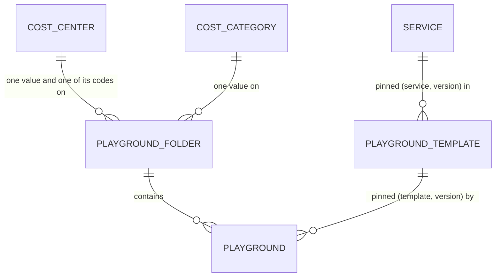
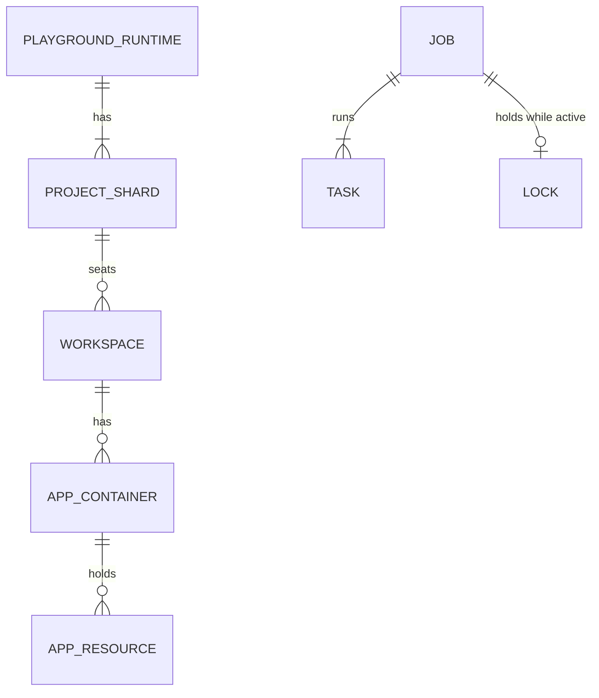

# Crucible (Learning Sandbox) Control Tower TDD: Data (Master)

> Parent: [tdd-master.md](../tdd-master.md) · Business requirements: [brs-master.md](../../01-brs/brs-master.md)

The data of the Control Tower is split into two domains, **configuration** and **runtime**. This master defines each domain: its entities, how they relate, how configuration is versioned, and how records change state. Physical schemas, JSON examples, indexes and queries are in the specifications listed in section 8.

---

## 1. Two data domains

| | **Configuration domain** | **Runtime domain** |
|---|---|---|
| Holds | Desired state: what IT and BU Admins decided | Observed state: what the platform did and what exists in GCP, plus the jobs that did it |
| Entities | Cost centers (with their codes), cost categories, services, playground templates, Playground Folders, playgrounds (section 2) | Folder, playground and project-shard runtime records, workspaces, app containers, app resources, jobs, tasks, locks (section 4) |
| Database | `lsb-control-tower-config-db` | `lsb-control-tower-db` |
| Written by | The Self Service API only | The Terraform runner, the async worker, and the API (jobs, locks, portal access) |
| Read by | API, runner, worker | API, runner, worker; a future UI may listen read-only |
| Rebuildable | No: source of truth | Observed state yes, from GCP; jobs no: audit trail |
| Protection | PITR, delete protection, weekly backups kept 14 weeks | PITR, delete protection; job history kept indefinitely |

The domains are separate because the engines that act on GCP must be able to read what was decided and never change it. A record in the runtime domain refers to its configuration counterpart by the same slug.

---

## 2. Configuration data domain

### 2.1 Entities

| Entity | One record is | Key | Versioned | Owner |
|---|---|---|---|---|
| **Cost center (with its codes)** | One school's cost center: the allowed `cost-center-bu` value **and**, inside the same record, the list of allowed `cost-center-code` values for that school, each code with its own active/disabled status. There is no separate code entity | the cost center value | No | IT Admin |
| **Cost category** | One allowed value of the `cost-category` tag, shared by all schools | the value | No | IT Admin |
| **Service** | One GCP service offered to playgrounds: availability mode, Terraform module, prerequisites, user group slots, fixed sizes, capacity per project shard, finite per-user allowance bounds, singleton and app resources | service slug | Yes | IT Admin |
| **Playground template** | One composition of pinned service versions (with optional mode promotion or narrower bounds), the user group slots it needs, and the maximum students per project (default 80) | template slug | Yes | IT Admin |
| **Playground Folder** | One governed folder: parent folder, billing account and currency, the three IT tag values, the BU Admin group, the folder budget, the lifecycle status | folder slug | No | IT Admin |
| **Playground** | One playground: its folder, pinned template version, two BU tag values, optional Playground Admin group, one mapped group per slot (all fixed), and its current configuration: name, expected students and the resulting number of project shards, budgets, enabled services and per-user allowances; plus lifecycle status | playground slug | Yes | BU Admin (and Playground Admin for configuration) |

### 2.2 How they relate

Three layers: the catalogs IT maintains, the collection of playgrounds IT creates for a BU (the Playground Folder), and the playgrounds the BU creates inside it.



| Layer | Entities | Relationship rules |
|---|---|---|
| Catalogs | Cost center (with its codes), cost category, service, playground template | A code exists only inside its cost center. A template version pins specific service versions; a template never references a service without a version. Services and templates do not reference folders or playgrounds. |
| Collection of playgrounds for a BU | Playground Folder | References exactly one cost center, one of that cost center's codes, and one cost category, all active at creation. References one BU Admin group by email (groups are not entities). |
| Playground | Playground | References exactly one Playground Folder and one template version. Copies the folder's billing account, currency and IT tag values onto itself. References each service it enables at the version the template pinned. References its admin and mapped user groups by email only. |

### 2.3 What changes, and how

Every configuration entity has fields that are set once at creation and never change. What is left changes in one of two ways: **versioned** entities get a new version (section 3), **in-place** entities are overwritten under a revision counter. Lifecycle status is separate from both and is covered in section 5.

**Fixed at creation**

| Entity | Never changes after creation |
|---|---|
| Cost center, cost category | The value itself: it is the tag value bound in GCP, so it can never be edited; it can only be disabled for future use (a code inside a cost center likewise) |
| Service, playground template | The identifier (slug) that templates, playgrounds, state paths and URLs refer to; the definition behind it changes only by publishing a new version, never in place |
| Playground Folder | Parent folder, billing account and currency, the three IT tag values, the BU Admin group |
| Playground | Its Playground Folder, the pinned template version, the maximum students per project, the two BU tag values, the Playground Admin group, the mapped user groups, and the billing and IT tag values copied from the folder |

**Everything else**

| Entity | How it changes | What can change |
|---|---|---|
| Service | New version | Any other field |
| Playground template | New version | Any other field |
| Playground | New version | Display name; expected students and therefore the number of project shards (grow-only); budgets; enabled services (add-only); per-user allowances |
| Cost center | In place | Its status; codes added to it; the status of each code |
| Cost category | In place | Its status |
| Playground Folder | In place | Display name; budget amount |

---

## 3. Configuration versioning model

Services, playground templates and playgrounds are versioned. Cost centers, cost categories and Playground Folders are not; they are updated in place under a `revision` counter with the same optimistic-concurrency rule.

Notation used below: **`N`** is the version number of the document as it is when a change starts (the current version); **`N + 1`** is the version number the change produces, which becomes the new current version.

### 3.1 Principles
1. **Exactly one latest version, on the main document.** A versioned entity is stored as `<collection>/{id}` and that document *is* the current version. There is no separate header document, no `current` pointer, no "make current" step, and no draft.
2. **One integer `version`** (`1, 2, 3, …`) on the document. It numbers the state and is the optimistic-concurrency token: a change must state the version it read, and is rejected with `409 CONFLICT` if the document has moved on. Rollback is a roll-forward (`N → N + 1` with the earlier content).
3. **`versions/{version}` holds the archived history `1 .. N-1`.** On create, only the main document (`version: 1`) is written. On every change, the current document is copied unchanged into `versions/{N}` and the main document is replaced by `N + 1`. Archived documents are never modified or deleted.
4. **Publishing a new version supersedes the previous one.** Nothing pins to a service or template except at a specific version, and new pins always take the latest; so there is no separate retire state and services and templates carry no status.

```text
<collection>/
└── {id}                      current ("version": N)
    └── versions/
        ├── 1                 archived
        ├── ...
        └── N-1               archived
```

### 3.2 Who archives, and when: one transaction in the API
Firestore does not version documents, and an asynchronous trigger would leave a window in which `N + 1` exists without `versions/{N}`. The API is the sole writer of the configuration domain, so one shared transactional helper performs every versioned change:

```mermaid
sequenceDiagram
    participant C as Caller
    participant API as Self Service API
    participant CFG as Configuration database

    C->>API: change <resource>/{id} (expected version N, delta)
    Note over API,CFG: one Firestore transaction
    API->>CFG: read <collection>/{id}
    API->>API: version == N (else 409 CONFLICT); playground and its folder ACTIVE; validate delta; build N+1
    API->>CFG: create versions/{N} = unchanged copy of N
    API->>CFG: set <collection>/{id} = N+1 (version, updated_at, updated_by)
    CFG-->>API: commit
    API-->>C: updated resource, or the job that applies N+1
```

- `create` on `versions/{N}` fails if the document exists, so an archived version can never be overwritten.
- Both writes commit or neither does: `N + 1` cannot exist without `versions/{N}`.
- Two concurrent changes against the same version: one commits, the other gets `409 CONFLICT` and must re-read.
- The `ACTIVE` guard applies to playgrounds (and their folder) only; services and templates have no status.

### 3.3 Resolving the latest and a pinned version
- **Latest** (lists, pickers, detail reads): read `<collection>/{id}`. Subcollection documents never appear in a collection query, so `versions/` costs nothing here.
- **Pinned to `K`** (template → service version, playground → template version, job → playground configuration version): read `<collection>/{id}`; if `version == K` use it, otherwise read `versions/{K}`. Because the archive is written in the same transaction as the advance, a pinned read never misses.

### 3.4 Which changes create a version

| Change | What is written |
|---|---|
| Any change to a service or a playground template | The current document (version `N`) is archived as `versions/{N}`; the document is rewritten as the new current version `N + 1` |
| A playground's name, budgets, an enabled service, a per-user allowance, or its expected students | Same copy-on-write on the playground document. In addition a job is created whose purpose is to make GCP match the new current version `N + 1`; the Terraform inputs for that job are built from `N + 1` only |
| A cost center or cost category created, a code added, a value or code disabled; a Playground Folder renamed or its budget changed | The document is updated in place and `revision` increases by one; nothing is archived |
| A Playground Folder or playground changes lifecycle status | Only the `status` field is updated, in place, by the job that completed the transition. A status change is not a configuration change, so the playground's `version` and the folder's `revision` stay as they were |
| Anything in the runtime domain (workspaces, portal access, app containers, app resources) | Written in the runtime domain only; the configuration domain is untouched |

---

## 4. Runtime data domain

### 4.1 Entities

| Entity | One record is | Key | Written by |
|---|---|---|---|
| **Folder runtime** | The GCP folder ID of a Playground Folder and its last job | folder slug | Runner |
| **Playground runtime** | The GCP folder ID of a playground, its **applied configuration version**, and its project shards | playground slug | Runner |
| **Project shard** | One GCP project of a playground (a playground has one or more, numbered `p01`, `p02`, …): project ID, shard code, seats used against the maximum students per project, budget resource | playground slug + shard code | Runner (create, expand), worker (seat count) |
| **Workspace** | One user in one playground: the project shard they sit in, their singleton resources, their **portal access** (enabled or suspended), and their used allowance per service | playground slug + user | Worker (initialization, counters), API (portal access) |
| **App container** | One `app-<name>` inside a workspace | workspace + app name | API (create), worker (delete) |
| **App resource** | One resource inside an app container: service, kind, name, GCP identifier | app container + resource name | Worker |
| **Job** | One change: requester, user acted for (if any), target (folder, playground, and where relevant project shard and user), kind, configuration version applied (if any), status, outcome | job ID | API (create), runner and worker (update) |
| **Task** | One ordered step of a job and its status | job ID + order | Runner, worker |
| **Lock** | The one active job on a Playground Folder or playground | target | API (take), runner and worker (release) |

### 4.2 How they relate



Relationship rules:
1. A playground runtime record has one project shard per project the playground is sized for (its current number of project shards); shards are only ever added, never removed.
2. A workspace sits in exactly one project shard of one playground and is created once; a user has at most one workspace per playground.
3. The counts kept on a workspace (used allowance per service) and on a project shard (seats used) are maintained in the same transaction as the app resource or workspace they count, so allowance and capacity checks need no second read.
4. A job targets exactly one Playground Folder or playground (plus optional project shard and user); a lock exists for a target only while a job on it is active.
5. Runtime records never hold configuration: they refer to it by slug and version.

### 4.3 Desired versus applied
1. The API writes the new configuration version in the configuration domain (section 3.2).
2. In the runtime domain, in one transaction, it creates the job for that version and takes the target's lock.
3. When the job succeeds, the runner sets the playground's applied version, marks the job succeeded and releases the lock, in one transaction.
4. Desired version greater than applied version means the change is pending or failed; re-running the job against the same version is safe.

No transaction spans the two databases.

---

## 5. Lifecycle states

| Entity | States | Transitions | Set by |
|---|---|---|---|
| Cost center, each of its codes, cost category | `ACTIVE`, `DISABLED` | `ACTIVE → DISABLED`, one way; disabling a cost center does not change its codes' own status, but none of them can be chosen for a new folder | API, on an IT Admin request |
| Service, playground template | none | — | — |
| Playground Folder | `PROVISIONING`, `ACTIVE`, `DECOMMISSIONED` | `PROVISIONING → ACTIVE` when the create job succeeds; `ACTIVE → DECOMMISSIONED` when the decommission job succeeds (cascades to its playgrounds); `DECOMMISSIONED → ACTIVE` when the recommission job succeeds (cascades) | The job finalizer |
| Playground | `PROVISIONING`, `ACTIVE`, `DECOMMISSIONED` | Same transitions; recommission requires an `ACTIVE` folder | The job finalizer |
| Workspace portal access | `ENABLED`, `SUSPENDED` | Either direction, any number of times | API, on an admin request |
| Job | `QUEUED`, `RUNNING`, `SUCCEEDED`, `FAILED` | Forward only; terminal states never change | API (create), runner and worker |

While a folder or playground is `DECOMMISSIONED`, every mutating operation on it and on its workspaces is rejected except recommission; reads and job history remain available.

---

## 6. From business concept to entity

| BRS concept | Entity | Domain |
|---|---|---|
| Cost center, cost center code, cost category | Cost center (codes are a property of it), cost category | Configuration |
| Service template, service version, availability mode, singleton and app resources, per-user bounds | Service | Configuration |
| Playground template, template version, max students per project, user group slots | Playground template | Configuration |
| Playground Folder, billing account, folder budget, BU Admin group, IT tags | Playground Folder | Configuration |
| Playground, BU tags, Playground Admin group, mapped user groups, expected students, playground and shard budgets, enabled services, allowances, configuration version | Playground | Configuration |
| Project (shard), applied version | Playground runtime, project shard | Runtime |
| Workspace, workspace initialization, singleton resource, suspended | Workspace | Runtime |
| App container, app resource, allowance used | App container, app resource | Runtime |
| Tracked job, decommission / recommission execution | Job, task, lock | Runtime |
| Tags and labels on GCP resources, guardrails, budgets in Cloud Billing | Not entities: created in GCP by jobs from the folder and playground records | — |
| Group membership | Not stored: read live from the directory | — |

---

## 7. Invariants

1. Nothing is ever deleted: no record, no archived version, no workspace, no job.
2. The configuration domain is written only by the API.
3. A versioned record is its latest version; archived versions are written in the same transaction as the version that replaced them and are never changed.
4. Services and templates have no status; a new version supersedes the previous one.
5. Only mandatory services define singleton resources, so a workspace is initialized once.
6. Every per-user allowance has a finite integer minimum and maximum; there is no unlimited allowance.
7. Maximum students per project defaults to 80.
8. Fixed-at-creation fields (section 2.3) are never changed, swapped or upgraded.
9. One BU Admin group per Playground Folder, at most one Playground Admin group per playground, exactly one group per template slot; membership lives in the directory.
10. No per-user state in the configuration domain.
11. Every change is a job; job history is kept indefinitely.
12. Every record carries its concurrency counter (`version` or `revision`), creation time, last-write time and last writer, and nothing else by way of audit.

---

## 8. Physical specifications

| Spec | Database | Scope | Status |
|---|---|---|---|
| [tdd-data-config.md](tdd-data-config.md) | `lsb-control-tower-config-db` (`FIRESTORE_CONFIG_DATABASE`) | Collections, document schemas and JSON examples for the configuration entities; the copy-on-write transaction; retrieval patterns, indexes and security rules | In review (2026-11-09) |
| `tdd-data-runtime-jobs.md` *(to write)* | `lsb-control-tower-db` (`FIRESTORE_DATABASE`) | Collections and schemas for folder, playground and project-shard runtime records, workspaces, app containers, app resources, jobs, tasks and locks | Planned |
