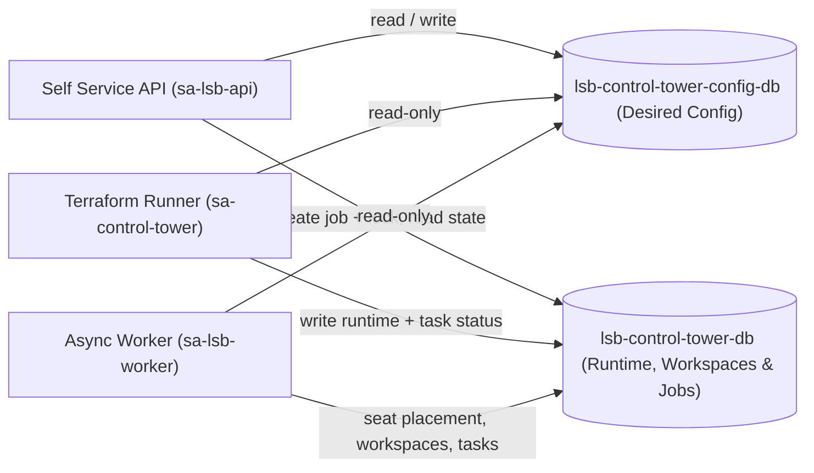
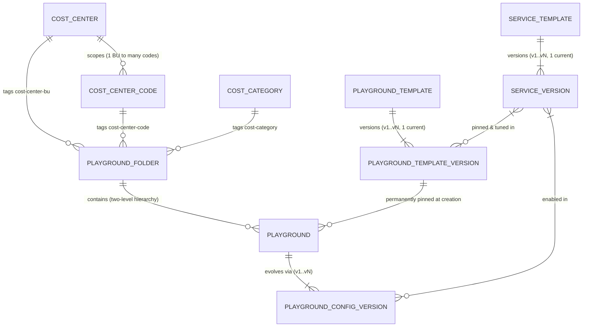
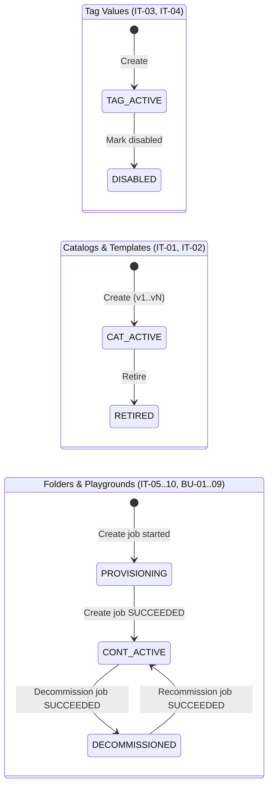

# Crucible (LSB Control Tower) TDD: Firestore Data Architecture (Master)

> Parent: [tdd-master.md](../tdd-master.md) · Business requirements: [brs-master.md](../../01-brs/brs-master.md)

Conceptual data domain design, database boundary, lifecycle invariants, and sub-specification index for the Crucible Control Tower.

## Domain specifications

| Spec | Database | Scope | Status |
|---|---|---|---|
| [tdd-data-config.md](tdd-data-config.md) | `lsb-control-tower-config-db` (`FIRESTORE_CONFIG_DATABASE`) | Physical Firestore schema, collection hierarchy, JSON document examples, and retrieval/index design for IT Admin and BU Admin configuration entities | In review (2026-11-09) |
| `tdd-data-runtime-jobs.md` *(to write)* | `lsb-control-tower-db` (`FIRESTORE_DATABASE`) | Observed GCP state (`runtime/*`), student workspaces (including portal access suspension) and app containers, jobs (`jobs/*`), tasks, and target locks (`locks/*`) | Planned |

---

## 1. Two-database boundary and trust model

Crucible splits Control Tower state across **two Firestore Native databases** in the Control Tower project ([tdd-master.md](../tdd-master.md) section 1.9) so execution engines can read desired configuration without ever having permission to alter it.

| Dimension | Configuration DB (`lsb-control-tower-config-db`) | Runtime, Workspaces & Jobs DB (`lsb-control-tower-db`) |
|---|---|---|
| **Purpose** | Authoritative **desired state** for governance catalogs, templates, Playground Folders, and Playgrounds | **Observed GCP state**, student workspaces (including suspended state) and app containers, asynchronous job/task execution, and target locks |
| **Entities** | Cost Centers, Cost Center Codes, Cost Categories, Service Templates & Versions, Playground Templates & Versions, Playground Folders, Playgrounds & Config Versions | Folder/Playground/Project Shard runtime state (`applied_config_version`), Student Workspaces & App Containers, Jobs, Tasks, Locks |
| **Writers** | `sa-lsb-api` only (acting on validated API requests) | `sa-lsb-api` (job + lock creation), `sa-control-tower` (Terraform runner), `sa-lsb-worker` (async worker) |
| **Readers** | `sa-lsb-api`, `sa-control-tower`, `sa-lsb-worker` (client SDK access denied) | `sa-lsb-api`, `sa-control-tower`, `sa-lsb-worker`, plus future UI read-only listeners under security rules |
| **Rebuildable from GCP?** | **No** — primary source of truth | Runtime inventory: yes; Jobs: append-only operational audit trail |
| **Deletion & retention** | **Zero hard deletes.** PITR, delete protection, and 14-week weekly backups | PITR and delete protection; job history kept indefinitely (no TTL) |

### Desired vs. applied consistency without cross-database transactions
1. Every playground mutation writes a new immutable `PlaygroundConfigVersion` (`vN`) and advances `latest_config_version` on `playgrounds/{slug}` in `lsb-control-tower-config-db` **first**.
2. Next, the API creates `jobs/{job_id}` (referencing `config_version = N`) and acquires `locks/PLAYGROUND:{slug}` in **one transaction** inside `lsb-control-tower-db`.
3. When the Terraform pipeline succeeds, `sa-control-tower` updates `applied_config_version = N` on the playground runtime record, marks the job `SUCCEEDED`, and releases the lock in **one transaction** inside `lsb-control-tower-db`.
4. Whenever `latest_config_version` (config DB) exceeds `applied_config_version` (runtime DB), the playground has a pending or failed configuration change that can be retried idempotently against `vN`.

### Why Student Workspaces and App Containers live in `lsb-control-tower-db`
When hundreds of students enter a playground simultaneously (`JobAsync`), `sa-lsb-worker` must atomically check remaining seat capacity on a project shard, assign a shard seat, record singleton/app-resource state (or per-user `SUSPENDED` portal status under `BU-05`), and advance task status in a single Firestore transaction. Rooting runtime shards and workspaces under `playgrounds/{playground_slug}` in `lsb-control-tower-db` keeps those updates in one database while preserving `sa-lsb-worker`'s read-only boundary and the 14-week backup schedule on `lsb-control-tower-config-db`.

---

## 2. Conceptual configuration domains

The configuration model mirrors the layered framework in [brs-master.md](../../01-brs/brs-master.md) section 2 across five conceptual domains.

### 2.1 Entity-relationship model (Configuration Domain)

### 2.2 Domain A: Tag Governance Catalog (IT Admin — `IT-03`, `IT-04`)
Governs the three IT-controlled Resource Manager dynamic tag keys bound on Playground Folders at creation and copied onto playground projects as billing labels ([tdd-tags-labels-master.md](../tdd-tags-labels/tdd-tags-labels-master.md)).

- **`CostCenter` (`cost-center-bu`):** Represents one school or business unit (for example `business`, `computing`).
- **`CostCenterCode` (`cost-center-code`):** A billing sub-code belonging to **exactly one** `CostCenter` (for example `cs-teaching` under `computing`).
- **`CostCategory` (`cost-category`):** A single institution-wide list of spend categories shared across all schools (for example `teaching`, `research`).
- **Domain rules:**
  1. **What you see is what you get (WYSIWYG):** Each catalog entry is the literal tag/label value itself (matching `^[a-z]([a-z0-9-]{0,61}[a-z0-9])?$`), with no separate display title or description.
  2. **Add-new or mark-disabled only:** Entries transition strictly from `ACTIVE` to `DISABLED`. Existing values are never edited in place and never deleted. `DISABLED` values cannot be picked for new Playground Folders; existing Playground Folders retain them permanently.
  3. **Outside the catalog:** Billing accounts are listed live using the calling IT Admin's GCP permissions and stored directly on each `PlaygroundFolder`. BU tags (`bu-tracking-code`, `bu-subcategory`) are un-cataloged WYSIWYG literal values set per `Playground` at creation.

### 2.3 Domain B: Service Catalog (IT Admin — `IT-01`)
Defines the governed single-service building blocks from which playground templates are composed.

- **`ServiceTemplate`:** Header entity representing **one GCP service capability** (for example `service-account`, `gemini`, `cloud-storage`, `cloud-sql`, `cloud-run`, `vertex-ai-search`). Elevated-privilege or heavy-tier variants are modeled as separate `ServiceTemplate` entities rather than flags on standard services. Points to one `current_version` and carries status `ACTIVE` or `RETIRED`.
- **`ServiceVersion` (`v1..vN`):** Immutable specification of a service capability containing:
  1. **Availability mode:** `MANDATORY` (always enabled, cannot be unchecked), `DEFAULT_ON` (enabled by default on new playgrounds, can be unchecked before creation), or `OPTIONAL` (disabled by default, can be enabled at creation or added later). **Only `MANDATORY` services may define a user singleton resource**; optional services (`DEFAULT_ON` / `OPTIONAL`) provide app resources only so enabling one later never requires re-initializing existing workspaces.
  2. **Provisioning module & dependencies:** Pinned Terraform root module reference (`source_path`, `git_ref`), `required_apis[]`, `prerequisite_services[]` (acyclic dependency list governing auto-enablement and execution order), and expected `group_slots[]` (such as `students`). Concrete GCP IAM role bindings live inside the Terraform module, not in Firestore.
  3. **Fixed service configuration defaults (`config_defaults`):** Underlying sizes and settings passed to Terraform (such as Cloud SQL `db-perf-optimized-N-8` Enterprise Plus or Cloud Run `2 vCPU / 2 GiB`), fixed for the life of the `ServiceVersion`.
  4. **Capacity & finite allowance bounds:** `project_quota` (maximum capacity per project shard) and finite `user_allowance_bounds` (`min` starting default and floor, up to a finite `max` integer ceiling for app resources — there is no `unlimited` allowance).
  5. **Resource descriptors:** Declarations of user `singleton_resources[]` (only when `availability_mode == "MANDATORY"`, 1 per user workspace) and `app_resources[]` (created and deleted by users inside app containers).
- **Domain rules:**
  1. Editing a service always creates a new immutable `ServiceVersion` (`v{N+1}`); existing versions are never mutated.
  2. New playground template versions default to each service's `current_version`, while older `ACTIVE` versions remain selectable to pin known-good modules.
  3. **Never deleted:** Both `ServiceTemplate` and `ServiceVersion` can only be marked `RETIRED` (blocking new template selection while keeping existing templates and playgrounds intact), never hard-deleted.

### 2.4 Domain C: Playground Templates (IT Admin — `IT-02`)
Composes pinned catalog service versions into ready-to-use course or lab blueprints available across all Playground Folders.

- **`PlaygroundTemplate`:** Header entity (for example `ai-course-standard`) tracking `current_version` and status `ACTIVE` or `RETIRED`. **Creating a new playground always uses the template's `current_version`, and the playground stays permanently pinned to that template version for life.**
- **`PlaygroundTemplateVersion` (`v1..vN`):** Immutable blueprint snapshot specifying:
  1. **Shard capacity ceiling (`max_students_per_project`):** Maximum user workspaces per project shard (capped at **`80`** for AI playgrounds to stay safely inside GCP's 100-Service-Account and 100-Data-Store default project limits).
  2. **Pinned service composition (`services[]`):** References exact `{service_id, service_version}` pairs (dependency-closed across `prerequisite_services[]`), inheriting `config_defaults` as-is from each `ServiceVersion` while permitting **two bounded template-level tunings**:
     - **Availability mode promotion:** May promote `OPTIONAL -> DEFAULT_ON | MANDATORY` or `DEFAULT_ON -> MANDATORY`, never weakening a `MANDATORY` service (and every prerequisite must carry an equal-or-stronger effective mode).
     - **Narrower per-user allowance bounds:** May tighten `[min..max]` within the `ServiceVersion`'s finite bounds (`template.min >= service.min` and `template.max <= service.max`).
  3. **Required `group_slots[]`:** Derived union of `group_slots` across all included service versions.
- **Domain rules:**
  1. Every template change creates a new immutable `PlaygroundTemplateVersion`.
  2. **Never deleted:** Templates and template versions can only be marked `RETIRED`, never hard-deleted.

### 2.5 Domain D: Playground Folders (IT Admin — `IT-05`, `IT-06`, `IT-07`, `IT-10`)
Represents a governed GCP folder container where one school's BU Admins create and run playgrounds.

- **Immutable after creation (`IT-05`):** `parent_folder_id`, `billing_account_id`, `billing_currency`, IT cost tags (`cost_center_bu`, `cost_center_code`, `cost_category`), and `bu_admin_group` (strictly 1 existing Google group nested in `grp-lsb-bu-admins@`).
- **Mutable after creation (`IT-06`, `IT-07`, `IT-10` — each as a tracked job):**
  - `display_name` (synced to the GCP folder display name)
  - `budget.amount` (whole units `> 0` in `billing_currency`, with platform-wide 50, 75, 90, and 100% alert thresholds)
  - `status`: `PROVISIONING -> ACTIVE <-> DECOMMISSIONED` (decommissioning disables billing across all child playgrounds/projects without deleting folders, projects, budgets, or resources; `IT-10` recommissioning reverses the cascade).
- **Single flat document:** Because placement, billing account, IT cost tags, and `bu_admin_group` never mutate after creation, `PlaygroundFolder` needs no `versions/{vN}` subcollection.

### 2.6 Domain E: Playgrounds & Config Versions (BU Admin & Playground Admin — `BU-01`..`BU-09`)
Represents one course, lab, or hackathon environment inside a `PlaygroundFolder`, backed by $K = \lceil \text{expected\_students} / \text{max\_students\_per\_project} \rceil$ project shards.

- **`Playground` (Header & Immutable Anchors):**
  - **Immutable after creation:** `playground_folder_id`, pinned `template_id` and `template_version` (never upgraded), `max_students_per_project`, BU cost tags (`bu_tracking_code`, `bu_subcategory`), optional `playground_admin_group` (`0..1` existing Google group, never swapped), `user_group_mappings` (strictly 1 existing Google group per template `group_slot`, never swapped), and inherited parent anchors (`bu_admin_group`, `billing_account_id`, `billing_currency`, IT cost tags).
  - **Mutable pointers & summary:** `display_name`, `latest_config_version` (`vN`), `expected_students`, `desired_shard_count`, `status` (`PROVISIONING -> ACTIVE <-> DECOMMISSIONED` via `BU-08` / `BU-09`), and `revision`.
- **`PlaygroundConfigVersion` (`v1..vN`):** Write-once desired-state snapshot created on initial creation (`v1`) and on subsequent playground mutations (`v2..vN`), driving `seeds/vN.tfvars.json`:
  1. **Rename or budget updates (`BU-02`):** `display_name`, required `playground_budget_amount > 0`, optional `default_shard_budget_amount` ($\le$ `playground_budget_amount`, inherited by newly added shards), and optional `shard_budget_overrides[shard_code]` ($\le$ `playground_budget_amount`).
  2. **Add-only optional services & finite allowances (`BU-03`):** Enables additional optional services from the playground's permanently pinned `template_version` (auto-including prerequisites) or adjusts per-user `user_allowance` within `[min, max]`. Once enabled in `v{N}`, a service remains enabled for the life of the playground; lowering `user_allowance` only gates new creations.
  3. **Grow-only capacity (`BU-04`):** `expected_students` ($\ge$ prior version) and `desired_shard_count`.

---

## 3. Lifecycle state machines

---

## 4. Cross-cutting invariants

| Invariant | Rule across `lsb-control-tower-config-db` |
|---|---|
| **Zero hard deletes** | No configuration document (and no GCP folder, project, budget, workspace, or resource) is ever deleted by the platform. Tag values become `DISABLED`; services/templates/versions become `RETIRED`; folders and playgrounds toggle `ACTIVE <-> DECOMMISSIONED` via billing disable/enable. |
| **Singletons only on `MANDATORY` services** | Only `MANDATORY` services may declare `singleton_resources`; optional services declare `app_resources` only, so workspaces are initialized once and never re-initialized. |
| **Finite `min .. max` allowances** | Every countable app resource specifies finite integer `min` and `max` bounds (`1 <= min <= max`, bounded by shard `project_quota`); there is no `unlimited` allowance. |
| **Permanently pinned anchors** | IT tags and `bu_admin_group` on a `PlaygroundFolder`, and `template_id` + `template_version`, BU tags, `playground_admin_group`, and `user_group_mappings` on a `Playground`, are fixed at creation and never changed, swapped, or upgraded. Denormalizing `admin_groups[]`, `mapped_user_groups[]`, `billing_*`, and `effective_tags` onto `playgrounds/{slug}` has zero drift risk. |
| **One group per container / slot** | `1` `bu_admin_group` per Playground Folder; `0..1` `playground_admin_group` per Playground; `1` Google group per template `group_slot`. Group memberships live solely in Google Workspace / Cloud Identity. |
| **Standard revision & audit block** | Every document carries only `revision` (`integer >= 1`), `created_at` (UTC timestamp), `updated_at` (UTC timestamp), and `updated_by` (lowercase caller email — no `subject` fields). Tracked jobs provide the full operational audit history. |
