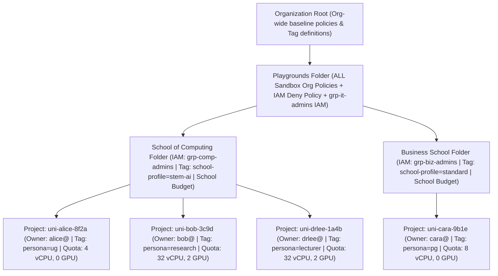
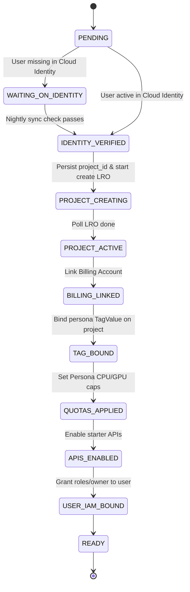

# Dedicated Playground Sandboxes

This guide defines the conceptual model and implementation architecture for provisioning and governing **25,000+ dedicated personal Google Cloud projects** across a university. Every student, researcher, and lecturer receives an independent sandbox project with full administrative rights inside their project boundary, while Central IT enforces non-bypassable security guardrails, delegates school-level oversight, relaxes resource rules by school and persona, and tracks spend through hierarchical folder budgets.

---

## 1. First Principles

The architecture rests on four foundational principles derived from how Google Cloud evaluates IAM, Organization Policies, Resource Manager Tags, and Cloud Billing at scale.

### 1.1 Independent Personal Project Autonomy
Every user receives a dedicated Google Cloud project where they hold `roles/owner` on that single project. A dedicated project gives learners realistic cloud administration experience (configuring project-level IAM, creating service accounts, enabling allowed APIs, and deploying applications) without noisy-neighbor collisions or multi-tenant resource naming conflicts.

Giving a student `roles/owner` requires two structural boundaries above the project so self-administration never turns into self-sabotage or governance escape:
1. **Inherited Administrative Oversight:** Central IT (`grp-it-admins`) and School Administrators (`grp-<school>-admins`) are bound only on parent folders, never on individual projects. Because Google Cloud IAM is additive and flows downward, administrators automatically hold full rights across every child project without per-project IAM bindings.
2. **Parent-Level Guardrails Over `roles/owner`:** A project `Owner` can normally delete their project, unlink its billing account, or invite external personal accounts. An **IAM Deny Policy** on the parent `Playgrounds` folder blocks project deletion, billing unlinking, and tag tampering for everyone except Central IT and the provisioning service account, while `constraints/iam.allowedPolicyMemberDomains` blocks external domain invitations.

### 1.2 Central Policy Enforcement from a Single Root
Unlike AWS Service Control Policies (SCPs), Google Cloud Organization Policies do **not** evaluate on a "most restrictive policy wins" basis. Instead, **the explicit policy closest to the project wins**:
* For boolean constraints, a child folder setting `enforced: false` completely cancels a parent folder's `enforced: true`.
* For list constraints, a child folder setting `inheritFromParent: false` discards parent restrictions entirely, while `inheritFromParent: true` unions `allowedValues` and widens access.

To guarantee central guardrails can never be weakened by legacy folder exceptions:
* Dedicated personal sandboxes live under a clean top-level **`Playgrounds` folder**, separate from existing permissive folders used for faculty production or BAU workloads.
* **100% of Organization Policies and IAM Deny Policies attach to the `Playgrounds` folder.** Child folders underneath `Playgrounds` carry **zero** explicit Organization Policy overrides.
* Because `roles/orgpolicy.policyAdmin` can only be granted at the Organization root (never on folders or projects), neither School Folder Admins nor project `Owner` students can alter or override these policies.

### 1.3 Progressive School and Persona Relaxation
University users do not need uniform restrictions. An introductory undergraduate needs a minimal, low-risk environment, whereas a Computing postgraduate, AI research student, or lecturer needs broader APIs, regions, VM families, or GPUs.

Rather than scattering policy overrides across dozens of subfolders, policies start **strict by default** at the `Playgrounds` folder and **progressively relax** along two independent tag dimensions:
1. **School Resource Profile (`school-profile`):** Bound once on each School folder (`standard`, `analytics`, `stem-ai`) and inherited automatically by all projects in that school.
2. **User Persona (`persona`):** Bound directly on each user's project (`ug`, `pg`, `research`, `lecturer`).

Progressive relaxation relies on two complementary mechanics:
* **Configuration & Service Relaxation (Organization Policies):** List constraints define a minimal `allowedValues` baseline for `ug` + `standard`, and union additional allowed services and regions when `school-profile` or `persona` tag rules match. Boolean and Custom Organization Policies enforce strict blocks by default (`enforce: true`) and unlock (`enforce: false`) for qualifying tag combinations.
* **Capacity Relaxation (Cloud Quotas):** Organization Policies govern *what types* of resources can be created, while **Cloud Quotas** govern *how much* capacity (vCPUs, GPUs) a project can consume based on the user's persona.

### 1.4 Hierarchical Budget Management via Folders and Labels
Managing 25,000 individual credit cards or manual per-project billing setups is operationally unviable. All sandbox projects link to centralized institutional Cloud Billing Account(s), and spend governance follows the folder hierarchy:
* **School Pooled Budgets:** Each School folder under `Playgrounds` acts as a native ancestor filter in Cloud Billing Budgets, giving Deans and School Admins consolidated visibility and threshold alerts across their entire school.
* **Persona Spend Pools:** Because native Cloud Billing Budget filters support Folders and Project Labels (while Resource Manager Tags appear only in BigQuery Billing Export), the provisioner mirrors `persona` and cost-center metadata onto **Project Labels** at project creation time. This enables dedicated budget alerts for `ug`, `pg`, `research`, and `lecturer` cohorts within each school without introducing extra folder nesting.

---

## 2. Conceptual Model and Entities

### 2.1 Resource Hierarchy and Governance Topology



### 2.2 Core Entities

| Entity | Scope / Location | Purpose and Governance Rules |
| :--- | :--- | :--- |
| **`Playgrounds` Folder** | Under Organization (or Sandbox Root) | Single attachment point for all sandbox Organization Policies, Custom Constraints, IAM Deny Policies, and `grp-it-admins` folder IAM. |
| **School Folder** | Child of `Playgrounds` (1 per School/Faculty) | Scopes `grp-<school>-admins` IAM inheritance, binds one `school-profile` TagValue, and anchors pooled School Cloud Billing Budgets. Holds **no** Org Policies. |
| **Personal Sandbox Project** | Child of its School Folder (1 per user, 25,000+) | Globally unique immutable ID (`<uni>-<slug>-<rand4>`). Carries 1 direct IAM binding (`user:<email>` as `roles/owner`), 1 `persona` TagBinding, billing Labels, and Persona Quota caps. |
| **IT Admins (`grp-it-admins`)** | Bound on `Playgrounds` Folder & TagKeys | Holds full administrative rights across all sandboxes, `Tag User` on governance tags, and exemption from the Folder IAM Deny Policy. |
| **School Admins (`grp-<school>-admins`)** | Bound on their respective `School Folder` | Inherits administrative visibility and support access across all projects in their school; cannot modify Org Policies or assign privileged `persona` tags. |
| **Sandbox User** | Bound on their single Project only | Holds `roles/owner` on their personal project; constrained by inherited `Playgrounds` Org Policies, Folder IAM Deny Policy, and per-project Cloud Quotas. |

### 2.3 Resource Manager Tags vs. Project Labels

A **Resource Manager Tag** is an Organization-defined, IAM-governed metadata object (`TagKey` + predefined `TagValue` + `TagBinding`) evaluated directly by Organization Policies and IAM Conditions. It differs fundamentally from a **Project Label**:

| Capability | Resource Manager Tags | Project Labels |
| :--- | :--- | :--- |
| **Primary Role** | Security & policy relaxation (`resource.matchTag(...)`) | Billing filtering & cost reporting |
| **Hierarchy Inheritance** | Inherits automatically down folders to projects | Does not exist on folders; does not inherit |
| **Tamper Resistance** | Protected by `roles/resourcemanager.tagUser` on the TagValue; a project `Owner` **cannot** forge or swap tags | Editable by any project `Owner` or `Editor` |
| **Billing Support** | Exported to BigQuery Billing Export | Native filter in Cloud Billing Budgets UI/API & BigQuery |

> **Important (Why `school-profile` uses capability profiles instead of raw school names):** Google Cloud limits each conditional Organization Policy CEL expression to **10 `matchTag()` subexpressions**. Mapping 20 to 30 university schools onto 3 to 5 capability profiles (`standard`, `analytics`, `stem-ai`) plus 4 personas (`ug`, `pg`, `research`, `lecturer`) keeps every CEL rule compact (2 to 4 subexpressions) regardless of how many schools join the platform.

#### Governance Tag Taxonomy

1. **`<org_id>/school-profile`** (bound on School Folders):
   * `standard`: General coursework (Cloud Run, Cloud Storage, Firestore, Cloud SQL, Artifact Registry).
   * `analytics`: Adds data warehousing and streaming services (BigQuery, Dataflow, Pub/Sub, Dataproc).
   * `stem-ai`: Adds container orchestration, AI/ML services, and eligibility for research GPU unlocks (GKE, Vertex AI, Notebooks).
2. **`<org_id>/persona`** (bound directly on Projects; `Tag User` granted **only** to the Provisioning Service Account and `grp-it-admins`):
   * `ug`: Strictest baseline capacity and service set.
   * `pg`: Expanded compute sizing and data/integration services.
   * `research`: Unlocks AI/ML platforms, multi-region GPU availability (when paired with `stem-ai`), and higher compute quotas.
   * `lecturer`: Unlocks teaching, demo, and multi-region capabilities across any school.

### 2.4 Progressive Policy Relaxation Mechanics

All policies below are attached **once** on `folders/<PLAYGROUNDS_FOLDER_ID>`.

#### A. List Constraints: Additive `allowedValues` Union
For list constraints such as `constraints/gcp.restrictServiceUsage` and `constraints/gcp.resourceLocations`, Google Cloud evaluates every matching rule on the policy and computes the **union** of `allowedValues`:

```yaml
name: folders/PLAYGROUNDS_FOLDER_ID/policies/gcp.resourceLocations
spec:
  rules:
    # 1. Unconditional Baseline (applies to every sandbox, including standard UG)
    - values:
        allowedValues:
          - in:asia-southeast1-locations

    # 2. School Profile Relaxation (STEM-AI schools gain US batch/AI capacity)
    - condition:
        expression: resource.matchTag('123456789012/school-profile', 'stem-ai')
      values:
        allowedValues:
          - in:us-central1-locations

    # 3. Persona Relaxation (Research & Lecturers gain EU + US accelerator regions)
    - condition:
        expression: >-
          resource.matchTag('123456789012/persona', 'research') ||
          resource.matchTag('123456789012/persona', 'lecturer')
      values:
        allowedValues:
          - in:us-central1-locations
          - in:europe-west4-locations
```

> **Warning (Never use `deniedValues` for items that a School or Persona needs to unlock):** When Google Cloud merges matching list rules, `deniedValues` always take precedence over `allowedValues`. Express the strict baseline strictly as a minimal `allowedValues` allowlist and let School and Persona rules add to it.

#### B. Boolean & Custom Constraints: Strict Default with Conditional Unlock
Boolean constraints (and Custom Constraints with `actionType: DENY`) enforce restrictions unconditionally (`enforce: true`) and relax them (`enforce: false`) using combined tag conditions:

```yaml
# Custom constraint denying high-core VMs and GPU attachments by default
name: folders/PLAYGROUNDS_FOLDER_ID/policies/custom.denyGpusAndLargeVms
spec:
  rules:
    - enforce: true
    - condition:
        expression: >-
          resource.matchTag('123456789012/persona', 'lecturer') ||
          (resource.matchTag('123456789012/school-profile', 'stem-ai') &&
           resource.matchTag('123456789012/persona', 'research'))
      enforce: false
```

#### C. Non-Bypassable Baseline Guardrails on `Playgrounds`
* **Org Policies (unconditional across all personas):**
  * `constraints/compute.skipDefaultNetworkCreation` (`enforce: true`): prevents permissive `default` VPC creation on all 25,000 projects.
  * `constraints/iam.disableServiceAccountKeyCreation` (`enforce: true`): prevents downloadable JSON key leaks.
  * `constraints/iam.allowedPolicyMemberDomains`: restricts project IAM bindings to the university's verified Google Workspace / Cloud Identity domain.
* **IAM Deny Policy on `Playgrounds` Folder:**
  * Denies `resourcemanager.projects.delete`, `billing.resourceAssociations.delete`, and `resourcemanager.hierarchyNodes.deleteTagBinding` for `principalSet://goog/public:all`, with `exceptionPrincipals` set solely to `grp-it-admins` and `sa-playground-provisioner`.

---

## 3. The Provisioning Approach (Implementation Guide)

### 3.1 Two-Layer Split: Terraform Foundation + Queue-Driven Project Provisioner

Do **not** manage 25,000 student projects in Terraform. At 25,000 projects, 4 to 8 resources per project produce **100,000 to 200,000+ Terraform state objects**: every `terraform plan` triggers tens of thousands of read API calls that exhaust Resource Manager read quotas (`429 RESOURCE_EXHAUSTED`), a single unactivated student email halts an entire apply batch on `setIamPolicy`, and `-parallelism` cannot cleanly pace asynchronous `projects.create` Long-Running Operations (LROs).

Split provisioning cleanly into two layers:

| Layer | Mechanism | Scope & Scale |
| :--- | :--- | :--- |
| **Layer 1: Static Foundation** | **Terraform** (GitOps pipeline) | ~50 to 150 resources total: `Playgrounds` folder, School folders, Folder IAM bindings, `school-profile` and `persona` TagKeys/TagValues, School folder TagBindings, all `Playgrounds` Org Policies & IAM Deny Policies, School/Persona Billing Budgets, and the Layer 2 worker infrastructure. |
| **Layer 2: Bulk Personal Sandboxes** | **Cloud Tasks + Cloud Run Worker + Firestore/Postgres Ledger** | 25,000+ user projects: paced, idempotent per-user state machine calling Cloud Resource Manager v3, Cloud Billing, Resource Manager Tags, Cloud Quotas, Service Usage, and Cloud Identity APIs. |

---

### 3.2 Mandatory Pre-Flight Checklist (Weeks Before Bulk Provisioning)

Almost all bulk-provisioning outages at 25,000-project scale stem from four preventable platform limits:

1. **Raise Project Creation Quota on `sa-playground-provisioner`:** Service accounts start with a low project creation cap. Submit a quota request raising the provisioning service account's project creation allotment to **30,000+ projects**.
2. **Raise Cloud Billing Account Project Attachment Limit:** Cloud Billing Accounts enforce a hard cap on linked projects. Request a billing account project-link limit increase to **30,000+ projects** through Google Cloud Support / your account team before starting.
3. **Apply Layer 1 Terraform First (Especially `skipDefaultNetworkCreation`):** Ensure `Playgrounds` policies are active *before* creating any project so GCP never spins up 25,000 `default` VPC networks.
4. **Pre-Validate Roster Emails Against Cloud Identity:** University rosters always contain pending admissions or unsynced accounts. Batch-check all 25,000 emails via the Admin Directory / Cloud Identity API first so unactivated accounts are parked cleanly rather than failing `setIamPolicy`.

---

### 3.3 Idempotent Per-User Provisioning State Machine

Each roster entry is stored as a document/row in Firestore or Cloud SQL (keyed by immutable university user ID) and enqueued as **one task in Cloud Tasks**. If a step hits a transient error or worker restart, the retried task resumes from the last committed state.



#### Critical Step Ordering Rules

| State Transition | API Call | Why Ordering and Idempotency Matter |
| :--- | :--- | :--- |
| **1. `IDENTITY_VERIFIED`** | Admin Directory `users.get` | Avoids burning project quota or entering retry loops on typos and unactivated student accounts. |
| **2. `PROJECT_CREATING`** | CRM v3 `projects.create` | **Collision-proof ID:** Project IDs are globally unique across all GCP customers and permanently burned even after deletion. Generate `<uni>-<slug>-<rand4>` **once** and commit it to the ledger *before* calling `projects.create` (alongside `parent: folders/<school_folder_id>` and `labels: {persona, school, cost_center}`). Only generate a new 4-char suffix if `projects.create` returns `409 ALREADY_EXISTS` (never probe with `projects.get`, which returns `403` for both nonexistent and third-party projects). Persist the returned LRO name. |
| **3. `PROJECT_ACTIVE`** | CRM v3 `operations.get` | Poll the saved LRO until `done: true` and capture the numeric `projectNumber` required for Tag bindings. |
| **4. `BILLING_LINKED`** | Billing `projects.updateBillingInfo` | Links the project to the approved Billing Account before quota adjustments or billable API enablement. |
| **5. `TAG_BOUND`** | CRM v3 `tagBindings.create` | **Must run before `APIS_ENABLED`:** Attaches `persona=<ug\|pg\|research\|lecturer>` to `//cloudresourcemanager.googleapis.com/projects/<projectNumber>` so `gcp.restrictServiceUsage` immediately recognizes relaxed API allowances for `pg`, `research`, and `lecturer` users. |
| **6. `QUOTAS_APPLIED`** | Cloud Quotas `quotaPreferences.create` | Applies persona-specific vCPU and GPU upper bounds before the user gains access. |
| **7. `APIS_ENABLED`** | Service Usage `services.batchEnable` | Enables the persona's starter API bundle so the sandbox is ready out of the box. |
| **8. `USER_IAM_BOUND`** | CRM v3 `projects.getIamPolicy` + `setIamPolicy` | Grants `roles/owner` to `user:<student_email>` last, ensuring the user enters a fully tagged, quota-capped, and policy-governed project. |

---

### 3.4 Throughput Tuning and Day-2 Operations

* **Queue Rate Control (Zero `429` Storms):** Configure the Cloud Tasks queue with `maxDispatchesPerSecond: 2.0` (tuned below your approved Resource Manager `projects.create` write quota, typically 60 to 180 creations per minute), `maxConcurrentDispatches: 20`, and exponential backoff (`minBackoff: 5s`, `maxBackoff: 300s`) on HTTP `429`, `500`, and `503`. At 1.5 to 2 projects/second, **all 25,000 sandboxes provision cleanly in ~3.5 to 4.5 hours**.
* **In-Place Persona Promotion (`ug` → `pg` → `research`):** When a student advances to postgraduate or research work, enqueue an update task that swaps their project's `persona` TagBinding, updates the `persona` Project Label, and updates their Cloud Quota preferences. Their `project_id`, data, and School folder placement remain untouched.
* **Cross-School Transfers:** If a student changes schools, call `projects.move` to move the project to the new School folder (inheriting the new `school-profile` tag and School Admin IAM automatically) and update the `school` billing label.
* **Graduation & Offboarding:** Because `sa-playground-provisioner` is explicitly exempted in the `Playgrounds` IAM Deny Policy, offboarding tasks can cleanly revoke `user:<student_email>`, unlink billing (or move projects to an Archive folder for a retention window), and execute `projects.delete` after retention expires.
